<!-- 2026-10-30 22:18 KST -->

# 중간고사 대체 과제 수행 보고서: 팀 편성 웹 앱

- 내려받기: [PDF](https://raw.githubusercontent.com/logistex/recipe4fridge/note-slides/mid26/report/report_mid26.pdf), [마크다운](https://raw.githubusercontent.com/logistex/recipe4fridge/note-slides/mid26/report/report_mid26.md)(그림은 PDF와 노션 페이지에 있음)

| 항목 | 내용 |
|---|---|
| 과목명 | 데이터과학 미니프로젝트(AI-X) |
| 보고서 번호 | 중간고사 대체 과제(공고 10/16) |
| 제출 기한 | 2026-11-02 23:59 |
| 제출 일자 | 2026-11-02 |
| 소속 | 빅데이터과(담당 교수) |
| 학번 | 해당 없음(교수) |
| 성명 | 신해웅 |

[표 1] 제출물

| 제출물 | 값 | 비고 |
|---|---|---|
| 깃허브 저장소 | <https://github.com/logistex/prj_mid_26> | 공개함(11/3 00:01). 마감(11/2 23:59)까지는 비공개였음 |
| 배포 주소 | <https://prj-mid-26.streamlit.app/> | Streamlit Community Cloud, 누구나 볼 수 있게 공개함 |
| 관리자 비밀번호 | 공개하지 않음 | 학생은 실제 값을 e-class 제출 칸에만 적음. 배포한 앱은 누구나 열 수 있으므로, 이 보고서에는 비밀번호의 일부나 해시 지문도 적지 않음 |
| 보고서(공고 7.1절 양식) | <https://github.com/logistex/prj_mid_26/blob/main/README.md> | 저장소의 `README.md` |
| 저장소 압축 파일 | [prj_mid_26_b7c7f6d.zip](https://github.com/logistex/prj_mid_26/releases/download/submit-b7c7f6d/prj_mid_26_b7c7f6d.zip) | 마지막 커밋 `b7c7f6d`에서 커밋한 파일만 담은 zip. 파일 74개, `.env` 없음(11/2 18:23 만들고 목록으로 확인함) |
| (제출물 밖) 보고서의 설명 영상 | <https://delightful-run-7c5.notion.site/409022e2cfe780c78c6ee12e76022ece> | [영상 0]~[영상 33]의 34편, 1.4절 [표 7]. 슬라이드, 실습 화면, 시연 녹화, 합성 음성 설명과 자막. 노션에서 바로 재생됨 |

## 요약

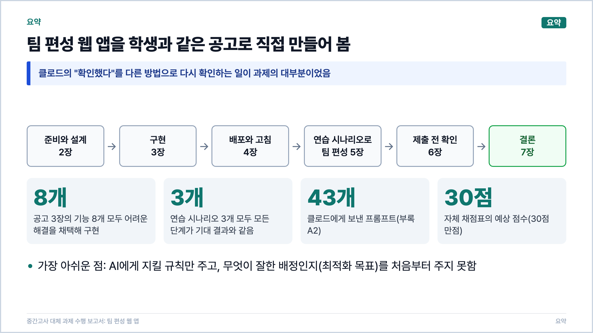

[슬라이드 0] 요약: 이 보고서를 1장으로 줄인 것

[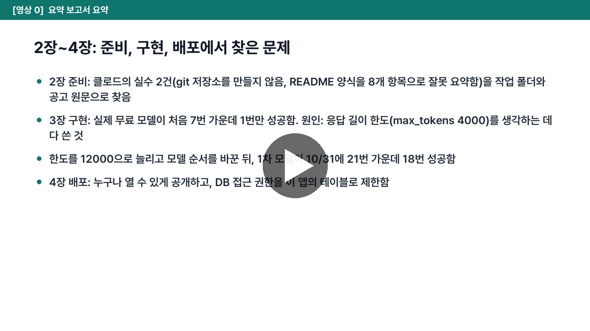](https://delightful-run-7c5.notion.site/409022e2cfe780c78c6ee12e76022ece#b28352532309412b9b2814a932a2d7a2)

[영상 0] 요약 슬라이드의 설명 영상(169초, 신 교수의 목소리로 합성한 설명과 자막). 그림을 누르면 노션에서 영상이 재생됨

- 이 과제는 "앱이 돌아가는가"보다 "앱이 규칙을 지키는지 어떻게 확인했는가"를 묻는 것으로 파악했고, 이 보고서는 교수가 학생과 같은 공고로 이 과제를 직접 수행한 기록임(1장)
  - 과제는 데이터과학 미니프로젝트(AI-X)의 중간고사 대체 과제로, 학생들이 팀 프로젝트의 팀을 스스로 편성하는 웹 앱을 만들어 Streamlit에 배포하는 것이고, 수행은 6장 노트의 절차를 따랐음
  - 채점은 공개하지 않은 시나리오 3개를 배포한 앱에서 자동으로 실행하고, 단계마다 결과 안내의 첫 낱말(승인, 대기, 거절, 막힘)이 기대 결과와 같은지 판정함
  - 공고가 준 연습 시나리오는 채점에 쓰지 않으므로, 연습 시나리오의 결과에 맞춘 앱이 아니라 규칙 자체를 지키는 앱이 필요했음
- 앱은 클로드(Claude Code)가 만들었고, 작성자는 학생처럼 프롬프트로 지시하고 결과를 공고와 대조했음
  - 이 보고서에서 "확인함"은 클로드가 보고한 것을 작성자가 시험, DB 질의, 브라우저 조작으로 다시 확인했다는 뜻이고, 다시 확인하지 않은 곳에는 "(클로드의 보고)"를 붙였음
  - 작성자의 일 가운데 상당 부분은 신 교수의 지시를 받은 별도의 클로드 세션(기록 세션)이 대신했고, 이 보고서는 그 일을 작성자가 한 일로 적음(1.3절 [표 3])
  - 앱을 만든 클로드에게는 노트 파일을 주지 않고 공고 PDF와 연습용 CSV 3개만 주어, 학생의 지시만으로 앱이 만들어지는지 확인하려 했음
  - 보낸 프롬프트 43개는 부록 A2에 원문으로 둠(1.3절)
- 준비 단계(2장)에서 클로드가 한 실수 2건은 모두 클로드의 보고가 아니라 작업 폴더와 공고 원문을 직접 확인해서 찾았음
  - 클로드는 "git으로 관리할 거야"라는 지시를 받고도 git 저장소를 만들지 않았고, 공고의 README 양식을 8개 항목으로 잘못 요약했음(실제 7개)
  - 이 단계에서는 키 3개를 `.env`에 두고, 오픈라우터의 무료 텍스트 모델 6개를 시험해 1차~3차 모델을 고르고, PRD 3개와 구현 계획을 쓰고, 테이블 8개로 DB를 설계했음
  - PRD는 그것을 쓴 클로드가 아닌 다른 클로드에게 공고와 대조하게 해, 공고와 다른 3건을 구현 전에 고쳤음
- 구현(3장)에서 가장 큰 문제는 실제 무료 모델이 처음 7번 가운데 1번만 성공한 것이었고, 호출 기록에서 원인을 찾아 고쳤음
  - 구현은 로그인과 명단 올리기, 지원과 투표와 마감, AI 배정과 실패 처리의 3단계로 나눠 진행했음
  - AI의 실패 처리(모델마다 120초 제한, 다음 모델로 넘어가기, 3차까지 실패하면 앱이 직접 배정하기)는 실제 호출에서도 동작했음. 3개 모델이 모두 실패해 앱이 직접 배정한 일이 4번(10/30 22:41~22:42와 22:44~22:46, 10/31 19:02, 11/4 15:12~15:17) 있었고, 4번 모두 확정한 팀이 규칙을 지켰음(3.3절 [표 12], 5.3절). 실패를 원하는 때에 만들려고 가짜 서버로도 재현해 시험했음
  - 실제 모델의 실패는 모델이 답을 쓰기 전에 생각하는 데 응답 길이 한도(`max_tokens` 4000)를 다 써서 빈 응답이 온 것이었음
  - 클로드는 PRD에 한도를 "넉넉하게 줌"이라고 적었지만, 이 앱의 입력으로 시험하지는 않았던 것임
  - 한도를 12000으로 늘리고 모델 순서를 바꾼 뒤, 1차 모델은 10/31에 21번 가운데 18번 성공했음
- 배포(4장)와 그 앞뒤의 고침으로, 앱은 누구나 열 수 있고 같은 DB에 있는 다른 앱의 테이블은 지울 수 없게 되었음
  - 비공개 저장소의 `main` 브랜치를 Streamlit Community Cloud에 배포하고, 처음에 특정한 사람만 열 수 있던 앱을 누구나 열 수 있게 바꿨음
  - 배포 전날 밤에는 시험과 노트의 사례로 찾은 문제 3가지(빈 응답, DB를 옮긴 뒤 느려진 화면, 오래 쓰지 않아 끊긴 DB 연결)를 모아 한 번에 고쳤음
  - 6장 노트의 15개 항목 보안 점검에서 나온 위험도 High 1건은 앱이 같은 DB에 있는 다른 앱의 테이블 20개를 지울 수 있다는 것이었고, 앱의 DB 접근 권한을 이 앱의 테이블로 제한해 고쳤음
  - DB 일시정지는 깃허브 Actions 예약 실행으로 막았음
- 완성한 앱으로 연습 시나리오 3개를 실행한 결과, 모든 단계가 기대 결과와 같았고 확정한 팀은 모두 규칙을 지켰음(5장)
  - 시나리오는 학생 8명과 팀 3개, 12명과 4개, 16명과 4개이고, 5가지 방법으로 실행했음
  - 2가지는 채점 프로그램처럼 브라우저에서 단추를 누르는 방법이고, 3가지는 앱에 만든 시나리오 실행 탭을 쓰는 방법임
  - 어려움 시나리오에서는 팀원 3명의 찬성을 받은 지원이 승인 직전 검사로 거절되었고, 필수 포함 역할의 자리가 모자라게 되는 지원이 막혔으며, 보조 역할로 필수 역할을 채운 배정이 나왔음
  - 시나리오 실행 탭은 신 교수가 배포한 앱을 직접 써 보고 낸 의견 18개로 2차례 고쳤음
  - 그보다 앞선 10/31에는 별도 페이지였던 탭을 기본 화면의 둘째 탭으로 옮긴 시험판을 교수용 채점 프로그램으로 시험하다가, 확정 단추가 배정안 없이 눌리는 결함을 찾아 고쳤음
- 제출 전(6장)에는 공고의 채점 요소마다 보고서에서 확인할 곳과 확인한 결과를 자체 채점표로 모았고, 예상 점수는 30점 만점에 30점임
  - 기능 8개의 해결 방법, 감점 21개, README의 사례 8건, 제출물 5가지도 공고와 하나씩 대조했음
  - README의 사례는 근거가 모두 맞았지만 읽는 사람에게 뜻이 전달되지 않아, 사례마다 요지부터 다시 썼음
  - 학생 앱의 채점은 11/3에 끝났음. 이 앱은 학생에게 보고서 작성의 시범을 보이려고 만든 것이라 채점하지 않았으므로 실제 점수는 없음(6.1절)
- 결론(7장)의 요지는, 클로드의 "확인했다"를 다른 방법으로 다시 확인하는 일이 이 과제의 대부분이었고 결함도 거의 모두 거기서 나왔다는 것임
  - 클로드가 노트, 공고, 기록과 다르게 한 5건 가운데 3건은 작업 폴더, 공고 원문, 호출 기록과 대조해 알아챘음. 1건은 클로드가 스스로 바로잡았고, 1건(기록 세션의 클로드가 확인 범위를 정하며 어려움 시나리오를 실수로 뺌)은 11/2 신 교수의 검토로 드러나 보충 확인했음
  - 가장 아쉬운 점은 AI에게 지킬 규칙만 강조하고, 규칙을 지키는 배정 가운데 어느 것이 잘한 배정인지(최적화 목표)를 처음부터 전달하지 못한 것이고, 그래서 쉬움 시나리오에서는 학생이 한 팀에 몰린 배정도 통과했음
  - 뒤에 고르는 순서를 프롬프트에 더했지만, AI가 그 순서를 지켰는지는 앱이 검사하지 않음
  - 이를 메우는 방법, 더하고 싶은 기능 3가지, 웹 접근성의 한계 8개를 앱을 더 발전시키는 방향으로 정리했음
  - 학생에게 주는 시사점은, 클로드의 보고가 잘 정리되어 있어도 요청한 항목마다 결과를 원본과 대조해야 한다는 것임(2.1절, 7.2절)
  - 작성자는 앞으로 AI에게 일을 맡길 때 지킬 규칙과 함께 무엇이 잘한 결과인지를 처음부터 적기로 다짐했음(7.5절)

## 목차

1\. 서론  
&emsp;&emsp;1.1 과제의 배경과 목적  
&emsp;&emsp;1.2 과제의 범위와 배점  
&emsp;&emsp;1.3 수행 방법과 환경  
&emsp;&emsp;1.4 보고서의 구성과 용어  
2\. 준비와 설계  
&emsp;&emsp;2.1 키 관리와 git 저장소 준비  
&emsp;&emsp;2.2 AI 모델 고르기와 연결 시험  
&emsp;&emsp;2.3 PRD와 구현 계획의 작성  
&emsp;&emsp;2.4 DB 설계와 schema.sql  
3\. 구현과 확인  
&emsp;&emsp;3.1 1단계: 로그인과 명단 올리기  
&emsp;&emsp;3.2 2단계: 지원, 투표, 마감과 규칙 검사  
&emsp;&emsp;3.3 3단계: AI 배정과 실패 처리  
4\. 배포와 배포 뒤에 고친 것  
&emsp;&emsp;4.1 비공개 저장소와 Streamlit 배포  
&emsp;&emsp;4.2 시험과 노트의 사례로 찾은 문제 3가지를 한 번에 고침  
&emsp;&emsp;4.3 보안 점검  
&emsp;&emsp;4.4 DB 일시정지 막기와 무료 모델의 하루 호출 수 관리  
5\. 연습 시나리오로 팀 편성하기  
&emsp;&emsp;5.1 시나리오와 확인 방법  
&emsp;&emsp;5.2 실제 AI 모델이 한 배정  
&emsp;&emsp;5.3 앱이 직접 한 배정(AI 모델이 모두 실패했을 때와 같은 방식)  
6\. 제출 전 확인  
&emsp;&emsp;6.1 자체 채점표  
&emsp;&emsp;6.2 기능별 해결 방법과 점수의 대조  
&emsp;&emsp;6.3 감점 항목 21개의 대조  
&emsp;&emsp;6.4 README.md 사례 8건과 다시 쓴 까닭  
&emsp;&emsp;6.5 제출물의 확인  
7\. 결론  
&emsp;&emsp;7.1 결과의 요약  
&emsp;&emsp;7.2 클로드가 노트, 공고, 기록과 다르게 한 점의 해석  
&emsp;&emsp;7.3 남은 문제와 공고, 노트의 보완 제안  
&emsp;&emsp;7.4 앱을 더 발전시키는 방향  
&emsp;&emsp;7.5 배운 점, 느낀 점, 다짐한 점  
A1\. 참고 문헌  
A2\. 사용한 프롬프트  
A3\. 노트, 공고, 기록과 다르게 진행된 사례  
A4\. 연습 시나리오 실행 기록  
A5\. 대화 기록  

## 1. 서론

- 이 보고서는 중간고사 대체 과제(팀 편성 웹 앱 만들기)를 6장 노트의 기법으로 직접 수행한 과정과 결과를 적은 것임
  - 1장은 과제를 어떻게 파악했고 어떤 방법으로 수행했는지 밝힘
  - 2장~4장은 준비, 구현, 배포를 시간 순서로 적고, 5장은 완성한 앱으로 연습 시나리오의 팀을 편성한 결과를 적음
  - 6장은 제출 전에 공고와 대조한 결과를, 7장은 결과의 요약과 남은 문제, 배운 점을 적음

### 1.1 과제의 배경과 목적

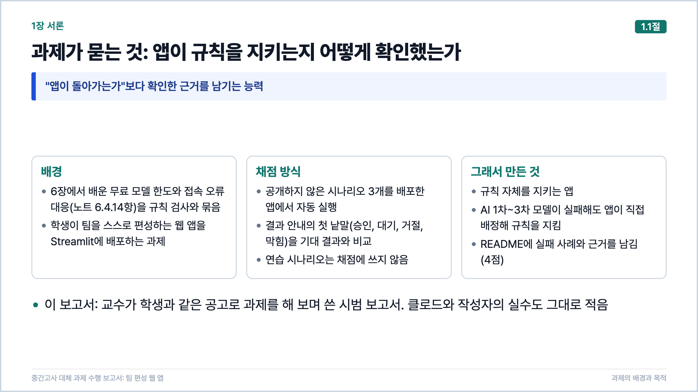

[슬라이드 1.1] 과제의 배경과 목적

[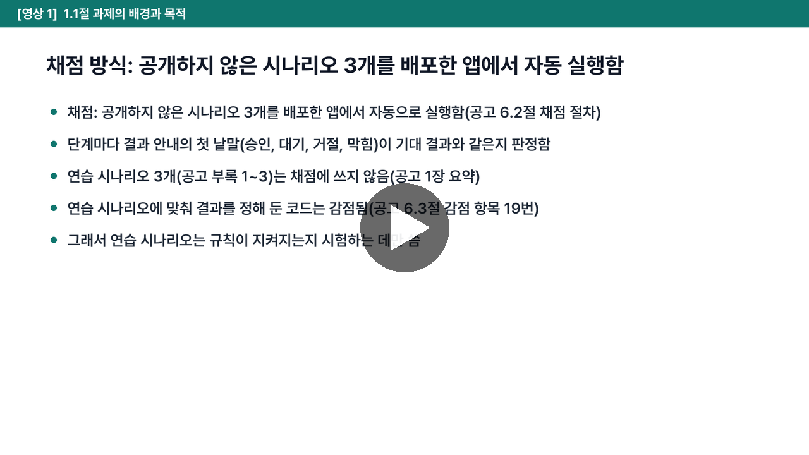](https://delightful-run-7c5.notion.site/409022e2cfe780c78c6ee12e76022ece#221d38b3e3344df9993e19ee4fa95a7c)

[영상 1] 1.1절 슬라이드의 설명 영상(151초, 신 교수의 목소리로 합성한 설명과 자막). 그림을 누르면 노션에서 영상이 재생됨

- 이 과제의 목적은 AI가 만든 앱이 정해진 규칙을 지키는지를 학생이 스스로 확인하고, 확인한 근거를 남기는 능력을 기르는 것으로 파악했음
  - 과제 공고[3]의 채점은 공개하지 않은 시나리오 3개를 배포한 앱에서 자동으로 실행해, 단계마다 결과 안내의 첫 낱말(승인, 대기, 거절, 막힘)이 기대 결과와 같은지 판정함(공고 6.2절)
  - 공고가 주는 연습 시나리오 3개(공고 부록 1~3)는 채점에 쓰지 않음(공고 1장). 그래서 연습 시나리오의 기대 결과에 맞춘 앱이 아니라, 규칙 자체를 지키는 앱을 만들어야 한다고 판단했음
  - 연습 시나리오에 맞춰 결과를 정해 둔 코드는 감점됨(공고 6.3절 감점 항목 19번). 그래서 연습 시나리오는 규칙이 지켜지는지 시험하는 데만 썼음
  - 공고 7.1절(README.md 양식) 5~7항은 AI 호출 실패 사례, 클로드가 잘못 추론한 사례, 자기 앱에서 찾은 문제를 근거와 함께 적게 하고 4점을 줌. "문제 없음"은 인정하지 않음
  - 따라서 과제는 "앱이 돌아가는가"보다 "앱이 규칙을 지키는지 어떻게 확인했는가"를 묻는 것으로 판단했음
- 공고가 AI 배정에 1차~3차 모델과 앱의 직접 배정을 두게 한 것은, 외부 서비스가 실패해도 앱이 규칙을 지키게 만드는 설계를 익히게 하려는 것으로 파악했음
  - 공고 4.3절(AI 모델)은 무료 모델이 응답이 늦거나, 거절하거나(HTTP 429), 빈 응답을 내는 일이 잦다고 미리 알림
  - 채점은 AI가 낸 배정의 내용이 아니라, 확정한 팀 구성이 규칙을 지키는지와 실패를 처리했는지를 판정함(공고 4.3절)
  - 6장 노트[2] 6.4.14항(무료 모델 한도와 접속 오류 대응)도 같은 문제를 다룸. 이 과제는 6장에서 배운 대응을 규칙 검사와 묶어 한 단계 더 나아가게 함
- 이 보고서는 교수가 학생과 같은 공고로 과제를 직접 수행하며 쓴 시범 보고서임
  - 교수라서 학생과 다르게 한 일 가운데 수행 방법의 차이는 1.3절 [표 5]에, 채점 프로그램과 채점 시나리오로 한 시험은 5.2절에 적음
  - 공고가 요구하는 보고서는 저장소의 `README.md`이고(공고 7장), 이 문서는 그와 별도로 썼음. 학생이 과정을 기록하고 근거를 대는 방법을 보여 주려는 것임
  - 클로드의 실수와 작성자의 실수도 그대로 적음. 보고서 작성 지침[1] 3.7절(결론의 요건)은 정직을 요건으로 듦

### 1.2 과제의 범위와 배점

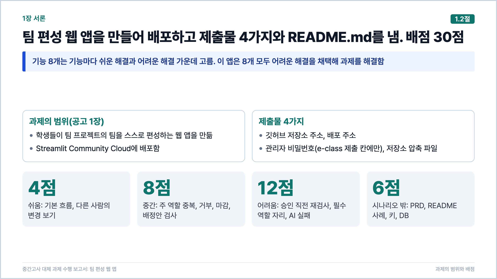

[슬라이드 1.2] 과제의 범위와 배점

[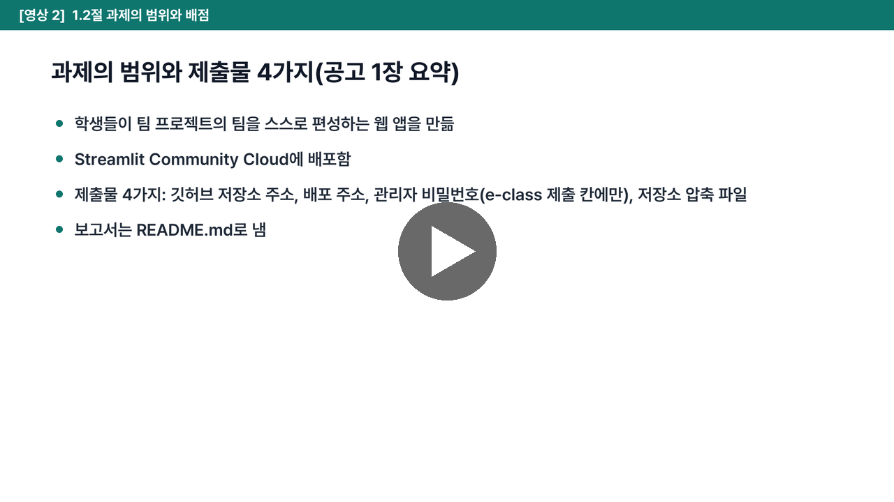](https://delightful-run-7c5.notion.site/409022e2cfe780c78c6ee12e76022ece#aba24f252058477dbcf76ed67d0107c3)

[영상 2] 1.2절 슬라이드의 설명 영상(123초, 신 교수의 목소리로 합성한 설명과 자막). 그림을 누르면 노션에서 영상이 재생됨

- 과제는 팀 프로젝트를 위한 팀을 학생들이 스스로 편성하는 웹 앱을 만들어 Streamlit에 배포하고, 제출물 4가지(공고 1장)와 보고서 `README.md`를 내는 것임
  - 배점은 시나리오 3개와 시나리오 밖의 4개 구분으로 나뉨([표 2])
  - 채점 요소마다 보고서의 어디에서 확인할 수 있는지와 예상 점수는 6.1절 [표 20], 자체 채점표에 모았음
  - 공고 3장의 기능 8개는 기능마다 쉬운 해결과 어려운 해결 가운데 하나를 고름. 이 보고서의 앱은 8개 모두 어려운 해결을 채택해 구현했음(6.2절)

[표 2] 과제의 배점(공고 6.1절)

| 구분 | 점수 | 공고가 밝힌 채점 대상 |
|---|---|---|
| 쉬움 시나리오 | 4 | 로그인, 지원, 투표, 마감, 배정과 확정의 기본 흐름, 다른 사람의 변경 보기 |
| 중간 시나리오 | 8 | 주 역할 중복, 거부, 한 번에 한 팀, 마감 처리, 배정안 검사 |
| 어려움 시나리오 | 12 | 승인 직전 재검사, 필수 포함 역할 자리, 보조 역할을 쓴 배정, AI 실패 처리와 대기 안내 |
| 시나리오 밖 | 6 | PRD와 구현 계획, README 사례, 키 관리, DB 유일성 제약, DB 일시정지 막기 |
| 합계 | 30 | |

### 1.3 수행 방법과 환경

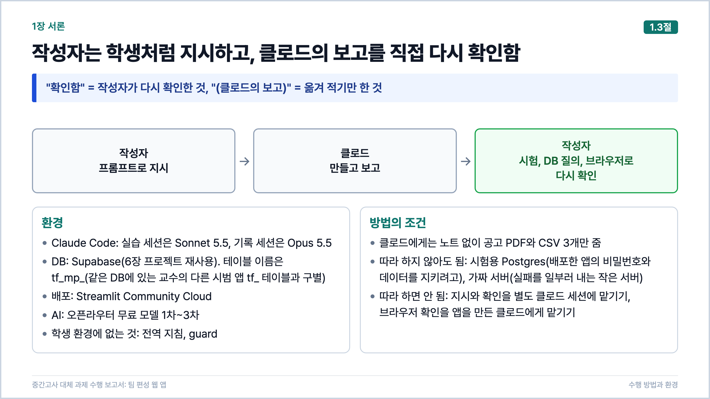

[슬라이드 1.3] 수행 방법과 환경

[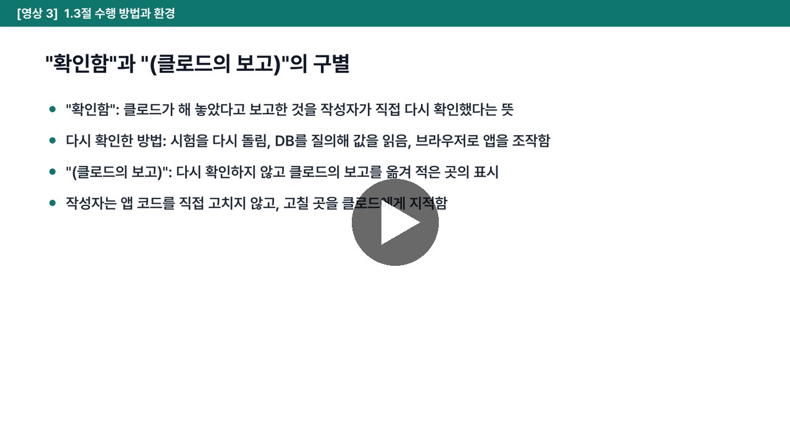](https://delightful-run-7c5.notion.site/409022e2cfe780c78c6ee12e76022ece#7f1546b89b9f4082a23cefd9957a1d81)

[영상 3] 1.3절 슬라이드의 설명 영상(263초, 신 교수의 목소리로 합성한 설명과 자막). 그림을 누르면 노션에서 영상이 재생됨

- 앱은 클로드(Claude Code)가 만들었고, 작성자는 학생처럼 프롬프트로 지시하고 결과를 공고와 대조해 다시 확인했음
  - 이 보고서의 작성자는 신 교수임. 프롬프트를 쓰고 결과를 다시 확인하는 작성자의 일 가운데 상당 부분은, 신 교수의 지시를 받은 별도의 클로드 세션이 대신했음. 이 보고서에서는 그 일을 작성자가 한 일로 적음([표 3])
  - 이 보고서에서 "확인함"은 클로드가 해 놓았다고 보고한 것을 작성자가 직접 다시 확인했다는 뜻임. 직접 다시 확인한 일에는 시험을 다시 돌리는 일, DB를 질의해 값을 읽는 일, 브라우저로 앱을 조작하는 일 등이 있음
  - 작성자가 다시 확인하지 않고 클로드가 보고한 내용을 그대로 옮겨 적은 곳은 문장 끝에 "(클로드의 보고)"라고 표시함
  - 작성자는 앱 코드를 직접 고치지 않고, 고칠 곳은 학생이 하듯 클로드에게 지적했음
- 앱을 만든 클로드에게는 6장 노트 파일을 주지 않고, 노트의 절차를 따라 쓴 프롬프트로 지시했음
  - 클로드는 공고 PDF와 연습용 CSV 3개만 있는 작업 폴더에서 일했음
  - 노트 없이 학생의 지시만으로 앱이 만들어지는지 확인하려는 것이었고, 이 방식은 작성자의 일을 대신한 클로드 세션이 정했음
  - 노트를 클로드에게 읽히는 것도 좋은 방법임. 학생에게 권하는 방법은 7.2절에 적음
  - [표 3]은 수행에 쓴 세션 2개와 세션마다 쓴 모델임

[표 3] 수행에 쓴 세션

| 세션 | 모델 | 한 일 | 작업 폴더 |
|---|---|---|---|
| 실습 세션(「중간 과제 실습 세션: 팀 편성 앱 prj_mid_26 구현」) | Sonnet 5.5 | 키 준비, PRD, 구현, 시험, 커밋 | `prj_mid_26/` |
| 기록 세션(「중간고사 대체 과제 수행 보고서 작성」) | Opus 5.5 | 프롬프트 작성, 공고와 대조, 다시 확인, 저장소와 DB 관리, 보고서 | 보고서 폴더 |

- 기록 세션은 보고서 작성자의 역할(프롬프트를 쓰고, 결과를 공고와 대조해 다시 확인함)을 대신한 클로드 세션임. 학생은 이 역할을 클로드에게 맡기지 말고 스스로 함

- 6장 노트의 절차를 이 과제에 대응시켜 진행했음([표 4])
  - 노트의 프롬프트를 그대로 쓴 곳은 "PRD_step1.md를 실행해."처럼 노트와 같은 문장을 썼고, 과제에 맞게 고친 곳은 A2에 원문을 둠

[표 4] 6장 노트의 절차와 이 과제의 대응

| 6장 노트 | 노트의 내용 | 이 과제에서 한 일 | 보고서 |
|---|---|---|---|
| 6.2절, 6.3.4항 | 키 발급, 모델 고르기, 연결 시험 | 무료 텍스트 모델 6개를 시험해 1차~3차를 고름 | 2.2절 |
| 6.3.3.2목 | `.env` 준비와 git 초기화 | 키 3개(오픈라우터, DB 주소, 관리자 비밀번호)를 `.env`에 두고 git 저장소를 만듦 | 2.1절 |
| 6.4.4항 | PRD를 3단계로 나눠 작성, 깃허브에 올림 | PRD 3개와 구현 계획을 쓰고 비공개 저장소에 올림 | 2.3절 |
| 6.4.5항~6.4.7항 | 단계별 구현 | 로그인과 명단 → 지원, 투표, 마감 → AI 배정의 3단계로 구현 | 3장 |
| 6.4.8항 | 배포 | Streamlit Community Cloud에 비공개 저장소로 배포 | 4.1절 |
| 6.4.9항 | 시험에서 찾은 문제를 모아 한 번에 고침(일괄 개선) | 빈 응답, 느린 화면, 끊긴 DB 연결의 3가지를 모아 고침 | 4.2절 |
| 6.4.13항 | 보안 점검 | 키 노출, RLS, 관리자 기능 막기 점검 | 4.3절 |
| 6.4.14항 | 무료 모델 한도와 오류 대응 | 2차, 3차 모델의 빈 응답 원인을 기록으로 확인 | 3.3절, 4.4절 |

- 수행한 컴퓨터에는 학생 환경에 없는 설정 2가지가 있었음
  - 전역 지침(`~/.claude/CLAUDE.md`): 클로드의 문체를 정하고, 사실을 적을 때 확인한 방법을 괄호로 붙이게 함. 클로드가 보고 끝에 "(grep으로 확인함)"처럼 적는 것은 이 지침 때문임
  - 점검 장치 guard: 클로드가 답을 끝내거나 깃허브에 올리기 전에 검사하는 검사 프로그램(Claude Code의 훅)임. 클로드의 대화 화면에 "[guard] 답을 고치는 중임."이라는 줄이 보이는 것은 이 장치가 답을 다시 쓰게 했다는 표시임([그림 1])
- 이 수행의 방법 가운데 학생이 따라 하지 않아도 되는 것과 따라 하면 안 되는 것은 [표 5]와 같음

[표 5] 학생이 따라 하지 않아도 되는 것과 따라 하면 안 되는 것

| 이 수행에서 한 것 | 학생은 | 까닭 |
|---|---|---|
| 프롬프트를 쓰고 결과를 확인하는 일을 별도의 클로드 세션에 맡김 | 따라 하면 안 됨 | 이 일은 보고서 작성자의 일(위의 기록 세션 설명)이므로, 학생은 클로드에게 맡기지 말고 스스로 함 |
| 브라우저 확인을 앱을 만든 클로드에게 맡김 | 따라 하면 안 됨 | 클로드가 만든 앱을 그 클로드가 눌러 본 확인은 학생 자신의 확인을 대신하지 못함. 학생은 연습 시나리오를 직접 눌러 보고 화면을 캡처해 남김 |
| 이 맥에 시험용 Postgres를 따로 띄움(5.1절) | 하지 않아도 됨 | 시험용 DB를 띄운 까닭은 2가지임. 로컬 앱은 시작할 때 관리자 비밀번호를 `ADMIN_PASSWORD`로 바꾸므로, 배포한 앱과 같은 DB로 띄우면 배포한 앱의 관리자 비밀번호가 바뀜(5.1절). 자동 시험은 시험마다 명단, 팀, 지원, 투표를 지우고 새로 만듦(`mp/service.py`의 `start_roster`). 시험끼리는 이렇게 초기화해도 되지만, 배포한 앱의 DB로 돌리면 그때 배포한 앱에 있던 명단과 팀까지 지워지고, 시험이 끝날 때까지 가짜 모델의 호출 기록이 실제 호출 기록에 섞임(`tests/conftest.py`). 채점 기간이었다면 채점 프로그램이 실행하던 명단과 팀이 지워졌을 것임(7.3절). 학생은 Supabase의 자기 프로젝트 하나로 충분하나, 자동 시험은 배포한 앱과 다른 DB에서 돌리기를 권함 |
| 가짜 오픈라우터 서버로 AI 실패를 재현함(3.3절) | 하지 않아도 됨 | 실패 처리는 실제 모델의 실패 기록(호출 기록 표)으로도 보일 수 있음. 가짜 서버는 실패를 원하는 때에 원하는 꼴로 만들려고 썼음 |
| 전역 지침과 guard | 학생 환경에는 없음 | 클로드의 대화에 "[guard]"가 보이거나 푸시가 막히는 장면은 학생에게 일어나지 않음 |

- DB는 Supabase 무료 프로젝트 `recipe4fridge`(6장 냉장고 앱이 쓰는 프로젝트)를 재사용했고, 테이블 이름을 `tf_mp_`로 시작하게 했음
  - 공고 4.2절(DB)은 6장에서 만든 프로젝트를 재사용하고 테이블 이름을 `tf_`로 시작하게 함
  - 같은 프로젝트에 공고를 쓰며 교수가 먼저 만든 다른 시범 앱(시연 동영상[4]의 앱)의 `tf_` 테이블이 이미 있어, 이름이 겹치지 않게 `tf_mp_`를 썼음
  - 처음에는 다른 계정의 프로젝트(`shopping-list-app`)에 만들었다가, 3단계 구현 뒤 `recipe4fridge`로 옮겼음(2.4절)

### 1.4 보고서의 구성과 용어

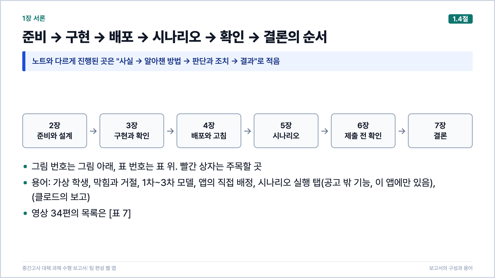

[슬라이드 1.4] 보고서의 구성과 용어

[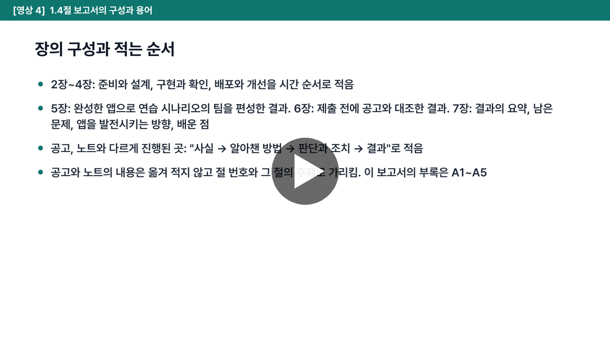](https://delightful-run-7c5.notion.site/409022e2cfe780c78c6ee12e76022ece#5895165d8fc143949ac02354679092b0)

[영상 4] 1.4절 슬라이드의 설명 영상(184초, 신 교수의 목소리로 합성한 설명과 자막). 그림을 누르면 노션에서 영상이 재생됨

- 2장은 준비와 설계, 3장은 구현과 확인, 4장은 배포와 개선, 5장은 연습 시나리오로 팀 편성하기, 6장은 제출 전 확인, 7장은 결론과 앱을 더 발전시키는 방향을 적음
  - 공고나 노트와 다르게 진행된 곳은 "사실 → 알아챈 방법 → 판단과 조치 → 결과"의 순서로 적음
  - 공고와 노트의 내용은 옮겨 적지 않고 절 번호로 가리킴. "공고 부록 1~3"은 공고의 연습 시나리오이고, 이 보고서의 부록은 A1~A5로 부름
  - 그림은 [그림 N], 표는 [표 N], 동영상은 [영상 N]으로 번호를 붙임. 그림 번호와 제목은 그림 아래에, 표 번호와 제목은 표 위에 둠(보고서 작성 지침[1] 3.8절)
  - 절마다 첫머리에 그 절을 1장으로 줄인 슬라이드를 [슬라이드 절 번호]로 두었고, 슬라이드 바로 밑에 그 슬라이드를 설명하는 영상을 두었음. \[슬라이드 3\](구현 3단계의 개요)에는 영상을 두지 않았음. 영상 그림을 누르면 노션 페이지에서 그 영상이 재생됨
  - 화면 그림에서 주목할 곳은 빨간 상자로 표시했고, 그림 설명에 그 곳을 밝힘
- 이 보고서에 자주 나오는 용어는 [표 6]에 모았음

[표 6] 이 보고서에 나오는 용어

| 용어 | 뜻 |
|---|---|
| 가상 학생 | 명단 CSV에 있는 학생. 앱을 쓰는 사람이며, 과제를 하는 수강생과 다름(공고 2.1절) |
| 막힘, 거절 | 막힘은 지원을 아예 접수하지 않은 것, 거절은 접수되어 대기하던 지원이 떨어진 것(공고 2.4절) |
| 1차~3차 모델 | AI 배정에 차례로 쓰는 오픈라우터의 무료 텍스트 모델 3개 |
| 앱의 직접 배정 | 3차 모델까지 실패했을 때, 또는 시나리오 실행 탭에서 실제 모델 호출을 껐을 때, 앱이 규칙을 지키는 배정을 스스로 찾는 것(공고 2.5절 6항) |
| PRD | 제품 요구사항 문서. 무엇을 만들지 정한 문서 |
| RLS | 행 수준 보안. Supabase의 공개 API 키로 테이블을 읽고 쓰지 못하게 막는 Postgres 기능 |
| 가짜 서버 | 오픈라우터 대신 앱의 AI 호출을 받는 작은 서버(`tests/fake_openrouter.py`). 모델 이름마다 늦게 답하기, HTTP 429, 빈 응답, 형식이 틀린 답, 올바른 배정안 가운데 하나를 돌려주게 정해 두고, 실제 모델이 언제 실패할지 기다리지 않고 실패 처리를 재현함(3.3절) |
| 시나리오 실행 탭 | 관리자에게만 보이는 앱의 둘째 탭. 공고가 요구하지 않은 기능이라 이 앱에만 있고 학생 앱에는 없음. 연습 시나리오의 단계표 CSV를 올리면 단계마다 실제 기능을 실행하고 기대 결과와 비교함(5.2절) |
| 클로드 | 앱을 만든 Claude Code 세션([표 3]의 실습 세션) |
| (클로드의 보고) | 작성자가 다시 확인하지 않고 클로드의 보고를 옮겨 적은 곳의 표시(1.3절) |

- 보고서의 영상 34편은 [표 7]에 모았음
  - 34편 가운데 31편은 슬라이드를 설명하는 영상임(요약, 5.2절과 5.3절을 뺀 1.1절~7.5절, 5.2.1항~5.2.3항, 7장 첫머리). 요약 영상은 [슬라이드 0]과 짝을 맞춰 [영상 0]으로 둠. 5.3.1항~5.3.3항에는 슬라이드 없이 영상만 1편씩 둠(3편)
  - 구성은 6장 노트의 영상과 같음: 첫 화면(제목, 보고서의 장, 이 영상에서 볼 것), 절의 슬라이드와 실습 화면, 정리 화면(다음으로 넘어가기 전에 확인할 항목)
  - 장면마다 아래나 왼쪽에 장면 설명을 붙였고, 영상 아래의 흰 띠에 설명 음성의 자막을 넣었음. 빨간 상자가 있는 그림은 상자 둘레를 확대해 보여 줌. 설명 음성은 신 교수의 목소리로 합성했음(VoxCPM2). 영상의 차례, 장면, 대본, 첫 화면과 정리 화면의 내용은 `증빙/그림/영상대본.json` 하나에 둠
  - 3.2절 영상은 구현 2단계의 규칙을 시나리오 실행 탭의 단계 화면 6장(쉬움 4단계, 중간 3, 8, 9단계, 어려움 8, 11단계)으로 보임
  - 5.2절과 5.3절의 영상은 시나리오 실행 탭에서 하위 단계를 하나씩 실행하며 화면을 연속으로 찍은 녹화로 만들었음. 녹화 도구는 단계를 누를 때 왼쪽의 단계 카드에, 결과를 보일 때 오른쪽 영역에 빨간 테두리를 그림. 영상에서는 "실제" 줄과 "+" 표시가 붙은 줄에 가는 상자를 더했음
  - 다시 디자인하기 전의 탭(10/31)으로 실제 AI 배정까지 찍은 영상 3편은 11/4 5장을 고치며 보고서에서 뺐음. 2차례 더 고친 시나리오 실행 탭의 실제 AI 배정 영상([영상 17]~[영상 19])으로 바꿨기 때문임

[표 7] 보고서의 설명 영상(11/2~11/4, 슬라이드, 실습 화면, 시연 녹화, 깃허브 `logistex/recipe4fridge` 저장소의 `note-slides` 브랜치)

| 번호 | 절 | 내용 | 길이 | 파일 |
|---|---|---|---|---|
| [영상 0] | 요약 | 보고서 요약 | 169초 | [video_0.mp4](https://raw.githubusercontent.com/logistex/recipe4fridge/note-slides/mid26/video/video_0.mp4) |
| [영상 1] | 1.1절 | 과제의 배경과 목적 | 151초 | [video_1-1.mp4](https://raw.githubusercontent.com/logistex/recipe4fridge/note-slides/mid26/video/video_1-1.mp4) |
| [영상 2] | 1.2절 | 과제의 범위와 배점 | 123초 | [video_1-2.mp4](https://raw.githubusercontent.com/logistex/recipe4fridge/note-slides/mid26/video/video_1-2.mp4) |
| [영상 3] | 1.3절 | 수행 방법과 환경 | 263초 | [video_1-3.mp4](https://raw.githubusercontent.com/logistex/recipe4fridge/note-slides/mid26/video/video_1-3.mp4) |
| [영상 4] | 1.4절 | 보고서의 구성과 용어 | 184초 | [video_1-4.mp4](https://raw.githubusercontent.com/logistex/recipe4fridge/note-slides/mid26/video/video_1-4.mp4) |
| [영상 5] | 2.1절 | 키 관리와 git 저장소 준비 | 108초 | [video_2-1.mp4](https://raw.githubusercontent.com/logistex/recipe4fridge/note-slides/mid26/video/video_2-1.mp4) |
| [영상 6] | 2.2절 | AI 모델 고르기와 연결 시험 | 103초 | [video_2-2.mp4](https://raw.githubusercontent.com/logistex/recipe4fridge/note-slides/mid26/video/video_2-2.mp4) |
| [영상 7] | 2.3절 | PRD와 구현 계획의 작성 | 134초 | [video_2-3.mp4](https://raw.githubusercontent.com/logistex/recipe4fridge/note-slides/mid26/video/video_2-3.mp4) |
| [영상 8] | 2.4절 | DB 설계와 schema.sql | 387초 | [video_2-4.mp4](https://raw.githubusercontent.com/logistex/recipe4fridge/note-slides/mid26/video/video_2-4.mp4) |
| [영상 9] | 3.1절 | 1단계: 로그인과 명단 올리기 | 136초 | [video_3-1.mp4](https://raw.githubusercontent.com/logistex/recipe4fridge/note-slides/mid26/video/video_3-1.mp4) |
| [영상 10] | 3.2절 | 2단계: 지원, 투표, 마감과 규칙 검사 | 170초 | [video_3-2.mp4](https://raw.githubusercontent.com/logistex/recipe4fridge/note-slides/mid26/video/video_3-2.mp4) |
| [영상 11] | 3.3절 | 3단계: AI 배정과 실패 처리 | 149초 | [video_3-3.mp4](https://raw.githubusercontent.com/logistex/recipe4fridge/note-slides/mid26/video/video_3-3.mp4) |
| [영상 12] | 4.1절 | 비공개 저장소와 Streamlit 배포 | 138초 | [video_4-1.mp4](https://raw.githubusercontent.com/logistex/recipe4fridge/note-slides/mid26/video/video_4-1.mp4) |
| [영상 13] | 4.2절 | 시험과 노트의 사례로 찾은 문제 3가지를 한 번에 고침 | 253초 | [video_4-2.mp4](https://raw.githubusercontent.com/logistex/recipe4fridge/note-slides/mid26/video/video_4-2.mp4) |
| [영상 14] | 4.3절 | 보안 점검 | 323초 | [video_4-3.mp4](https://raw.githubusercontent.com/logistex/recipe4fridge/note-slides/mid26/video/video_4-3.mp4) |
| [영상 15] | 4.4절 | DB 일시정지 막기와 무료 모델의 하루 호출 수 관리 | 193초 | [video_4-4.mp4](https://raw.githubusercontent.com/logistex/recipe4fridge/note-slides/mid26/video/video_4-4.mp4) |
| [영상 16] | 5.1절 | 시나리오와 확인 방법 | 319초 | [video_5-1.mp4](https://raw.githubusercontent.com/logistex/recipe4fridge/note-slides/mid26/video/video_5-1.mp4) |
| [영상 17] | 5.2.1항 | 쉬움 시나리오 | 133초 | [video_5-2-1.mp4](https://raw.githubusercontent.com/logistex/recipe4fridge/note-slides/mid26/video/video_5-2-1.mp4) |
| [영상 18] | 5.2.2항 | 중간 시나리오 | 166초 | [video_5-2-2.mp4](https://raw.githubusercontent.com/logistex/recipe4fridge/note-slides/mid26/video/video_5-2-2.mp4) |
| [영상 19] | 5.2.3항 | 어려움 시나리오 | 206초 | [video_5-2-3.mp4](https://raw.githubusercontent.com/logistex/recipe4fridge/note-slides/mid26/video/video_5-2-3.mp4) |
| [영상 20] | 5.3.1항 | 쉬움 시나리오(앱이 직접 배정) | 117초 | [video_5-3-1.mp4](https://raw.githubusercontent.com/logistex/recipe4fridge/note-slides/mid26/video/video_5-3-1.mp4) |
| [영상 21] | 5.3.2항 | 중간 시나리오(앱이 직접 배정) | 101초 | [video_5-3-2.mp4](https://raw.githubusercontent.com/logistex/recipe4fridge/note-slides/mid26/video/video_5-3-2.mp4) |
| [영상 22] | 5.3.3항 | 어려움 시나리오(앱이 직접 배정) | 119초 | [video_5-3-3.mp4](https://raw.githubusercontent.com/logistex/recipe4fridge/note-slides/mid26/video/video_5-3-3.mp4) |
| [영상 23] | 6.1절 | 자체 채점표 | 206초 | [video_6-1.mp4](https://raw.githubusercontent.com/logistex/recipe4fridge/note-slides/mid26/video/video_6-1.mp4) |
| [영상 24] | 6.2절 | 기능별 해결 방법과 점수의 대조 | 206초 | [video_6-2.mp4](https://raw.githubusercontent.com/logistex/recipe4fridge/note-slides/mid26/video/video_6-2.mp4) |
| [영상 25] | 6.3절 | 감점 항목 21개의 대조 | 198초 | [video_6-3.mp4](https://raw.githubusercontent.com/logistex/recipe4fridge/note-slides/mid26/video/video_6-3.mp4) |
| [영상 26] | 6.4절 | README.md 사례 8건과 다시 쓴 까닭 | 271초 | [video_6-4.mp4](https://raw.githubusercontent.com/logistex/recipe4fridge/note-slides/mid26/video/video_6-4.mp4) |
| [영상 27] | 6.5절 | 제출물의 확인 | 192초 | [video_6-5.mp4](https://raw.githubusercontent.com/logistex/recipe4fridge/note-slides/mid26/video/video_6-5.mp4) |
| [영상 28] | 7장 | 결론의 개요 | 77초 | [video_7.mp4](https://raw.githubusercontent.com/logistex/recipe4fridge/note-slides/mid26/video/video_7.mp4) |
| [영상 29] | 7.1절 | 결과의 요약 | 194초 | [video_7-1.mp4](https://raw.githubusercontent.com/logistex/recipe4fridge/note-slides/mid26/video/video_7-1.mp4) |
| [영상 30] | 7.2절 | 클로드가 노트, 공고, 기록과 다르게 한 점의 해석 | 278초 | [video_7-2.mp4](https://raw.githubusercontent.com/logistex/recipe4fridge/note-slides/mid26/video/video_7-2.mp4) |
| [영상 31] | 7.3절 | 남은 문제와 공고, 노트의 보완 제안 | 332초 | [video_7-3.mp4](https://raw.githubusercontent.com/logistex/recipe4fridge/note-slides/mid26/video/video_7-3.mp4) |
| [영상 32] | 7.4절 | 앱을 더 발전시키는 방향 | 321초 | [video_7-4.mp4](https://raw.githubusercontent.com/logistex/recipe4fridge/note-slides/mid26/video/video_7-4.mp4) |
| [영상 33] | 7.5절 | 배운 점, 느낀 점, 다짐한 점 | 206초 | [video_7-5.mp4](https://raw.githubusercontent.com/logistex/recipe4fridge/note-slides/mid26/video/video_7-5.mp4) |

## 2. 준비와 설계

- 2장은 키를 안전하게 둘 준비, AI 모델 고르기, PRD와 구현 계획, DB 설계를 적음
  - 이 단계에서 클로드가 잘못 추론한 사례 1건(README 항목 수)과, 노트와 다르게 진행된 사례 1건(`git init` 누락)이 나왔음

### 2.1 키 관리와 git 저장소 준비

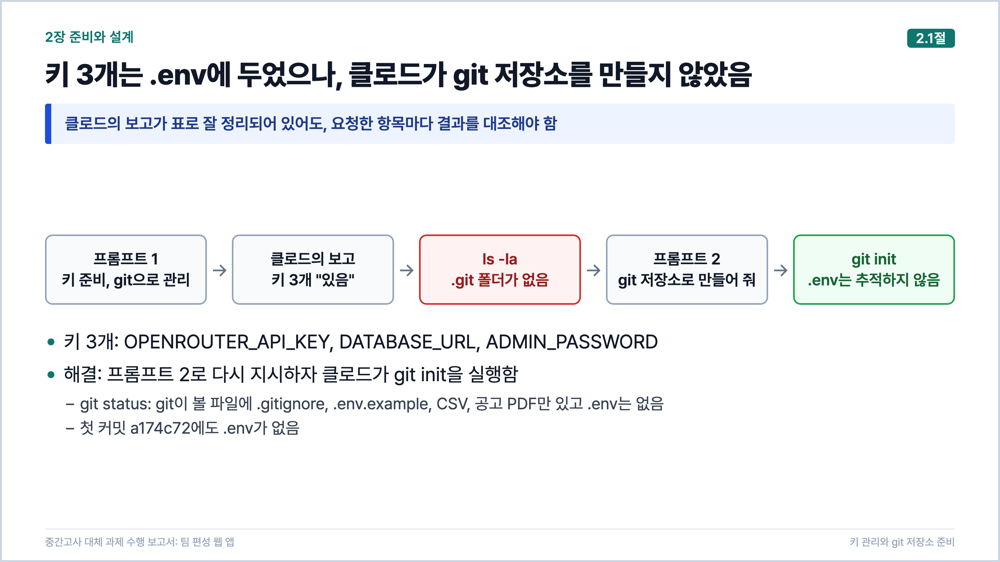

[슬라이드 2.1] 키 관리와 git 저장소 준비

[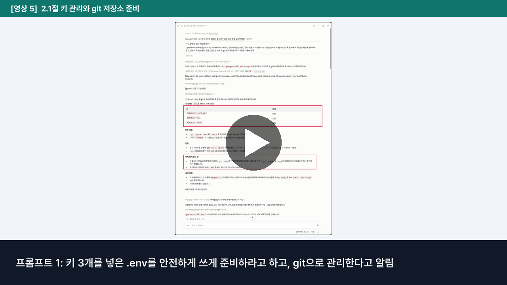](https://delightful-run-7c5.notion.site/409022e2cfe780c78c6ee12e76022ece#2fd5bc8e05c34fc3a65dc5735b039dd5)

[영상 5] 2.1절 슬라이드의 설명 영상(108초, 신 교수의 목소리로 합성한 설명과 자막). 그림을 누르면 노션에서 영상이 재생됨

- 키 3개를 `.env`에 두고 git이 이 파일을 올리지 않게 준비했으나, 첫 프롬프트에서 클로드는 git 저장소를 만들지 않았음
  - 작업 폴더를 만들고 공고 PDF, CSV 3개, `.env`를 넣었음(10/30 21:25). `.env`에는 `OPENROUTER_API_KEY`, `DATABASE_URL`, `ADMIN_PASSWORD`가 있음(공고 4.1절)
  - 프롬프트 1은 6장 노트 6.3.3.2목의 프롬프트 1~3을 한 메시지로 합친 것임(A2의 프롬프트 1)
  - 클로드는 `.gitignore`(`.env`와 `.env.*`를 무시함)와 `.env.example`(값을 비운 견본)을 만들고, 키 3개가 "있음"이라고 표로 보고했음([그림 1])
- 노트 6.3.3.2목(`.env` 준비와 git 초기화)의 b.2)에서는 "git으로 관리할 거야"에 클로드가 `git init`을 했으나, 이번에는 하지 않았음
  - 알아챈 방법: 클로드의 보고를 읽은 뒤 작업 폴더를 `ls -la`로 확인하니 `.git` 폴더가 없었음
  - 클로드는 저장소가 아닌 임시 폴더를 따로 만들어 `.env`가 무시되는지를 시험했고, 보고 끝에 "이 폴더는 아직 git 저장소가 아니며"라고 적었음. 거짓 보고는 아니었으나, 요청한 일을 하지 않은 것임
  - 조치: 프롬프트 2의 첫 줄에 "git으로 관리한다고 했는데 아직 git 저장소가 아니네. 이 폴더를 git 저장소로 만들어 줘(커밋은 아직 하지 마)"라고 지적했음(A2의 프롬프트 2). 커밋은 PRD를 쓴 뒤에 하려고 "커밋은 아직 하지 마"를 붙였음
  - 결과: 클로드가 작업 폴더에서 `git init`을 실행했고(10/30 21:28, 보고는 21:31), 이어서 `git status --short`로 git이 볼 파일 목록을 보였음. 목록에는 `.gitignore`, `.env.example`, 연습용 CSV 3개, 공고 PDF만 있고 `.env`는 없었음. `.gitignore`가 `.env`를 무시하므로, 키가 든 파일이 커밋될 일이 없음을 이것으로 확인했음
  - 첫 커밋 `a174c72`(10/30 21:49, PRD와 구현 계획, 공고 PDF, CSV 3개 등 파일 10개)에도 `.env.example`만 있고 `.env`는 없음(`git show --stat`으로 확인함, 11/2)
  - 학생에게 주는 시사점: 클로드의 보고가 길고 표가 잘 정리되어 있어도, 요청한 항목마다 결과가 있는지 하나씩 대조해야 함

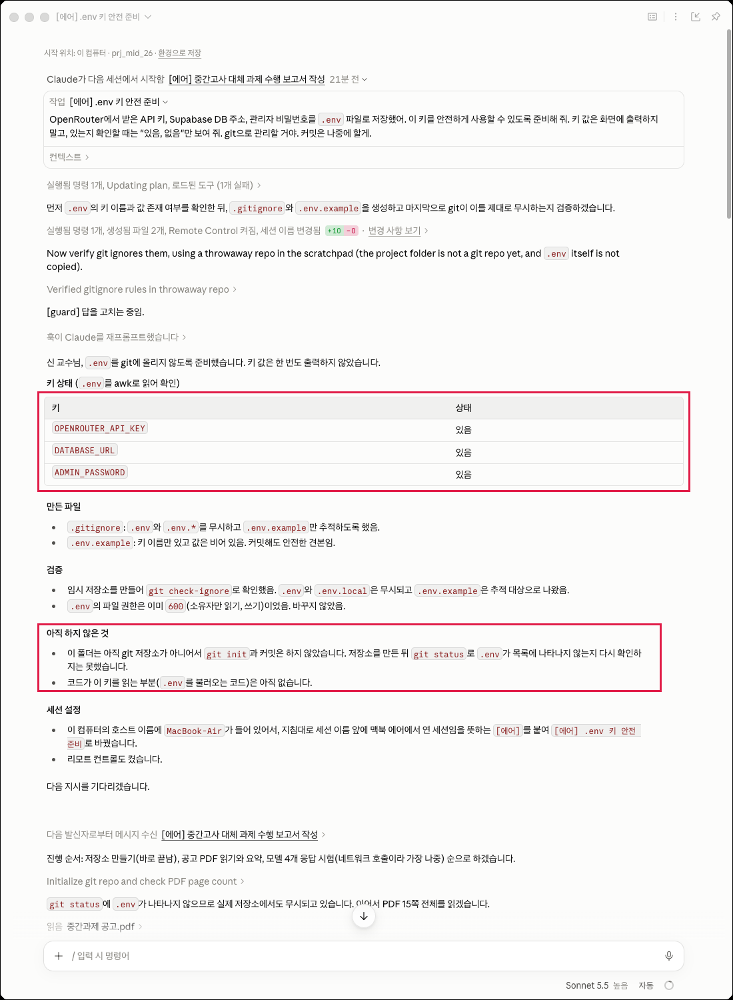

[그림 1] 키 준비 프롬프트와 클로드의 답. 빨간 상자는 키 3개를 "있음, 없음"으로만 보인 표와, git 저장소를 아직 만들지 않았다고 밝힌 "아직 하지 않은 것"임

### 2.2 AI 모델 고르기와 연결 시험

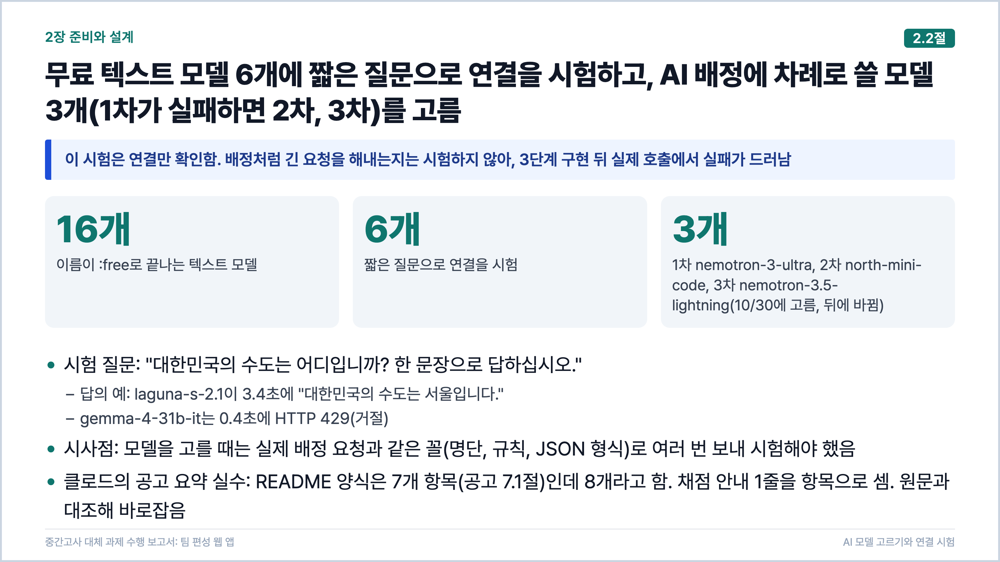

[슬라이드 2.2] AI 모델 고르기와 연결 시험

[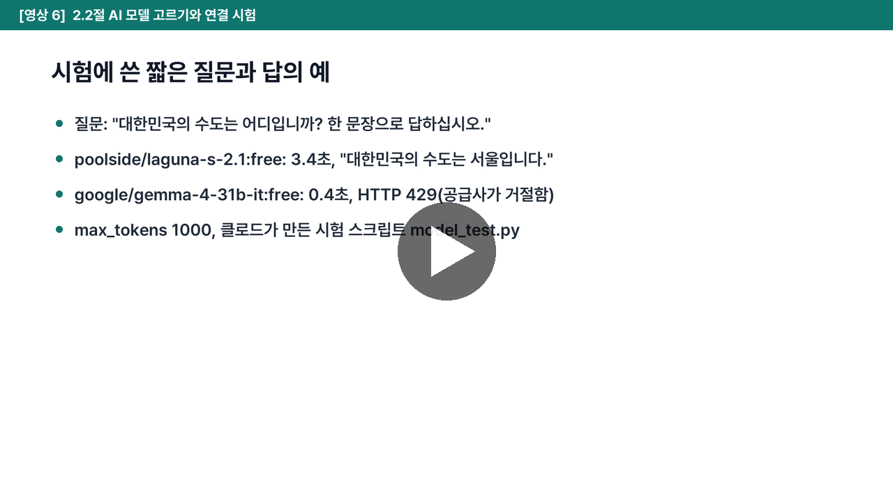](https://delightful-run-7c5.notion.site/409022e2cfe780c78c6ee12e76022ece#4521272ba7ca49f496845fb12a41d037)

[영상 6] 2.2절 슬라이드의 설명 영상(103초, 신 교수의 목소리로 합성한 설명과 자막). 그림을 누르면 노션에서 영상이 재생됨

- 오픈라우터의 무료 텍스트 모델 6개를 시험해 1차 `nvidia/nemotron-3-ultra-550b-a55b:free`, 2차 `cohere/north-mini-code:free`, 3차 `nvidia/nemotron-3.5-lightning:free`를 골랐음
  - 후보는 오픈라우터 모델 목록 API에서 이름이 `:free`로 끝나는 텍스트 모델 16개를 받아 골랐음(10/30 21:28)
  - 클로드는 모델마다 짧은 질문 1개를 보내고 응답 시간과 결과를 표로 보고했음([표 8], [그림 2])
    - 질문: "대한민국의 수도는 어디입니까? 한 문장으로 답하십시오."(`max_tokens` 1000, 클로드가 만든 시험 스크립트 `model_test.py`)
    - 답의 예: `poolside/laguna-s-2.1:free`가 3.4초에 "대한민국의 수도는 서울입니다."라고 답함. `google/gemma-4-31b-it:free`는 0.4초에 HTTP 429(공급사가 거절함)를 돌려줌(실습 세션의 대화 기록)
    - 이 시험은 모델이 응답하는지만 확인하는 것이라, 배정처럼 긴 요청에서의 성공은 알 수 없었음(아래 문단)
  - 2차를 cohere로 한 까닭은 1차(nvidia)와 공급사를 나눠, 한 공급사가 막힐 때 함께 실패하지 않게 하려는 것이라고 클로드가 밝힘

[표 8] 무료 모델 연결 시험(10/30 21:30~21:44, 모델마다 1~2회, 클로드의 보고)

| 모델 | 응답 시간 | 결과 | 쓰임 |
|---|---|---|---|
| `nvidia/nemotron-3-ultra-550b-a55b:free` | 1.7초 | 성공 | 1차 |
| `cohere/north-mini-code:free` | 2.2초 | 성공 | 2차 |
| `nvidia/nemotron-3.5-lightning:free` | 2.2초 | 성공 | 3차 |
| `poolside/laguna-s-2.1:free` | 0.7초, 3.4초 | 1회차 HTTP 429, 2회차 성공 | 예비 |
| `google/gemma-4-31b-it:free` | 0.5초, 0.4초 | 2번 모두 HTTP 429 | 뺌 |
| `thinkingmachines/inkling:free` | 0.3초 | HTTP 403(에이전트 도구 안에서만 쓸 수 있다는 응답) | 뺌 |

- 이 시험은 짧은 질문 1개였으므로, 실제 배정 요청에서의 성공률은 알 수 없었음. 실제로 3단계 구현 뒤의 실호출에서 2차와 3차가 빈 응답을 냈음(3.3절)
- 모델 시험 결과를 보고한 같은 답에서, 클로드가 공고 7.1절의 README 항목 수를 8개로 잘못 요약했음(실제 7개, README 6장 사례 A)
  - 사실: 클로드는 공고 요약에서 `README.md` 양식을 "8개 항목"이라고 했음. 공고 7.1절은 7개 항목이고, 8번째로 보인 것은 "5~7항은 사례만 적으면 부분 점수"라는 채점 안내임
  - 알아챈 방법: 요약을 공고 원문과 대조함
  - 조치: 프롬프트 3의 첫 줄에 "공고 7.1절을 다시 확인해 줘"라고 함. 클로드는 PDF에서 뽑은 본문과 대조해 7개라고 바로잡았음([그림 3])
  - 시사점: 클로드의 요약은 원문 대조 없이 믿으면 안 됨. 이 오류를 그대로 두었다면 README에 없는 8번째 항목을 채우느라 시간을 썼을 것임

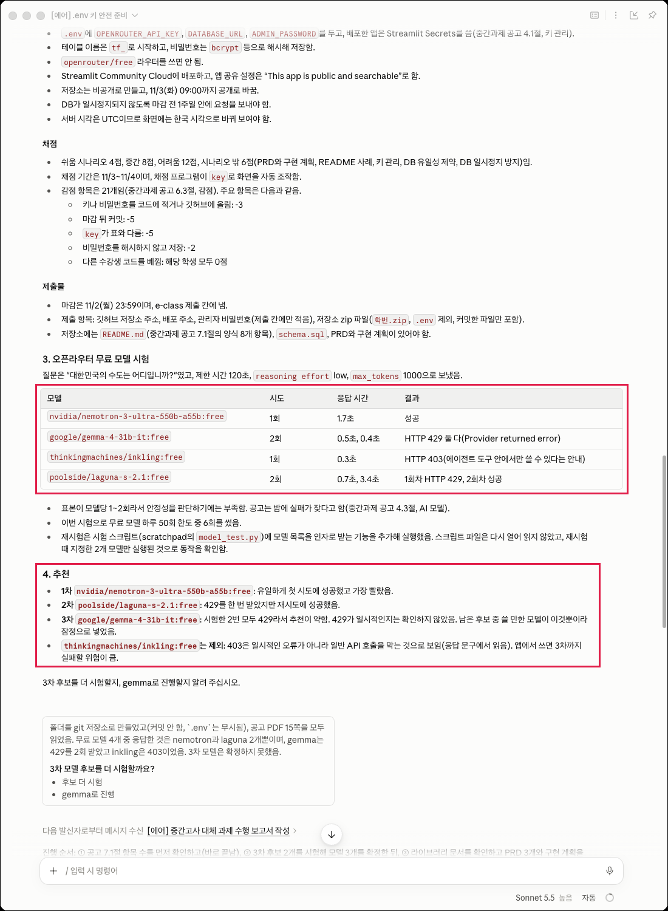

[그림 2] 처음 시험한 무료 모델 4개의 결과와 추천(클로드의 답). 빨간 상자는 모델마다의 결과 표와 추천임. 이때의 추천은 뒤에 2개를 더 시험해 바뀌었음([표 8], [그림 3])

### 2.3 PRD와 구현 계획의 작성

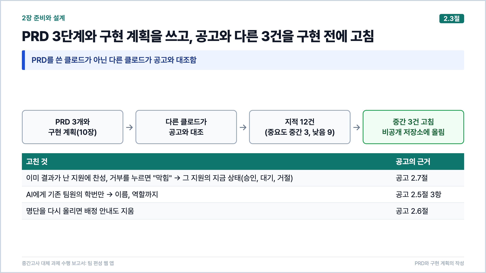

[슬라이드 2.3] PRD와 구현 계획의 작성

[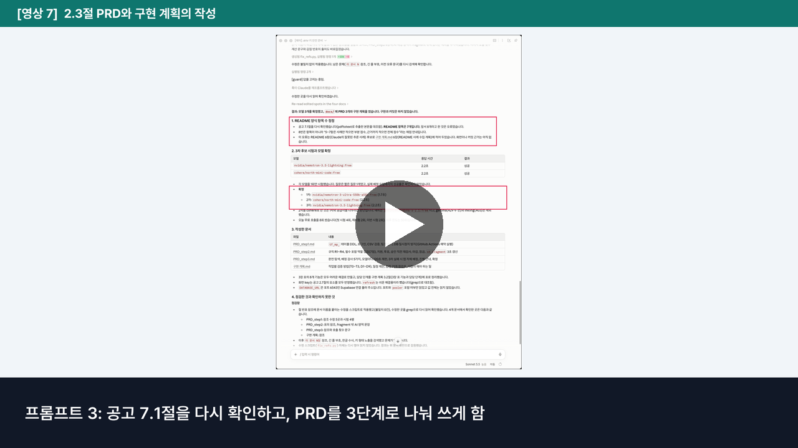](https://delightful-run-7c5.notion.site/409022e2cfe780c78c6ee12e76022ece#d0e54a55c7794b72b169036422ae0d99)

[영상 7] 2.3절 슬라이드의 설명 영상(134초, 신 교수의 목소리로 합성한 설명과 자막). 그림을 누르면 노션에서 영상이 재생됨

- PRD를 3단계로 나눠 쓰고 구현 계획도 쓰게 했고, PRD가 공고와 다른 곳 3건을 찾아 구현 전에 고쳤음([표 9])
  - 프롬프트 3은 6장 노트 6.4.4.1목(3단계 PRD 작성 지시)의 프롬프트를 이 과제에 맞게 바꾼 것임(A2의 프롬프트 3)
  - 단계 구성: 1단계는 DB 테이블, 로그인, 명단 올리기. 2단계는 지원, 투표, 마감과 규칙, 다른 사람의 변경 보기. 3단계는 AI 배정과 실패 처리, 배정안 검사, 확정
  - 공고 3장의 기능 8개는 모두 어려운 해결로, 화면 `key`(채점 프로그램이 단추와 칸을 찾을 때 쓰는 이름)는 공고 2.7절 표대로 하라고 함
  - 클로드는 `docs/`에 PRD 3개(229줄, 260줄, 268줄)와 구현 계획(223줄)을 썼음(10/30 21:44, `wc -l`로 셈)
  - 저장소의 `docs/`에는 PRD가 하나 더 있음. `PRD_step4.md`는 공고가 요구하지 않은 시나리오 실행 탭(5.2절)의 PRD로, 10/31에 따로 썼음(커밋 `81958ab`). 공고가 요구한 앱의 PRD는 위의 3개임
- PRD를 공고와 대조하는 일은 PRD를 쓴 클로드가 아닌 다른 클로드(하위 에이전트)에 맡겨 다른 눈으로 읽게 했고, 그 결과를 다시 읽어 판단했음([표 9])
  - 공고와 맞은 것: 핵심 규칙 5개(승인 직전 재검사, 필수 포함 역할 자리 계산, 마감 처리, 거부 1표면 거절, 투표 바꾸기 금지), 화면 `key` 18개, 어려운 해결 8개
  - 연습 시나리오 3개를 PRD의 규칙으로 손으로 계산하면 모든 단계가 기대 결과와 같았음
  - 하위 에이전트가 지적한 12건은 중요도를 중간으로 매긴 3건과 낮음으로 매긴 9건이었고, 중간 3건을 구현 전에 고쳤음([표 9]). 낮음 9건 가운데 1건(구현 계획 10장의 공고 PDF 항목)은 원문을 다시 읽어 잘못된 지적으로 판단했고, 나머지 8건의 처리는 기록에 남지 않았음(「PRD 대조 결과 1030.md」, 실습 기록)

[표 9] PRD와 공고의 대조에서 고친 3건

| 번호 | PRD의 내용 | 공고의 근거 | 고친 내용 |
|---|---|---|---|
| 1 | 이미 결과가 난 지원에 찬성이나 거부를 누르면 "막힘"을 보여 줌 | 공고 2.7절: 찬성, 거부 단추의 결과 안내는 그 지원의 지금 상태(승인, 대기, 거절) | 지금 상태를 보여 줌. 예: 앞 팀원의 거부로 거절된 직후 찬성을 누르면 "거절: 팀원이 거부함" |
| 2 | AI에게 보내는 팀 목록에 기존 팀원의 학번만 넣음 | 공고 2.5절 3항: 지금의 팀 구성과 역할을 보냄 | 기존 팀원의 학번, 이름, 주 역할, 보조 역할을 모두 보냄 |
| 3 | 명단을 다시 올려도 배정 진행 안내가 지워지지 않음 | 공고 2.6절: 명단을 올리면 처음 상태를 만듦 | 배정 안내와 배정안도 함께 지움 |

- 1번은 화면이 3초 늦게 갱신되는 사이에 생기는 일이라, 연습 시나리오의 손 계산으로는 드러나지 않음. 채점 프로그램이 학생을 바꿔 가며 단추를 빠르게 누르면 생길 수 있으므로 고쳤음
- 고친 PRD를 커밋하고(`276c0a1`), 비공개 저장소 `logistex/prj_mid_26`을 만들어 올렸음
  - 저장소는 `gh repo create --private`로 만들고 처음 올렸음(10/30 21:54). 깃허브에서 Private이고 `.env`가 없음을 `gh repo view`와 깃허브 API의 파일 목록으로 확인함
  - 커밋 작성자 이메일은 깃허브 noreply 주소로 함(6장 노트 6.4.4.2목). 저장소를 마감 뒤 공개해도 개인 이메일이 드러나지 않음

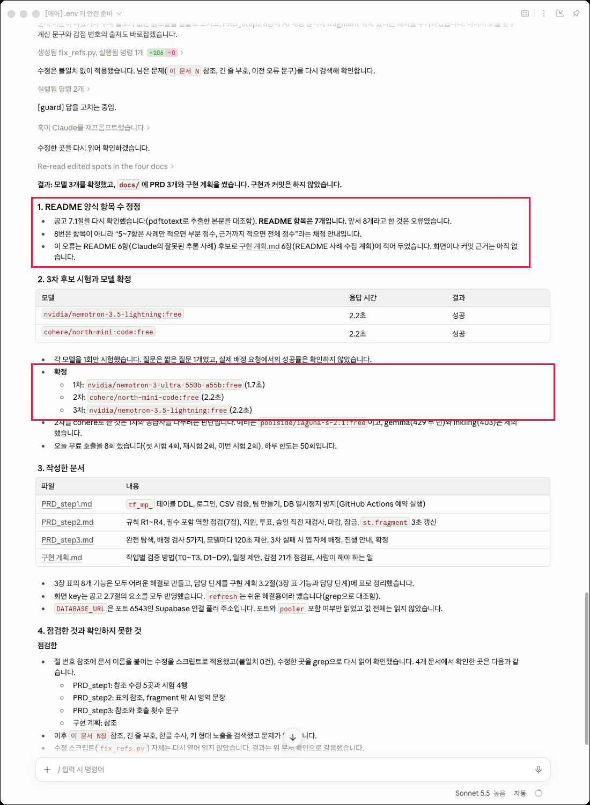

[그림 3] README 항목 수를 바로잡고, 모델 3개를 확정하고, PRD와 구현 계획을 쓴 클로드의 답. 빨간 상자는 README 항목 수의 정정(7개)과 확정한 모델 3개임

### 2.4 DB 설계와 schema.sql

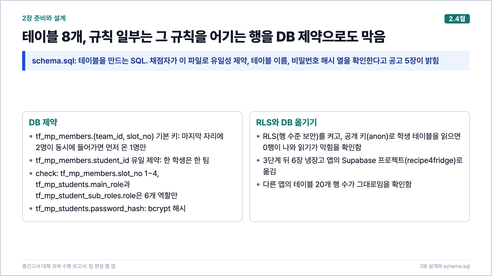

[슬라이드 2.4] DB 설계와 schema.sql

[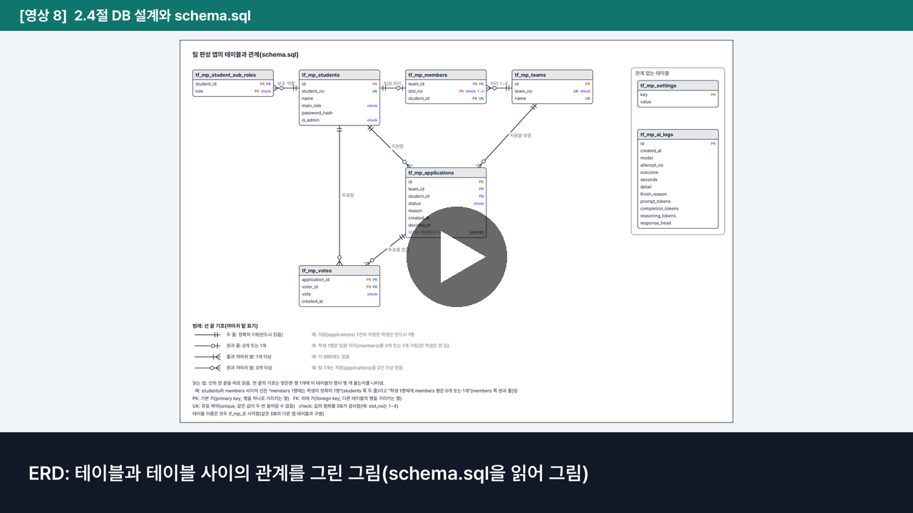](https://delightful-run-7c5.notion.site/409022e2cfe780c78c6ee12e76022ece#5ab360944464400d9eb9b0f7685e3500)

[영상 8] 2.4절 슬라이드의 설명 영상(387초, 신 교수의 목소리로 합성한 설명과 자막). 그림을 누르면 노션에서 영상이 재생됨

- DB는 공고 5장(DB 최소 참고안)의 테이블 7개에 AI 호출 기록 테이블 1개를 더한 8개로 설계했고, 규칙 일부는 그 규칙을 어기는 행이 저장되지 않게 DB 제약으로도 막았음([그림 4])
  - 테이블을 만드는 SQL은 저장소의 `schema.sql`에 있음. 채점자는 학생의 Supabase를 열어 볼 수 없으므로 이 파일로 유일성 제약, 테이블 이름, 비밀번호 해시 열을 확인한다고 공고 5장(DB 최소 참고안)이 밝힘
  - [그림 4]는 `schema.sql`을 읽어 파이썬으로 그린 ERD임. 선이 엇갈리지 않게 직선으로 그렸고, 다른 테이블과 관계가 없는 `tf_mp_settings`와 `tf_mp_ai_logs`는 오른쪽에 따로 둠
  - [표 10]은 공고가 요구한 제약과 `schema.sql`의 대응임. `schema.sql`을 읽어 대조했음

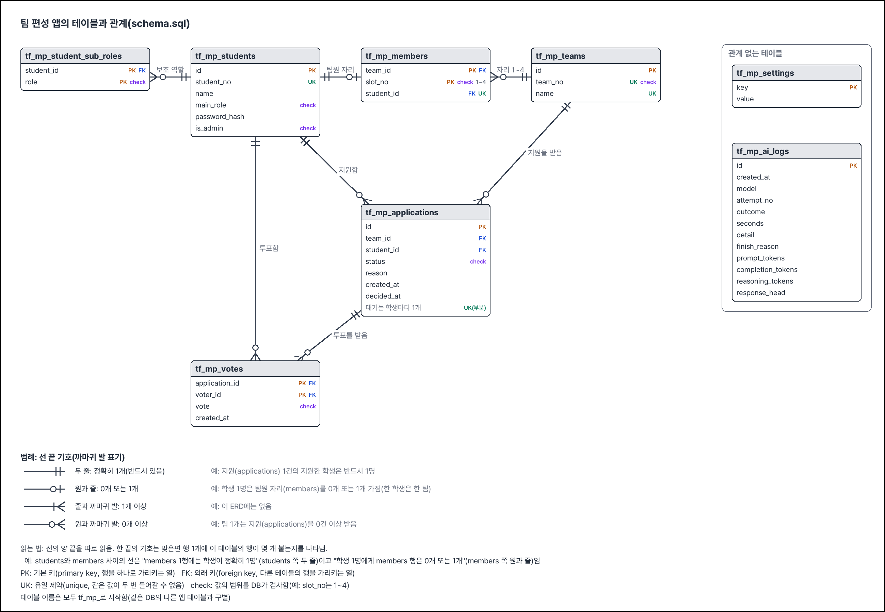

[그림 4] 팀 편성 앱의 테이블과 관계(ERD, Entity Relationship Diagram). 빨간 상자는 두지 않았고, 아래 범례가 선 끝 기호 4가지와 PK, FK, UK, check의 뜻을 풂

- ERD의 선은 양 끝을 따로 읽음. 한 끝의 기호는 맞은편 테이블의 행 1개에, 그 기호가 붙은 쪽 테이블의 행 몇 개가 관련되는지를 나타냄
  - 예: `tf_mp_students`와 `tf_mp_members` 사이의 선은 "members 행 1개에는 학생이 정확히 1명"(students 쪽 두 줄)이고 "학생 1명에게 members 행은 0개 또는 1개"(members 쪽 원과 줄)임
  - 줄임말: PK는 기본 키(행마다 값이 달라 그 행을 다른 행과 구별하는 열. 열 2개를 묶기도 함), FK는 외래 키(다른 테이블의 행을 가리키는 열), UK는 유일 제약(같은 값이 2번 들어갈 수 없음), check는 값의 범위를 DB가 검사하는 제약임
- 팀원을 학생 테이블의 열로 두지 않고 `tf_mp_members` 테이블을 따로 둔 것은, 팀 정원(4명)을 넘는 입장과 마지막 자리의 동시 입장을 DB 제약으로 막기 위함임
  - "한 학생은 한 팀"은 학생 테이블에 팀 id 외래 키 열을 두어도 지켜짐
  - 그러나 "다섯 번째 팀원이 들어감"과 "마지막 자리에 두 명이 동시에 들어감"은 그 방식으로는 DB 제약으로 막을 수 없음. 막으려면 트리거나 잠금 코드가 필요함
  - 그래서 자리 번호 1~4를 가진 `tf_mp_members` 테이블을 따로 두고, `(team_id, slot_no)`를 기본 키로, `tf_mp_members.student_id`에 유일 제약을 걸었음. 앱은 학생을 그 팀의 빈 자리 가운데 가장 작은 번호에 넣으므로(`mp/service.py`의 `_join`), 두 학생이 마지막 자리에 동시에 들어가려 하면 같은 자리 번호를 받음. 이때 기본 키가 겹쳐 먼저 도착한 학생만 기록됨
  - 이 구성은 공고 5장의 참고안과 같고, 공고 3장 표의 0.5점(마지막 자리에 두 명이 동시에 들어감)이 이 제약에 걸림

[표 10] 공고가 요구한 DB 제약과 schema.sql

| 공고의 요구 | schema.sql | 막는 일 |
|---|---|---|
| `tf_members`의 `(team_id, slot_no)` 기본 키(공고 5장) | `tf_mp_members` primary key `(team_id, slot_no)` | 마지막 자리에 학생 2명이 동시에 들어가면 먼저 도착한 학생만 기록됨(공고 3장 표의 어려운 해결) |
| `student_id` 유일 | `tf_mp_members.student_id unique` | 한 학생이 2개 팀에 들어감 |
| `slot_no` 1~4 | `tf_mp_members.slot_no`의 `check (slot_no between 1 and 4)` | 다섯 번째 자리 |
| 역할 6개 밖의 값 금지 | `tf_mp_students.main_role`, `tf_mp_student_sub_roles.role`에 `check (... in (6개))` | 오타가 든 역할 |
| 비밀번호 해시 | `tf_mp_students.password_hash text not null`(bcrypt) | 비밀번호를 그대로 저장함(공고 6.3절 감점 항목 10번) |
| 투표 기본 키 `(application_id, voter_id)` | `tf_mp_votes` primary key `(application_id, voter_id)` | 한 사람이 같은 지원에 2번 투표함 |
| (공고 2장 표 "한 학생의 지원" 규칙을 DB에서도 막음) | `tf_mp_applications`에 `status = '대기'`인 행만 학생마다 1개로 제한하는 부분 유일 인덱스 | 한 학생이 결과를 기다리는 지원을 2개 가짐(공고 2.4절) |
| (공고가 요구하지 않음. Supabase 점검의 경고를 받고 더함) | 모든 `tf_mp_` 테이블에서 RLS를 켬 | Supabase 공개 API 키로 학생 명단과 비밀번호 해시를 읽음 |

- RLS[8]는 Supabase 점검 결과를 읽고 2단계에서 켰고, 효과를 직접 확인했음
  - 사실: 1단계 뒤 Supabase 점검(Security Advisor)이 새 테이블에 RLS가 꺼져 있어 공개 API 키로 누구나 읽고 고칠 수 있다고 경고했음
  - 조치: A2의 프롬프트 8에서 RLS를 켜는 문장을 `schema.sql`에 넣고 DB에 적용하게 함. 앱은 `DATABASE_URL`로 테이블 소유자 역할에 접속하므로 RLS의 영향을 받지 않음
  - 확인: 공개 키가 쓰는 DB 계정(`anon`)으로 바꿔 질의하니 학생 테이블 `tf_mp_students`가 0행으로 나왔고, 앱이 쓰는 DB 계정으로는 13행이 나왔음(10/30 22:20 무렵, 질의 뒤 롤백함)
- 3단계 구현 뒤 DB를 다른 계정의 프로젝트에서 `recipe4fridge`로 옮겼음
  - 처음에는 다른 Supabase 계정의 `shopping-list-app` 프로젝트에 만들었음. 교수 계정 정리 방침에 따라 6장 냉장고 앱의 `recipe4fridge`로 옮겼음(10/30 23:10~23:24). 학생에게는 해당하지 않는 사정임
  - 옮기기 전에 `recipe4fridge`의 테이블 18개를 화면으로 남겼고, 옮긴 뒤 다른 앱의 테이블 20개(`diary` 스키마 2개 포함)의 행 수가 그대로임을 질의로 확인했음
  - 옮긴 것은 테이블 구조와 AI 호출 기록 11행뿐임. 학생, 팀, 지원 데이터는 명단을 올리면 다시 만들어지므로 옮기지 않았음
  - 옛 프로젝트의 `tf_mp_` 테이블 8개는 CSV로 백업한 뒤 지웠음
  - 새 프로젝트는 싱가포르 지역이라, 이 맥에서 잰 질의 1번의 시간이 9ms에서 72ms로 늘고 시험 시간이 약 170초에서 852초로 늘었음. 이 영향은 4.2절에서 다룸

## 3. 구현과 확인

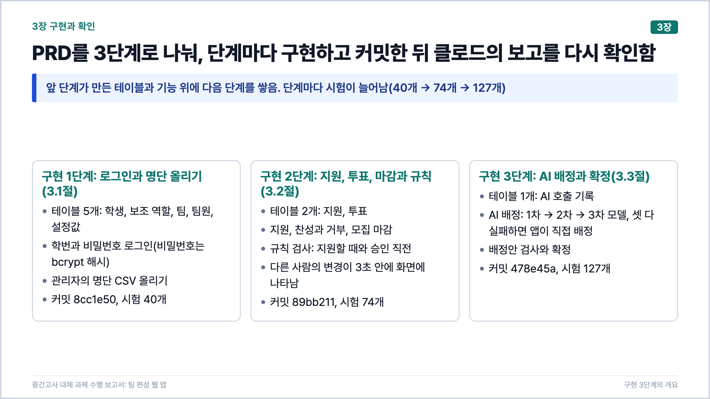

[슬라이드 3] 구현 3단계의 개요

- 3장은 PRD 3단계를 차례로 구현한 과정과, 단계마다 클로드의 보고를 다시 확인한 결과를 적음
  - 단계마다 프롬프트는 6장 노트 6.4.5.1목의 "PRD_step1.md를 실행해."와 같은 꼴로 보내고, 확인할 시나리오 단계를 덧붙였음(A2의 프롬프트 7~9)
  - [표 11]은 단계별 커밋과 시험 수임. 완성한 앱으로 연습 시나리오 3개를 끝까지 실행한 결과는 5장에 모았음

[표 11] 단계별 구현 결과

| 단계 | 커밋 | 바뀐 파일 | 시험 | 다시 확인한 것 |
|---|---|---|---|---|
| 1단계 | `8cc1e50` | 19개, 1,040줄 추가 | 40개 통과 | 커밋이 저장소에 있음과 Supabase에 테이블 5개가 생긴 것을 확인함 |
| 2단계 | `89bb211` | 9개 | 74개 통과 | `pytest` 74개 통과(74.1초), RLS 질의, 브라우저로 공고 부록 1의 1~5단계와 부록 2의 1~10단계(3.2절). 부록 3의 1~14단계는 11/2에 보충함 |
| 3단계 | `478e45a` | 14개 | 127개 통과 | 화면 3장이 대기 안내, 2차로 넘어감, 앱의 직접 배정을 보여 주는지 확인함. 전체 시험을 다시 돌림 |
| 일괄 고침(4.2절) | `91257f3`, `cd00595` | 7개, 10개 | 135개 통과 | 전체 시험을 다시 돌림 |

- 테이블은 1단계에 5개(`tf_mp_students`, `tf_mp_student_sub_roles`, `tf_mp_teams`, `tf_mp_members`, `tf_mp_settings`), 2단계에 2개(`tf_mp_applications`, `tf_mp_votes`), 3단계에 1개(`tf_mp_ai_logs`)를 더해 8개가 됨(커밋마다 `schema.sql`을 읽음)

### 3.1 1단계: 로그인과 명단 올리기

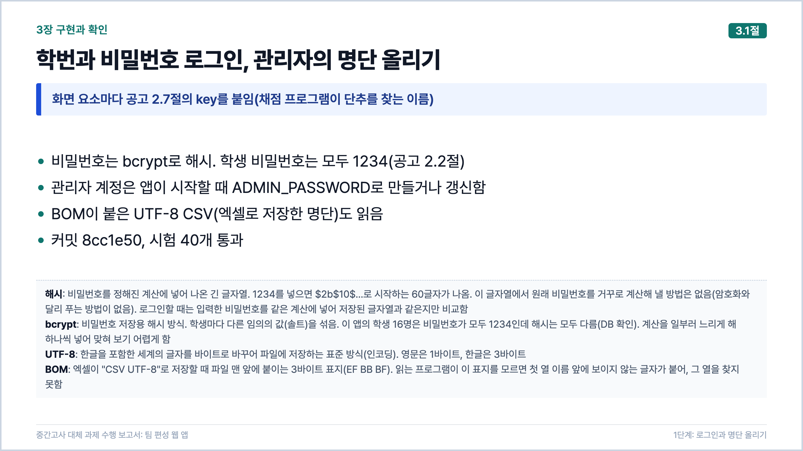

[슬라이드 3.1] 1단계: 로그인과 명단 올리기

[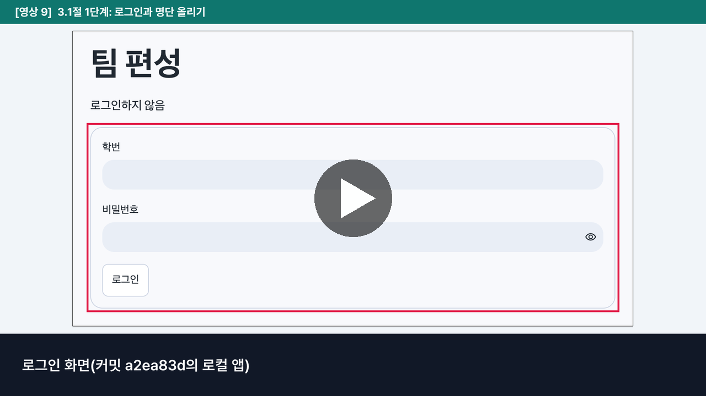](https://delightful-run-7c5.notion.site/409022e2cfe780c78c6ee12e76022ece#57f1a47b68ba4d6c91bf1418057e2370)

[영상 9] 3.1절 슬라이드의 설명 영상(136초, 신 교수의 목소리로 합성한 설명과 자막). 그림을 누르면 노션에서 영상이 재생됨

- 1단계는 DB 테이블, 학번과 비밀번호 로그인, 관리자의 명단 올리기를 만들었고, 클로드가 로컬 앱의 화면으로 확인했다고 보고했음
  - 비밀번호는 `bcrypt`로 해시해 저장함. 학생의 비밀번호는 모두 `1234`이고, 관리자 계정은 앱이 시작할 때 `ADMIN_PASSWORD`로 만들거나 갱신함(공고 2.1절)
    - 용어: 해시는 비밀번호를 정해진 계산에 넣어 나온 긴 글자열임. 예: `1234`를 넣으면 `$2b$10$`로 시작하는 60글자가 나옴. 이 60글자에서 원래 비밀번호 `1234`를 거꾸로 계산해 낼 방법은 없음. 암호화는 열쇠가 있으면 원래 글로 풀 수 있지만, 해시는 푸는 방법 자체가 없음
    - 로그인할 때는 입력한 비밀번호를 같은 계산에 다시 넣어, 나온 글자열이 DB에 저장된 것과 같은지만 비교함. 다만 `1234`처럼 쉬운 비밀번호는 후보를 하나씩 같은 계산에 넣어 보면 맞힐 수 있음. 그래서 bcrypt는 계산을 일부러 느리게 함(아래 줄)
    - 용어: bcrypt는 비밀번호 저장용으로 만든 해시 방식임. 학생마다 다른 임의의 값(솔트)을 섞어 같은 비밀번호도 다른 해시가 되게 하고, 계산을 일부러 느리게 해 비밀번호를 하나씩 넣어 맞혀 보기 어렵게 함
    - 확인: 앱은 `bcrypt.hashpw`로 저장하고 `bcrypt.checkpw`로 비교함(`mp/service.py` 37행, 45행). 틀린 비밀번호가 막히는 시험이 있음(`tests/test_service_db.py` 106행). DB의 학생 16명의 해시는 모두 `$2b$10$`로 시작하는 60글자였고, 비밀번호가 모두 `1234`인데 해시는 16개가 모두 달랐음(11/2 20:22 무렵, 값은 내지 않고 개수만 세는 읽기 질의)
  - 명단 CSV는 BOM이 붙은 UTF-8도 읽음(공고 2.6절). 연습용 CSV 3개는 모두 BOM이 붙어 있음(파일 첫 3바이트 `efbbbf`로 확인함)
    - 용어: UTF-8은 한글을 포함한 세계의 글자를 바이트로 바꾸어 파일에 저장하는 표준 방식(인코딩)임. 영문은 1바이트, 한글은 3바이트로 저장함
    - 용어: BOM(Byte Order Mark)은 엑셀이 "CSV UTF-8"로 저장할 때 파일 맨 앞에 붙이는 3바이트 표지(`EF BB BF`)임. 읽는 프로그램이 이 표지를 모르면 첫 열 이름 앞에 보이지 않는 글자가 붙어, 그 열을 찾지 못함
  - 화면 요소마다 공고 2.7절의 `key`를 붙였음([그림 5]). 예: 학번 칸 `login_student_no`, 결과 안내 `result`
- 클로드가 화면으로 확인했다고 보고한 것: 관리자로 `쉬움.csv`와 팀 수 3을 넣어 처음 상태를 만들고, 학생 2026101이 `1234`로 로그인되고, 틀린 비밀번호는 막히는 것(클로드의 보고)
  - 작성자는 3.2절의 브라우저 확인(10/30 22:25 무렵)에서 가상 학생과 관리자로 로그인되는 것을 확인했음. 틀린 비밀번호가 막히는지는 다시 확인하지 않았고, 이를 검사하는 시험이 있음(`tests/test_app.py`의 `test_wrong_password_is_blocked`, 클로드의 보고)
- 이 단계에서 같은 DB에 다른 앱의 `tf_` 테이블이 있는 것이 문제가 되지 않았음. 처음 상태를 만드는 함수는 `tf_mp_votes`, `tf_mp_applications`, `tf_mp_members`, `tf_mp_teams`, `tf_mp_students`(관리자 제외)의 행과 `tf_mp_settings`의 키 3개(phase, proposal, assign_status) 행만 지움. `tf_mp_student_sub_roles`는 학생 행을 지울 때 함께 지워짐(`mp/service.py` 137~139행의 `delete` 문과 `schema.sql` 22행을 읽어 확인함)

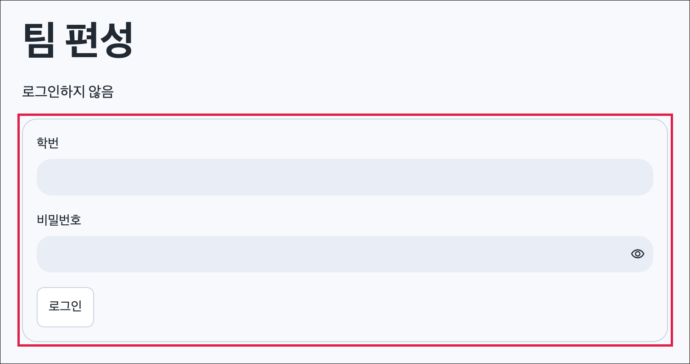

[그림 5] 로그인 화면(11/1, 커밋 `a2ea83d`의 로컬 앱). 빨간 상자는 학번 칸, 비밀번호 칸과 로그인 단추임. 보고서의 그림을 11/1에 다시 찍을 때, 로그인 화면이 1단계와 같은 이 판으로 찍었음

### 3.2 2단계: 지원, 투표, 마감과 규칙 검사

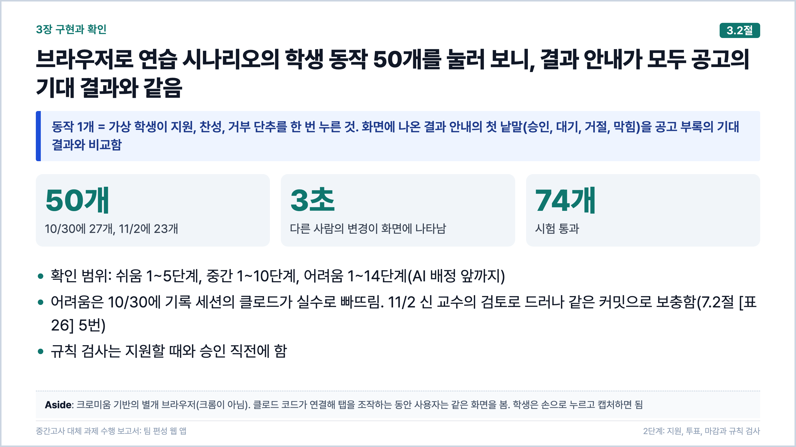

[슬라이드 3.2] 2단계: 지원, 투표, 마감과 규칙 검사

[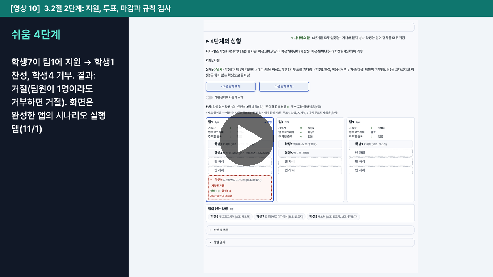](https://delightful-run-7c5.notion.site/409022e2cfe780c78c6ee12e76022ece#4169943f80794680b3fe818a9cc3b51e)

[영상 10] 3.2절 슬라이드의 설명 영상(170초, 신 교수의 목소리로 합성한 설명과 자막). 그림을 누르면 노션에서 영상이 재생됨

- 2단계는 지원, 투표, 모집 마감과 팀 규칙, 3초마다 바뀐 부분만 다시 그리는 화면(`st.fragment`[7])을 구현했음. 브라우저로 연습 시나리오의 학생 동작 50개를 눌러 보니, 화면에 나온 결과 안내가 모두 공고의 기대 결과와 같았음(10/30에 27개, 그때 빠뜨린 어려움 23개는 11/2에 보충)
  - 규칙 검사는 지원할 때와 승인 직전에 함. 승인 직전 재검사는 투표가 끝난 순서대로 처리함(공고 2.4절, 3장 표)
  - 필수 포함 역할 자리 계산은 "지원자가 들어간 뒤 남는 자리 수가 아직 채우지 못한 필수 역할 수보다 적으면 막음"으로 구현함(공고 3장 표 아래). 예는 5.2.3항 11단계(학생14가 팀3에 지원해 막힘)임
- 확인 방법: 로컬 앱을 따로 띄우고(포트 8710), 기록 세션이 Aside로 가상 학생과 관리자로 번갈아 로그인하며 단추를 눌렀음(10/30 22:25 무렵)
  - Aside는 크로미움 기반의 별개 브라우저(크롬이 아님)로, 사람과 AI 에이전트가 함께 쓰게 만든 것임(<https://aside.com>). 클로드 코드가 MCP(AI 앱이 다른 프로그램과 도구를 쓰도록 연결하는 표준 규격)로 연결해 탭을 조작하는 동안 사용자는 같은 화면을 봄
  - 단추는 공고 2.7절의 `key`로 찾았음. Streamlit은 `key`를 붙인 요소에 `st-key-<key>` 꼴의 이름표(CSS 클래스)를 붙이므로, 예를 들어 학번 칸은 `.st-key-login_student_no`로 찾음(녹화 도구 `동영상/recorder.js` 14행이 같은 방식임). 채점 프로그램도 `key`로 단추를 찾음(공고 2.7절)
  - 동작 1개는 가상 학생이 지원, 찬성, 거부 단추를 한 번 누른 것임. 예: 쉬움 2단계는 "학생4로 로그인해 팀1에 지원"(결과: 대기), "학생1로 로그인해 학생4에 찬성"(결과: 승인)의 2개. 관리자의 마감은 세지 않음
  - 학생은 손으로 누르고 화면을 캡처하면 됨(1.3절 [표 5])
  - 공고 부록 1(쉬움) 1~5단계의 동작 12개와 부록 2(중간) 1~10단계의 동작 15개가 모두 기대 결과와 같았음. 시나리오마다의 단계별 결과는 5장에 모았음(5.1절 [표 15]의 첫째 방법)
  - 부록 3(어려움)은 10/30에 빠졌음. 확인 범위를 적은 프롬프트 8(A2)을 기록 세션(클로드)이 쓰며 AI 배정 앞까지의 단계를 고르다가 실수로 부록 3을 넣지 않았고, 프롬프트 9에서 "직접 해 봤다"며 3단계로 넘어갔음. 부록 3의 1~14단계도 구현 2단계의 기능이라 넣었어야 했음. 11/2 신 교수가 보고서를 검토하며 짚어 드러났고, 보충 확인했음(7.2절 [표 26] 5번)
  - 11/2에 같은 커밋 `89bb211`을 이 맥의 시험용 DB로 띄워(배포한 앱의 DB와 관리자 비밀번호에 닿지 않게 함) 부록 3 1~13단계의 동작 23개를 같은 방법으로 눌렀고, 모두 기대 결과와 같았음. 8단계는 "거절: 승인 직전 검사: 같은 주 역할의 팀원이 있음", 11단계는 "막힘: 필수 포함 역할(기획자, 웹 프로그래머)을 맡을 학생의 자리가 모자람"이 나왔고, 14단계 마감으로 학생13의 대기 지원이 거절되고 학생10이 팀에서 빠졌음(화면 27장, `증빙/앱 화면/03_2단계_어려움_보충_1102/`)
  - 다른 학생의 지원이 새로 고치지 않아도 화면에 나타나는 것을 확인함(다른 사람의 변경 보기, 공고 3장 표)
  - 중간 시나리오 6단계에서 학생6이 찬성한 뒤 학생6의 화면에 "내 투표: 찬성"이 나왔음(공고 2.8절)
  - 동작마다 화면을 캡처했음(30장, 작성자의 증빙 화면, 공개하지 않음)

### 3.3 3단계: AI 배정과 실패 처리

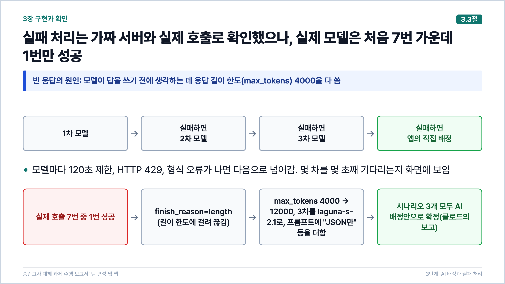

[슬라이드 3.3] 3단계: AI 배정과 실패 처리

[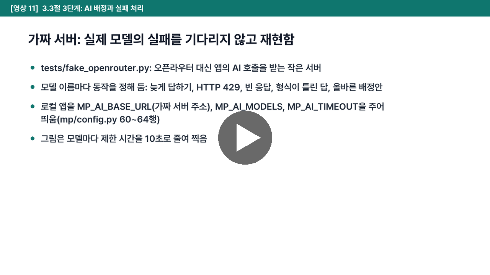](https://delightful-run-7c5.notion.site/409022e2cfe780c78c6ee12e76022ece#0ea39d11ce094477819266631e5d71c1)

[영상 11] 3.3절 슬라이드의 설명 영상(149초, 신 교수의 목소리로 합성한 설명과 자막). 그림을 누르면 노션에서 영상이 재생됨

- 3단계는 AI 배정, 배정안 검사 5가지, 실패 처리, 확정을 만들었음. 실패 처리는 가짜 서버로 재현해 동작을 확인했으나, 실제 무료 모델은 처음 7번 가운데 1번만 성공했고 원인을 기록으로 찾아 고쳤음
  - AI 호출의 결과는 성공과 실패 6가지임(`mp/ai.py` 14~20행). 빈 응답은 답 글이 비어 있음, 형식 오류는 답을 JSON으로 읽을 수 없음, 검사 실패는 JSON은 읽었으나 배정안 검사 5가지 가운데 하나를 어김, 시간 초과는 120초 안에 답이 오지 않음, HTTP 오류는 오픈라우터가 오류 코드(예: 429)를 돌려줌, 연결 오류는 오픈라우터에 닿지 못함. [표 12]에는 이 가운데 5가지가 나옴
    - 배정안 검사 5가지(공고 2.5절 4항, `mp/rules.py` 106~140행): 1번 팀이 없는 학생을 빠짐없이 배정함, 2번 한 학생을 한 번만, 있는 팀에만 배정함, 3번 팀마다 2~4명, 4번 팀 안에 주 역할 중복 없음, 5번 팀마다 필수 포함 역할(기획자, 웹 프로그래머)을 채움
- 실패 처리 3가지는 실제 무료 모델이 실패하기를 기다리지 않고 가짜 서버로 재현했음([그림 6]~[그림 8])
  - 가짜 서버를 쓴 까닭: 실제 무료 모델은 실패를 원하는 때에 원하는 꼴로 낼 수 없고, 시험할 때마다 하루 호출 수(50회)를 씀
    - 쓰는 방법 1: 이 맥에서 `python tests/fake_openrouter.py 8899`로 가짜 서버를 띄움. 배정안 JSON 파일을 함께 주면 `fake/ok-model:free`가 그 배정안으로 답함
    - 쓰는 방법 2: 로컬 앱을 환경 변수 `MP_AI_BASE_URL`(가짜 서버의 주소), `MP_AI_MODELS`(1차~3차 모델 이름), `MP_AI_TIMEOUT`(모델마다 제한 시간)을 주어 띄움. 앱은 이 값이 있으면 오픈라우터 대신 그 주소로 요청을 보냄(`mp/config.py` 60~64행)
    - 모델 이름마다의 동작: `fake/slow-model:free`는 답하지 않아 시간 초과가 남, `fake/rate-limited-model:free`는 HTTP 429, `fake/garbage-model:free`는 배정안이 아닌 글(형식 오류)(`tests/fake_openrouter.py` 80~85행)
    - 배포한 앱에는 이 환경 변수를 두지 않으므로 실제 오픈라우터를 부름
  - 그림은 11/1 13:54의 커밋 `a2ea83d`로 띄운 앱의 기본 화면("팀 편성" 탭)에서, 가짜 오픈라우터 서버의 제한 시간을 모델마다 10초로 두고 찍었음(작성자의 실행 기록, 공개하지 않음)
  - 모델마다 120초 전체 대기 제한: 시험에서는 제한을 3초와 10초로 줄여 확인했고, 제한을 실제 값 120초로 두고 한 번 돌렸을 때 120.0초에 끊고 2차로 넘어갔음(클로드의 보고). 10/30의 실제 호출 기록에도 120.0초 시간 초과가 있음([표 12])
  - 몇 차 모델을 기다리는지 안내: "1차 모델(…) 응답을 기다리는 중: 5초 / 10초"처럼 1초마다 바뀜([그림 6])
  - 1차가 제한 시간을 넘기면 2차로 넘어가고, 2차의 배정안이 검사를 통과하면 그 배정안을 보여 줌([그림 7])
  - 3차까지 실패하면 앱이 직접 배정함. [그림 8]은 1차 시간 초과, 2차 HTTP 429, 3차 형식 오류를 차례로 재현한 화면임
  - 이 화면들은 가짜 서버로 재현한 것이므로, README 5장(AI 호출 실패 사례)에는 실제 호출의 기록을 따로 씀
  - 실제 호출에서도 3차까지 실패해 앱이 직접 배정한 일이 4번 있었음. 10/30에는 중간(22:41~22:42)과 어려움(22:44~22:46)에서 2차와 3차가 빈 응답을 내 앱이 직접 배정했음([표 12]). 10/31 19:02에는 1차 빈 응답, 2차 120초 시간 초과, 3차 검사 실패 뒤 앱이 직접 배정했음(기록 id 411~413, README 5장 사례 C). 11/4 시연 녹화에서는 1차와 2차가 120초에 끊기고 3차가 HTTP 404(오픈라우터에서 없어진 모델)로 실패해 앱이 직접 배정했음(5.3.3항, [영상 22])

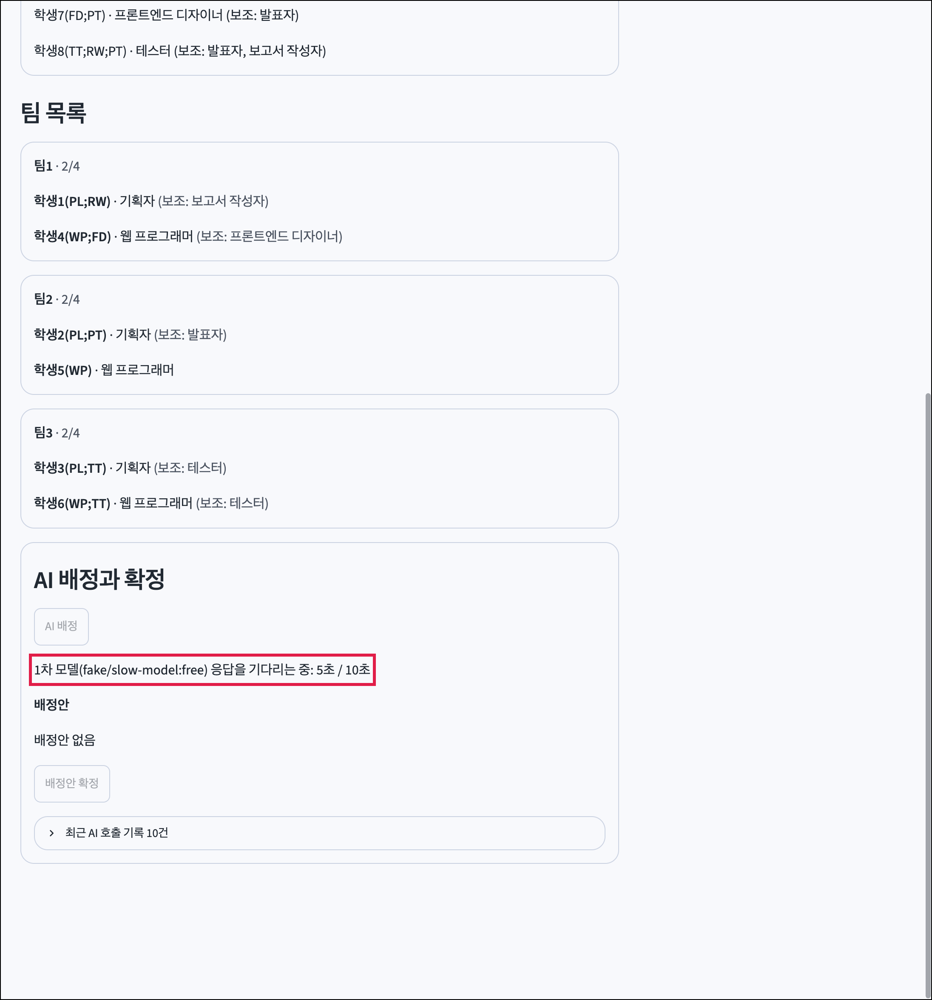

[그림 6] AI 대기 중 안내. 빨간 상자는 몇 차 모델의 응답을 몇 초째 기다리는지 보이는 안내임. 기다리는 동안 "배정안 확정" 단추는 눌리지 않음(5.2절). 가짜 오픈라우터 서버로 찍음(모델마다 제한 10초)

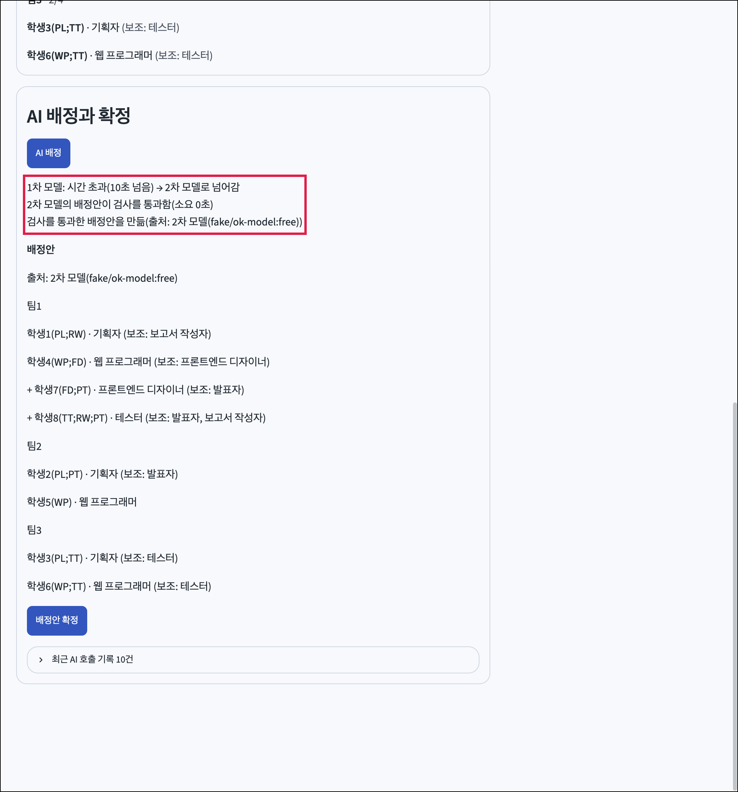

[그림 7] 1차 모델의 시간 초과와 2차 모델의 배정. 빨간 상자는 1차가 제한 시간 10초를 넘겨 2차로 넘어가고, 2차의 배정안이 검사를 통과했다는 진행 안내임. 가짜 오픈라우터 서버로 찍음

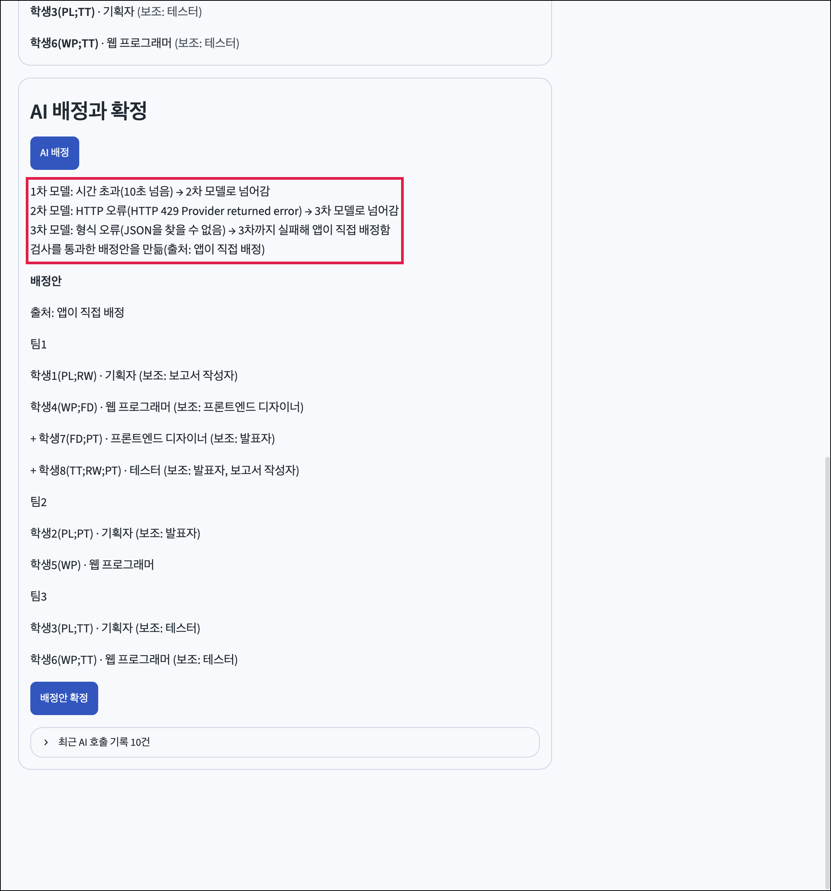

[그림 8] 3차 모델까지 실패해 앱이 직접 배정함. 빨간 상자는 1차 시간 초과, 2차 HTTP 429, 3차 형식 오류 뒤 앱이 직접 배정했다는 진행 안내임. 가짜 오픈라우터 서버로 찍음

- 실제 무료 모델로 연습 시나리오 3개를 돌리자 7번 가운데 1번만 성공했고, 2차와 3차는 4번 모두 빈 응답이었음([표 12])
  - 클로드는 "앱이 직접 배정으로 막아 주므로 결과는 규칙을 지켰다"고 보고하고 설정을 그대로 두는 선택지도 냈음
  - 클로드는 처음에 "2차와 3차가 5번 모두 빈 응답"이라고 보고했으나, 호출 기록에는 4번임([표 12]). 클로드가 README를 쓰며 기록과 대조해 스스로 바로잡았음. 작성자는 이 숫자를 기록과 대조하지 않고 작업 기록과 보고서 초안에 옮겨 적었다가 뒤늦게 고쳤음
  - 그대로 두지 않기로 판단했음. 채점 때 AI가 거의 쓰이지 않으면 AI 배정 기능을 만든 의미가 없고, 원인을 모르는 실패는 채점 날에도 되풀이되기 때문임
  - A2의 프롬프트 10에서 호출 기록에 `finish_reason`, 토큰 수, 응답 앞부분을 남기게 하고, 2차와 3차를 `max_tokens` 12000으로 늘려 다시 부르게 했음

[표 12] 실제 무료 모델 호출 기록(`tf_mp_ai_logs`, 10/30)

| 시각(KST) | 시나리오 | 모델 | max_tokens | 결과 | 소요 | 원인 |
|---|---|---|---|---|---|---|
| 22:39 | 쉬움 | 1차 nemotron-3-ultra | 4000 | 성공 | 38.6초 | |
| 22:41 | 중간 | 1차 nemotron-3-ultra | 4000 | 형식 오류 | 93.3초 | |
| 22:41 | 중간 | 2차 north-mini-code | 4000 | 빈 응답 | 50.9초 | finish_reason=length |
| 22:42 | 중간 | 3차 nemotron-3.5-lightning | 4000 | 빈 응답 | 40.2초 | finish_reason=length |
| 22:44 | 어려움 | 1차 nemotron-3-ultra | 4000 | 시간 초과 | 120.0초 | |
| 22:45 | 어려움 | 2차 north-mini-code | 4000 | 빈 응답 | 41.5초 | finish_reason=length |
| 22:46 | 어려움 | 3차 nemotron-3.5-lightning | 4000 | 빈 응답 | 70.1초 | finish_reason=length |
| 23:00 | 실험 | north-mini-code | 12000 | 검사 실패 | 57.6초 | 이미 팀이 있는 학생을 넣음(추론 8,145토큰) |
| 23:02 | 실험 | nemotron-3.5-lightning | 12000 | 시간 초과 | 120.0초 | |
| 23:04 | 실험 | laguna-s-2.1 | 12000 | 성공 | 115.0초 | 추론 6,325토큰 |
| 23:05 | 실험 | laguna-s-2.1 | 4000 | HTTP 429 | 0.5초 | |

- 빈 응답의 원인은 모델이 답을 쓰기 전에 생각하는 데(추론) `max_tokens` 4000을 다 쓴 것이었음
  - 근거: 빈 응답 4번이 모두 `finish_reason=length`(길이 한도에 걸려 끊김)[6]였고, 12000으로 늘리자 추론에만 6,000~8,000토큰을 썼음
  - 공고 4.3절도 "추론 모델은 `max_tokens`를 생각하는 데 다 써서 빈 응답을 낼 수 있음"이라고 미리 알렸음. 처음 PRD를 쓸 때 `max_tokens`를 4000으로 둔 것은 이 경고를 충분히 반영하지 못한 것임
- 대응은 클로드가 낸 안 가운데 작성자가 골라 지시했음(A2의 프롬프트 12): `max_tokens`를 12000으로, 3차를 시간 초과가 난 lightning에서 성공한 laguna-s-2.1로, 프롬프트에 "이미 팀이 있는 학생은 배정하지 말 것"과 "JSON만 답할 것"을 넣음
  - AI에게 보내는 요청: 지금의 팀 구성(`teams`)과 팀이 없는 학생(`students_without_team`)을 JSON으로 주고, 규칙 4가지, 고르는 순서 2가지(11/1부터, 7.4절), 답의 형식을 적음(`mp/ai.py`의 `build_messages`)
  - 받는 답의 형식: `{"assignments": [{"student_no": "2026107", "team_no": 1}, ...]}`. 앱은 이 답을 읽어 배정안 검사 5가지를 돌림
  - 보강한 문장: "teams의 members에 이미 있는 학생은 옮기지 않으며, 답의 assignments에 넣지 않습니다", "답은 JSON만 쓰십시오. 설명, 풀이 과정, 코드 블록 표시(`` ``` ``)를 쓰지 않습니다"(커밋 `cd00595`)
- 고친 뒤 시나리오 3개를 한 번씩 다시 돌린 결과, 세 시나리오 모두 AI가 낸 배정안이 검사를 통과해 확정되었음(10/30 23:45 무렵, 호출 5번, 클로드의 보고)
  - 쉬움: 1차가 32.5초에 성공함(추론 1,091토큰)
  - 중간, 어려움: 1차가 120.0초에 끊기고 2차가 42.1초, 32.4초에 성공함(추론 3,917토큰, 6,163토큰). 2차의 추론 토큰은 옛 한도 4000을 넘은 경우가 있어, 옛 설정이었다면 빈 응답이 되었을 것임
  - 빈 응답과 "이미 팀이 있는 학생" 검사 실패는 다시 나오지 않았음
  - 남은 문제: 1차 모델이 3번 가운데 2번 120초에 끊겨, 배정 1번에 2분 반이 걸렸음. 이 문제는 4.2절 끝에서 다룸
- 3단계 구현 직후(10/30 22:50~22:59)에 작성자의 실수가 1건 있었음
  - 사실: 작성자가 전체 시험을 2번 다시 돌렸는데, 1번째(127개, 22:50~22:53)는 1개 실패, 2번째(132개)는 1개 실패와 1개 오류가 났음. 2번째의 실패는 교착 상태(`DeadlockDetected`: 두 작업이 서로 상대가 잠근 데이터를 기다리다 둘 다 멈춘 상태)와 "명단이 새로 올라와 계정이 사라짐"이었음
  - 알아챈 방법: 실패한 시험만 따로 돌리자 1번째의 실패는 통과했으나 2번째의 실패는 다시 교착 상태로 실패했음. 그때 클로드가 22:58부터 같은 DB로 `pytest`를 돌리고 있었음(프로세스 목록). 1번째 실패의 원인은 확인하지 않았음
  - 원인: 시험 코드가 시작할 때 `tf_mp_` 테이블을 비우므로, 시험 2개가 동시에 돌면 서로의 데이터를 지움. 앱의 결함은 아님
  - 조치: DB를 쓰는 시험은 클로드만 돌리고, 작성자는 클로드가 시험을 멈췄을 때만 돌리기로 함
  - 결과: 그 뒤 클로드가 멈춘 때에 작성자가 다시 돌려 135개가 통과했음(10/31 00:01, 4.2절)

## 4. 배포와 배포 뒤에 고친 것

- 4장은 배포, 시험에서 찾은 문제를 한 번에 고친 것, 보안 점검과 그 뒤에 앱의 DB 권한을 이 앱의 테이블로 제한한 것, DB 일시정지 막기와 무료 모델의 하루 호출 수를 적음
  - 배포한 앱은 누구나 열 수 있고, 앱의 DB 접속은 `tf_mp_` 테이블 8개만 다루는 앱 전용 DB 계정(Postgres는 계정을 역할이라 부름, 4.3절)으로 바꿨음
  - 시간 순서: 4.2절의 고침(10/30 23:09~10/31 00:17)과 4.3절의 진단(10/31 00:01~00:20)은 배포(10/31 09:31) 전날 밤의 일이고, 4.3절의 권한 제한(10/31 15:28)은 배포 뒤의 일임. 4.4절의 예약 작업은 10/30에 1단계 구현과 함께 만들었고, 비밀 값 등록과 실행 확인은 배포 뒤에 했음

### 4.1 비공개 저장소와 Streamlit 배포

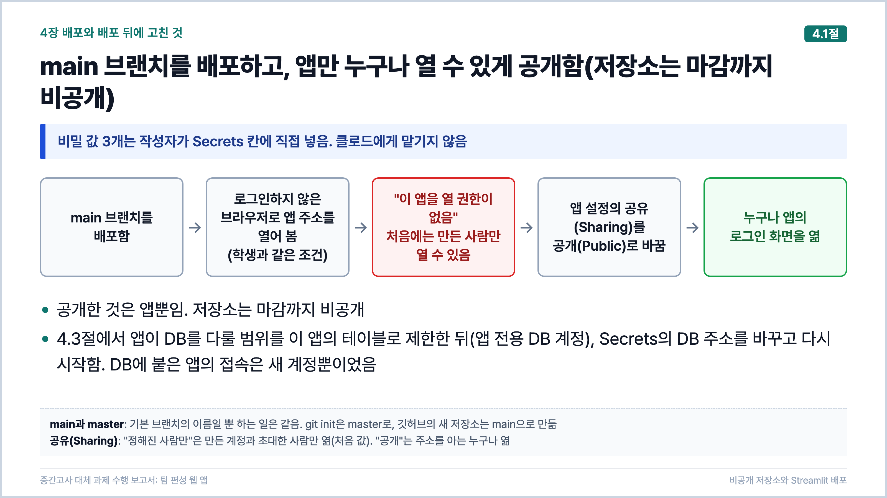

[슬라이드 4.1] 비공개 저장소와 Streamlit 배포

[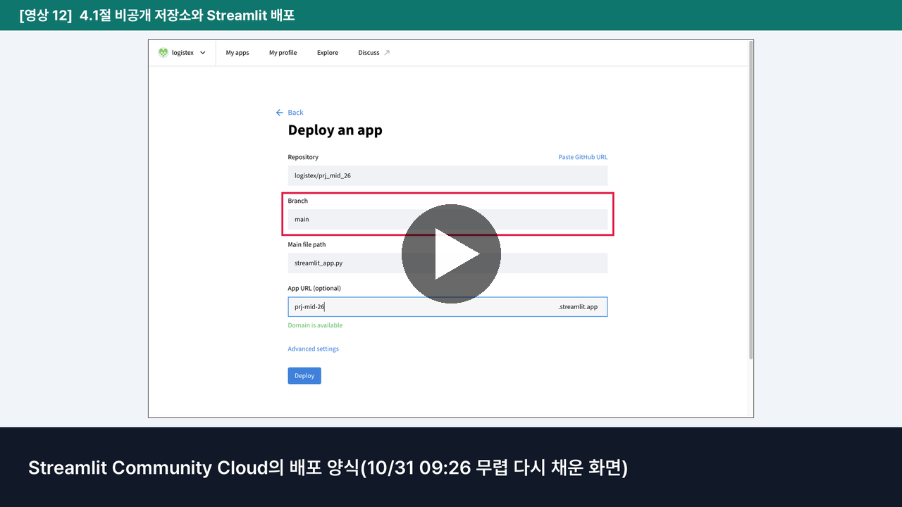](https://delightful-run-7c5.notion.site/409022e2cfe780c78c6ee12e76022ece#829260ed95eb40cf92e0e54d4555c67d)

[영상 12] 4.1절 슬라이드의 설명 영상(138초, 신 교수의 목소리로 합성한 설명과 자막). 그림을 누르면 노션에서 영상이 재생됨

- 비공개 저장소 `logistex/prj_mid_26`의 `main` 브랜치를 Streamlit Community Cloud에 배포했고(10/31 09:31), 로그인하지 않은 브라우저에서 로그인 화면이 열리는 것을 확인했음(10/31 15:09)
  - 배포 양식에는 저장소, 브랜치 `main`, 파일 `streamlit_app.py`, 주소 `prj-mid-26`을 넣었음([그림 9]). 공고 6.3절 감점 항목 5번(기본 브랜치가 아닌 코드로 배포)에 해당하지 않음
  - 비밀 값 3개(`OPENROUTER_API_KEY`, `DATABASE_URL`, `ADMIN_PASSWORD`)는 양식의 Advanced settings에 있는 Secrets 칸[9]에 직접 넣었음. 클로드에게는 웹 양식에 비밀 값을 넣게 하지 않았고, 넣을 3줄은 `.env`에서 화면에 내지 않고 클립보드로 복사하는 명령으로 옮겼음
    - 명령(맥): `grep -E '^(OPENROUTER_API_KEY|DATABASE_URL|ADMIN_PASSWORD)=' .env | sed -E 's/^([A-Z_]+)="?([^"]*)"?$/\1 = "\2"/' | pbcopy`
    - 뜻: `.env`의 3줄을 골라 Secrets 칸의 꼴(`이름 = "값"`)로 바꾼 뒤, 화면에 내지 않고 클립보드에 넣음. 이어서 Secrets 칸에 붙여 넣음
  - Deploy를 누른 뒤 약 15초에 로그인 화면이 나왔고, "설정 값이 없음"이나 DB 오류는 나오지 않았음(작성자의 증빙 화면, 공개하지 않음)
  - 배포한 앱에 관리자로 로그인해 이름 옆에 "관리자" 표시가 뜨는 것을 확인했음(10/31 09:36). 배포한 앱의 관리자 로그인은 클로드의 도구를 쓰지 않고 직접 했음
- 배포한 직후에는 다른 사람이 앱 주소를 열면 "이 앱을 열 권한이 없음(You do not have access to this app)"이 나와, 앱을 쓸 수 없었음
  - 사실: 비공개 저장소로 배포한 앱은 처음에 공유 설정(Sharing)이 "정해진 사람만(Only specific people)"임. 그래서 앱을 만든 계정 말고는 열 수 없었음
  - 알아챈 방법: 학생이나 채점 프로그램과 같은 조건이 되도록, Streamlit에 로그인하지 않은 브라우저(앱 내장 브라우저)로 배포 주소를 열어 봄(10/31 15:06 직전). 만든 사람의 브라우저는 로그인되어 있어 이 문제가 보이지 않음
  - 조치: 공고 4.4절은 앱을 누구나 열 수 있게 하라고 함. 앱 설정의 공유(Sharing)를 "공개(This app is public and searchable)"로 바꿈. 공개한 것은 앱뿐이고, 저장소는 마감까지 비공개로 둠
  - 결과: 같은 브라우저에서 로그인 화면이 열림. 공고 6.3절 감점 항목 2번(배포 주소가 열리지 않음)에 해당하지 않게 됨. 앱 목록에 공개 표지가 붙은 화면도 남겼음(작성자의 증빙 화면, 공개하지 않음)
- 배포한 뒤 앱이 DB를 다룰 수 있는 범위를 이 앱의 테이블 8개로 제한했으므로(4.3절, 앱 전용 DB 계정), Secrets의 DB 주소(`DATABASE_URL`)를 새 계정의 주소로 바꾸고 앱을 다시 시작했음(10/31 15:40)
  - 다시 시작한 뒤 DB의 접속 목록(`pg_stat_activity`)에 앱 쪽 접속이 새 앱 전용 DB 계정 `tf_mp_app`으로만 있고 옛 `postgres` 계정의 접속은 없음을 확인했음(15:40:56의 접속)

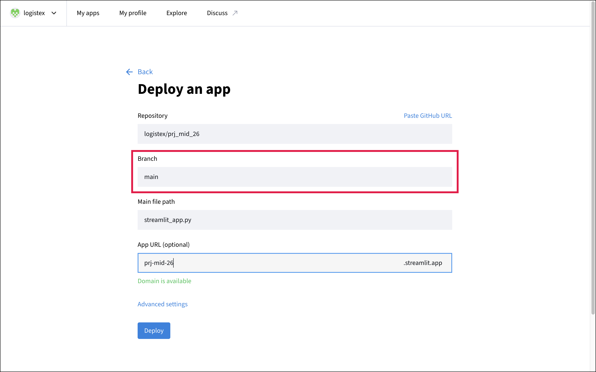

[그림 9] Streamlit Community Cloud의 배포 양식. 빨간 상자는 브랜치(Branch) 칸의 `main`임(공고 6.3절 감점 항목 5번). 10/31 09:26 무렵 다시 채운 화면이고, Secrets는 직접 넣음

### 4.2 시험과 노트의 사례로 찾은 문제 3가지를 한 번에 고침

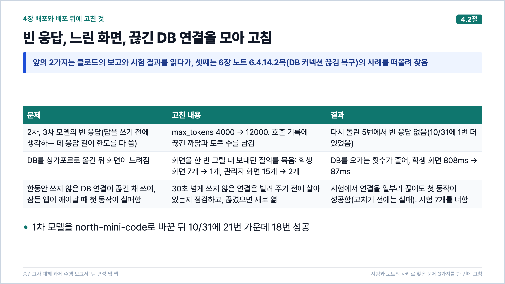

[슬라이드 4.2] 시험과 노트의 사례로 찾은 문제 3가지를 한 번에 고침

[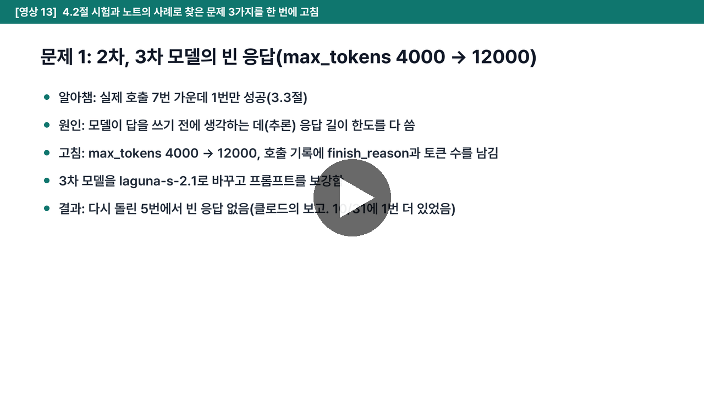](https://delightful-run-7c5.notion.site/409022e2cfe780c78c6ee12e76022ece#c13cf2c6e8b043acad6f7725c9934956)

[영상 13] 4.2절 슬라이드의 설명 영상(253초, 신 교수의 목소리로 합성한 설명과 자막). 그림을 누르면 노션에서 영상이 재생됨

- 2차와 3차 모델의 빈 응답, DB를 옮긴 뒤 느려진 화면, 오래 쓰지 않은 DB 연결이 끊긴 채 쓰이는 문제의 3가지를 모아 한 번에 고쳤음(6장 노트 6.4.9항의 일괄 개선)
  - [표 13]은 문제, 알아챈 방법, 고친 내용과 결과임
  - 앞의 2가지는 클로드의 보고와 시험 결과를 읽다가, 셋째는 6장 노트의 사례를 떠올려 찾았음. 모두 클로드에게 원인을 파악하게 한 뒤 고치게 했음(A2의 프롬프트 10, 12, 13)

[표 13] 일괄 개선의 내용(커밋 `91257f3`, `cd00595`, `c678a56`)

| 문제 | 알아챈 방법 | 고친 내용 | 결과 |
|---|---|---|---|
| 2차, 3차 모델의 빈 응답 | 실제 호출 7번 가운데 1번만 성공(3.3절) | 호출 기록에 `finish_reason`과 토큰 수를 남김, `max_tokens` 4000 → 12000, 3차를 laguna-s-2.1로, 프롬프트 보강 | 다시 돌린 5번에서 빈 응답 없음. 세 시나리오 모두 AI 배정안으로 확정 |
| DB를 싱가포르로 옮긴 뒤 화면이 느려짐(화면 1번에 DB 질의 7~15번) | DB를 싱가포르 프로젝트로 옮긴 뒤 시험 시간이 약 170초에서 852초로 늘었음 | 화면 1번에 필요한 읽기를 질의 1개로 묶고, 읽기 전용 연결 풀을 따로 둠 | 학생 화면 질의 7번 → 1번(808ms → 87ms), 관리자 화면 15번 → 2번(1959ms → 171ms). 시험 시간 852초 → 515초 |
| 잠든 앱이 깨어날 때 첫 동작이 실패할 수 있음 | 6장 노트 6.4.14.2목(DB 커넥션 끊김 복구)의 사례를 떠올려 재현을 지시함 | 30초 넘게 쓰지 않은 연결은 빌려 주기 전에 점검하고, 끊겼으면 새로 만듦 | 고치기 전에는 시험에서 연결을 일부러 끊으면 첫 사용이 실패했음. 고친 뒤에는 끊어도 성공하며, 이를 확인하는 시험 7개를 더해 통과 |

- 표의 낱말: 연결 풀은 DB 접속을 미리 몇 개 열어 두고 화면마다 빌려 쓰는 방식임. 점검은 30초 넘게 쓰지 않은 연결을 빌려 주기 전에 짧은 질의 1개로 살아 있는지 확인하고, 죽었으면 버리고 새로 여는 것임(`mp/db.py` 2~5행, 12~28행)
- [표 13]의 결과 칸에 적은 질의 수, 화면 시간, 재현 결과는 클로드의 보고임. 전체 시험 135개 통과(4개 건너뜀)는 직접 다시 돌려 확인함(511.7초, 10/31 00:01)
- 화면 시간은 이 맥(한국)에서 싱가포르 DB로 잰 값임. 배포한 앱은 미국 오리건의 Streamlit 서버에서 돌므로(`docs/PRD_step3.md` 354행), 배포한 앱에서 다시 재야 함(7.3절)
- 1차 nemotron-3-ultra가 자주 120초 동안 답하지 않아 배정 1번에 2분 반이 걸렸으므로, 10/30의 호출에서 시간 초과가 없던 north-mini-code를 1차로 올리고 nemotron-3-ultra를 2차로 내렸음(A2의 프롬프트 13, 커밋 `c678a56`, 10/31 00:17)
  - 바꾼 뒤 10/31의 실제 호출에서 1차는 21번 가운데 18번 성공했음(5.0~112.1초). 실패 3번(검사 실패, 시간 초과, 빈 응답 각 1번)은 2차 이후로 넘어가 배정이 끝났음(`tf_mp_ai_logs` id 132~135, 340~343, 371~374, 402~414)
  - 바꾸기 전에는 1차가 3번 가운데 2번 120초에 끊겼음(3.3절). 바꾼 뒤 배정 21번 가운데 2분을 넘은 것은 3번(153초, 178초, 207초)임

### 4.3 보안 점검

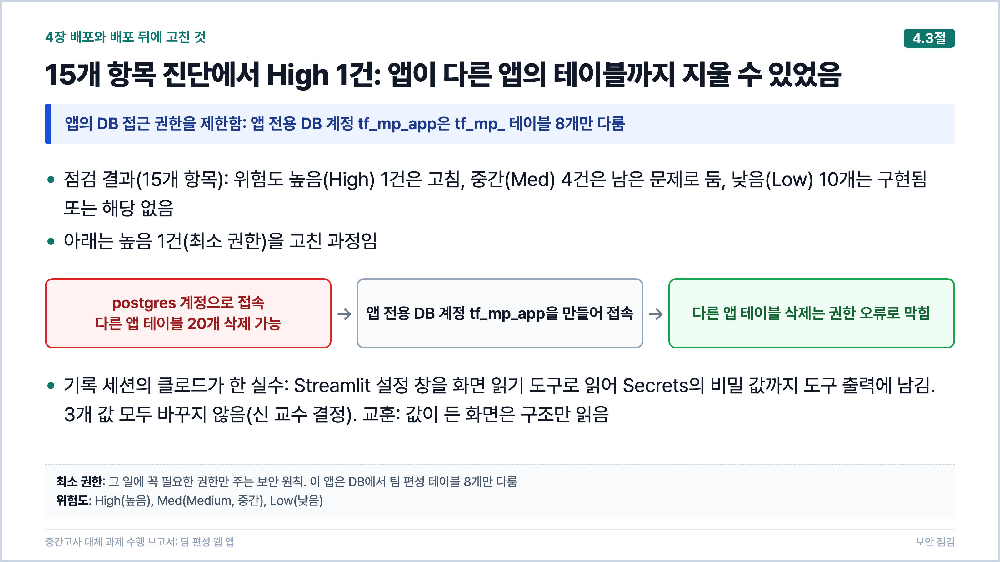

[슬라이드 4.3] 보안 점검

[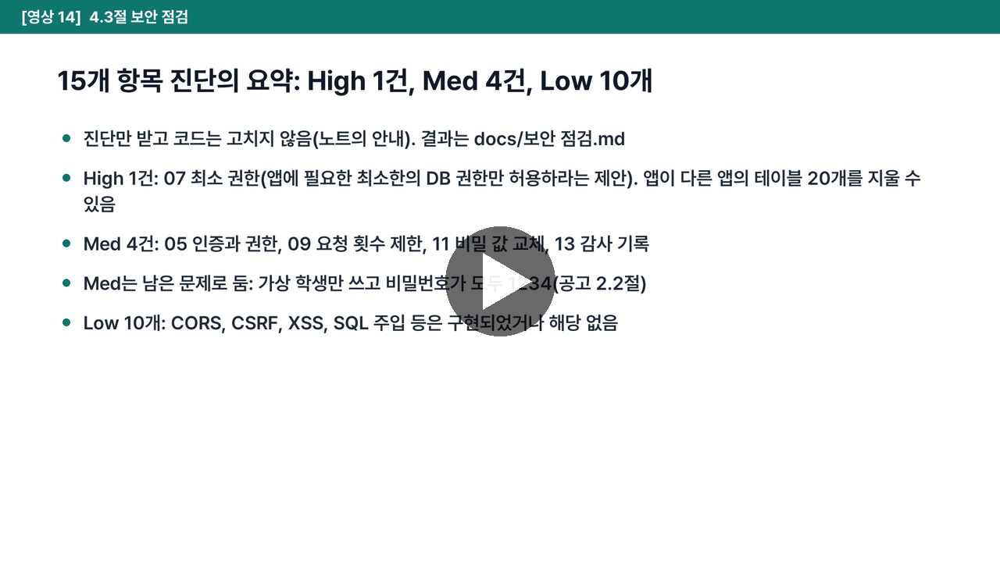](https://delightful-run-7c5.notion.site/409022e2cfe780c78c6ee12e76022ece#ce6936b62be74eb091669840dce09b62)

[영상 14] 4.3절 슬라이드의 설명 영상(323초, 신 교수의 목소리로 합성한 설명과 자막). 그림을 누르면 노션에서 영상이 재생됨

- 6장 노트 6.4.13항(보안 점검)의 15개 항목 프롬프트로 배포 전 진단을 받았고, 위험도 High 1건은 처음에 미뤘다가 배포 뒤에 고쳤음(10/31 15:28)
  - 노트의 안내대로 진단까지만 하고, 그 단계에서 코드는 고치지 않았음. 진단 결과는 저장소의 `docs/보안 점검.md`에 있음
  - Med 4건은 고치지 않고 남은 문제로 둠(7.3절, 신 교수 결정 10/31). 이 앱은 가상 학생만 쓰고 학생 비밀번호가 모두 공고 2.2절이 정한 `1234`라, 로그인 시도 제한과 감사 기록을 더해도 채점 기간의 위험이 줄지 않는다고 판단했음
  - [표 14]는 진단의 요약임. 항목 번호(07, 09 등)는 6장 노트 6.4.13항 점검 프롬프트의 15개 항목 번호임(A2의 프롬프트 13). 의존성 취약점은 `pip-audit` 2.10.1을 돌려 알려진 취약점이 없었음(클로드의 보고)

[표 14] 15개 항목 보안 진단의 요약(10/31 00:01~00:20)

| 위험도 | 항목 | 요지 |
|---|---|---|
| High | 07 최소 권한(앱에 필요한 최소한의 DB 권한만 허용하라는 항목) | 앱이 권한이 아주 넓은 `postgres` 계정(RLS 우회와 역할 만들기가 됨. 다만 슈퍼유저는 아님)으로 접속해 같은 DB에 있는 다른 앱의 테이블 20개를 지울 수 있음 |
| Med | 05 인증과 권한 | bcrypt와 DB의 `is_admin` 재확인은 됨. 학생 비밀번호가 모두 `1234`인 것은 공고 2.2절의 요구임 |
| Med | 09 요청 횟수 제한 | 로그인 시도 제한이 없음 |
| Med | 11 비밀 값 교체 | 교체 절차 문서가 없음 |
| Med | 13 감사 기록 | AI 호출은 기록되나 로그인과 관리자 동작은 기록되지 않음 |
| Low | 나머지 10개 | CORS, CSRF, XSS, SSRF, SQL 주입, 에러 노출, 의존성 등은 구현되었거나 해당 없음 |

- Low 행의 약어: CORS는 다른 사이트의 웹 페이지가 이 앱에 요청할 수 있는지 정하는 규칙, CSRF는 로그인한 사용자 몰래 요청을 보내게 하는 공격, XSS는 페이지에 남의 스크립트를 넣는 공격, SSRF는 서버가 공격자가 고른 주소로 요청을 보내게 하는 공격임

- High 1건은 직접 다시 확인했음: 앱이 접속하는 역할은 `postgres`이고, RLS를 우회하고 역할을 만들 수 있으며, `tf_mp_`가 아닌 테이블 20개 모두에 `DELETE` 권한이 있었음(권한 질의, 10/31 00:01~00:20)
- 이 위험은 공고가 요구한 구성(6장 프로젝트를 재사용하고 `DATABASE_URL`로 직접 접속)에서 생김. 공고 4.1절대로 Supabase에서 복사한 주소를 쓰면 접속 사용자가 `postgres`이므로, 공고를 따른 학생 앱은 같은 위험을 가짐. 7.3절에서 보완을 제안함
- High 1건은 앱의 DB 접근 권한을 이 앱의 테이블로 제한해 고쳤음: 이 앱의 테이블만 다룰 수 있는 앱 전용 DB 계정 `tf_mp_app`을 만들고, 앱이 이 계정으로 접속하게 함
  - 용어: Postgres는 접속 계정과 그 권한을 묶어 "역할(role)"이라 부름. 아래 SQL의 `create role`이 계정을 만드는 문장임
  - 처음에는 마감 전 변경 범위(새 비밀번호, `DATABASE_URL`을 둔 3곳)가 커서 미루려 했으나, 신 교수가 "앱의 DB 접속 권한을 줄여라"라고 정함
  - 새 계정은 `tf_mp_` 테이블 8개만 읽고 쓰고, 그 테이블마다 이 계정만 행을 읽고 쓸 수 있게 하는 RLS 정책을 둠(`schema.sql` 끝, 커밋 `884a0f4`). 테이블을 만드는 일은 관리자용 주소(`DATABASE_ADMIN_URL`)로만 함
    - 핵심 SQL(`schema.sql` 104~124행): `create role tf_mp_app login nosuperuser nocreatedb nocreaterole noinherit nobypassrls;`, `revoke create on schema public from tf_mp_app;`, 테이블마다 `grant select, insert, update, delete on public.<테이블> to tf_mp_app`와 이 역할용 RLS 정책
    - `DATABASE_ADMIN_URL`은 로컬 `.env`에만 두고, Streamlit Secrets와 깃허브 Secrets에는 넣지 않음
  - 첫 적용은 `ALTER ROLE … NOSUPERUSER`에서 권한 오류로 실패했음. Supabase의 `postgres` 계정은 슈퍼유저가 아니라 그 속성을 바꿀 수 없기 때문임. 새 계정은 처음부터 슈퍼유저가 아니므로 그 줄에서 `NOSUPERUSER`만 뺐음(`schema.sql` 110행. 만들 때의 `create role … nosuperuser`는 그대로 둠). 고친 SQL은 먼저 적용했다가 되돌려(rollback) 오류가 없는지 시험한 뒤 다시 적용했음
  - 문서와 설치 안내(README의 설치 순서, `docs/보안 점검.md` 07)는 클로드가 커밋 `884a0f4`로 고쳤음
  - 확인: 새 계정으로 접속해 `tf_mp_` 테이블의 읽기와 쓰기는 되고, 다른 앱의 테이블(`users`, `saved_recipes`) 삭제와 새 테이블 만들기는 권한 오류로 거부됨(10/31 15:29, 질의). 거부되는 것이 의도한 결과임. 배포한 앱도 다시 시작한 뒤 이 계정으로 접속함(4.1절)
- 작성자 역할을 맡은 기록 세션(클로드)의 실수가 1건 있었음
  - 사실: Secrets를 바꾸는 절차를 확인하려고 Streamlit 앱 설정 창의 단추와 칸 목록을 Aside로 읽었는데, Secrets 입력 칸의 값 3개까지 목록에 담겨 도구 출력에 남았음(10/31 15:30 무렵, 실습 기록에는 15:36에 적음)
  - 영향: 답과 문서에는 옮기지 않았으나 이 맥의 대화 기록 파일에 남았음
  - 판단: 값이 든 칸이 있는 화면은 목록으로 읽지 않고, 칸의 글자 수만 재거나 사람이 화면을 보고 판단해야 했음. 옛 `postgres` 비밀번호, 오픈라우터 키, 관리자 비밀번호를 바꿀지 정하기로 함
  - 결정(10/31 신 교수): 3개 모두 바꾸지 않음. 값마다 까닭은 다음과 같음
    - 공통: 값은 이 맥의 대화 기록 파일과 대화를 처리한 모델 서비스 쪽에만 있고, 깃허브, 보고서, 배포한 앱에는 없음(`git grep` 0건, 10/31 22:48)
    - 옛 `postgres` 비밀번호: 같은 프로젝트(recipe4fridge)를 쓰는 다른 앱이 이 비밀번호로 접속하면, 바꾸는 순간 그 앱들이 끊김. 이 앱은 이제 이 값을 쓰지 않고 관리자용 주소로만 씀(위 문단)
    - 관리자 비밀번호: 이 앱 안의 팀 자료만 바꿀 수 있고, 어차피 채점자에게 e-class로 알려 줄 값임. 채점 기간에 바꾸면 공고 6.3절 감점 항목 17번(채점 기간에 관리자 비밀번호를 바꿈)에 해당해 시나리오 점수가 0점이 됨
    - 오픈라우터 키: 이 앱만 쓰므로 바꾸는 비용은 작음(`.env`와 Streamlit Secrets 2곳). 신 교수가 "웬만하면 비밀 키 변경 없이 진행하자"고 정해 바꾸지 않음
  - 학생에게 권하는 원칙은 "비밀 값이 정해 둔 자리(`.env`와 Streamlit Secrets) 밖으로 나가면 바꾼다"임. 이번에는 값이 대화 기록과 모델 서비스에 남았으므로 원칙대로라면 바꿔야 했고, 이번 결정은 위 까닭으로 그 원칙의 예외를 둔 것임
  - 작업 중에 만든 `.env` 임시 사본 2개는 지웠음

### 4.4 DB 일시정지 막기와 무료 모델의 하루 호출 수 관리

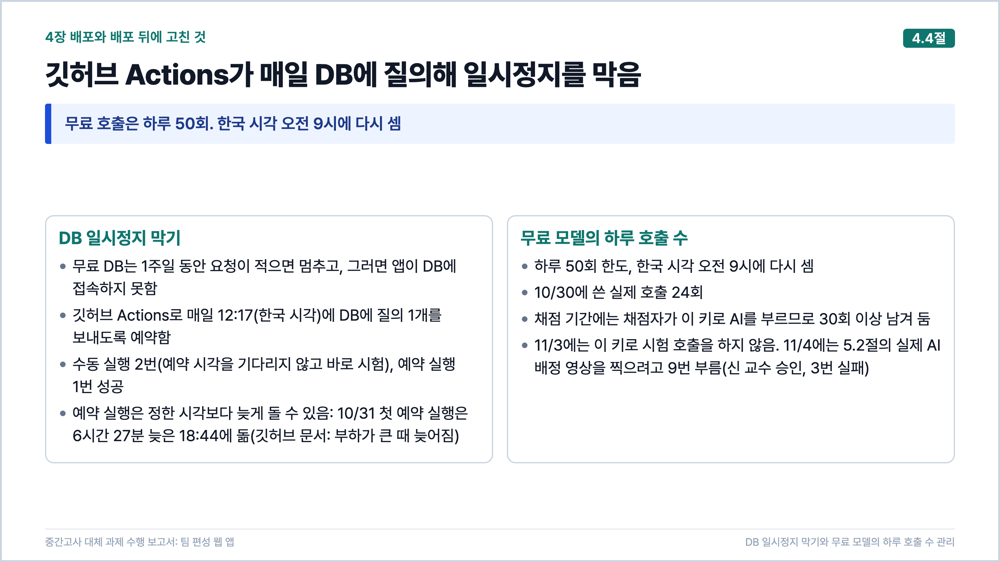

[슬라이드 4.4] DB 일시정지 막기와 무료 모델의 하루 호출 수 관리

[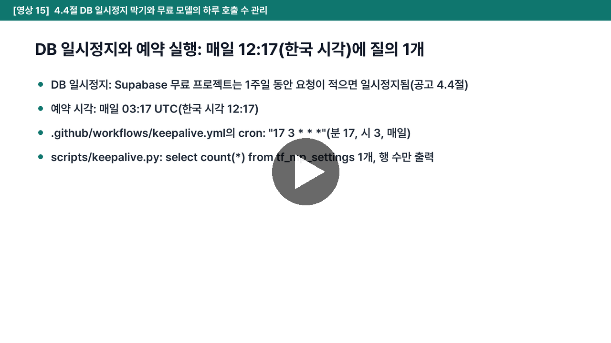](https://delightful-run-7c5.notion.site/409022e2cfe780c78c6ee12e76022ece#0ccc133d095c41ba9adf4aceaada4897)

[영상 15] 4.4절 슬라이드의 설명 영상(193초, 신 교수의 목소리로 합성한 설명과 자막). 그림을 누르면 노션에서 영상이 재생됨

- DB 일시정지는 깃허브 Actions 예약 실행으로 매일 한 번 DB에 질의를 보내 막음(공고 3장 표의 어려운 해결)
  - DB 일시정지: Supabase 무료 프로젝트는 1주일 동안 요청이 적으면 일시정지되고, 그러면 앱이 DB에 접속하지 못함(공고 4.4절)
  - 예약 시각은 매일 03:17 UTC(세계 표준시, 한국 시각 12:17)임. `.github/workflows/keepalive.yml`의 `cron: "17 3 * * *"`(분 17, 시 3, 매일)로 정함
  - 질의 스크립트 `scripts/keepalive.py`는 `select count(*) from tf_mp_settings` 질의 1개를 보내고 행 수만 출력함
  - 예약 실행에는 깃허브 저장소의 비밀 값 `DATABASE_URL`이 필요함. 클로드 코드로 `gh secret set`을 실행해 등록하려 했으나, 클로드 코드의 자동 권한 판정이 "Secret-Store Writes"로 거부해, 값을 화면에 내지 않는 명령으로 직접 등록함
    - 명령: `grep '^DATABASE_URL=' .env | cut -d= -f2- | tr -d '"' | gh secret set DATABASE_URL --repo logistex/prj_mid_26`
    - 뜻: `.env`의 `DATABASE_URL` 값만 잘라 깃허브 저장소의 비밀 값으로 등록함. 값은 화면에 나오지 않음
  - 등록 뒤 예약 시각을 기다리지 않고 바로 확인하려고 예약 작업을 수동으로 한 번 돌려 성공했고(실행 41176215654, 로그 "keepalive 성공, tf_mp_settings 행 수: 2"), 앱의 DB 접속 계정을 바꾼 뒤 새 주소로 다시 돌려도 성공했음(실행 41177476295)
  - 예약 실행도 처음으로 성공했음(실행 41189925843, 10/31 18:44). 예약 시각 12:17보다 6시간 27분 늦게 돌았음. 깃허브 문서를 확인해 보니 부하가 큰 때에 예약 실행이 늦어질 수 있다고 함[10]. 일시정지는 1주일 동안의 요청으로 정해지므로, 몇 시간 늦어도 일시정지를 막는 데는 지장이 없다고 판단함
- 무료 모델 호출은 하루 50회 한도 안에서 썼음
  - 하루 한도는 UTC 날짜로 세므로 한국 시각 오전 9시에 초기화됨(6장 노트 6.4.14.1목)
  - 10/30 23:52(한국 시각)까지 쓴 실제 호출은 24회였음(클로드의 보고). 연결 시험 8회, 3단계 시험 7회, 원인 실험 4회, 고친 뒤 시험 5회
  - 채점 기간에는 채점자가 이 키로 AI를 부르므로 하루 30회 이상을 남겨 두어야 함(공고 4.3절). 11/3에는 이 키로 시험 호출을 하지 않았음. 11/4에는 5.2절의 실제 AI 배정 영상을 찍으려고 이 맥의 시험용 앱에서 모두 9번 불렀고(신 교수 승인), 그 가운데 3번이 실패였음. 하루 한도 가운데 30회 이상은 남았음(5.2절)

## 5. 연습 시나리오로 팀 편성하기

- 공고 부록의 연습 시나리오 3개(쉬움, 중간, 어려움)로 가상 학생들의 팀을 완성한 앱에서 실제로 편성했고, 모든 단계가 기대 결과와 같았으며 확정한 팀은 모두 규칙을 지켰음
  - 5.1절은 시나리오를 실행한 5가지 방법을, 5.2절은 시나리오 실행 탭과, 시나리오마다 단계별 결과, 실제 AI 배정과 확정, 드러난 규칙을, 5.3절은 AI 모델이 모두 실패했을 때와 같은 방식으로 앱이 직접 한 배정을 적음
  - 연습 시나리오는 채점에 쓰지 않으므로, 기대 결과에 맞추는 데가 아니라 규칙이 지켜지는지 시험하는 데 썼음(1.1절)

### 5.1 시나리오와 확인 방법

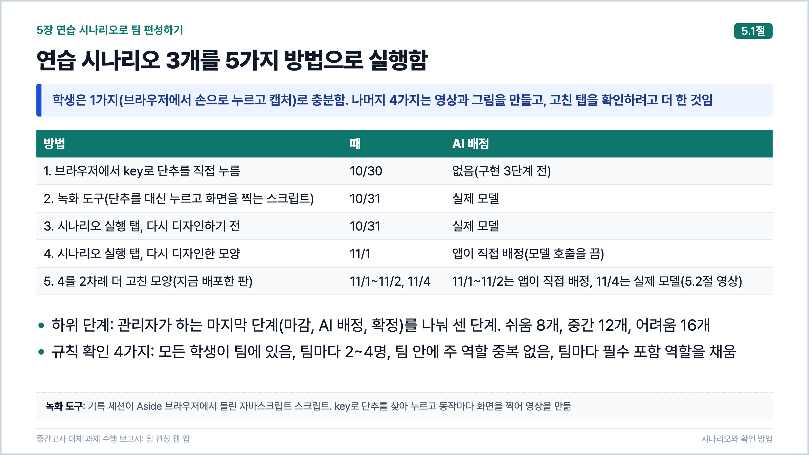

[슬라이드 5.1] 시나리오와 확인 방법

[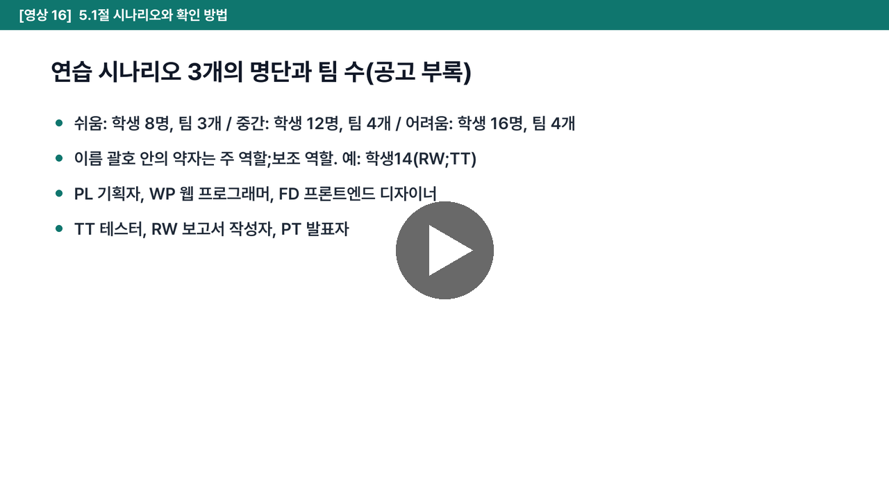](https://delightful-run-7c5.notion.site/409022e2cfe780c78c6ee12e76022ece#3169c5816dd4439d9f35f125b1a89345)

[영상 16] 5.1절 슬라이드의 설명 영상(319초, 신 교수의 목소리로 합성한 설명과 자막). 그림을 누르면 노션에서 영상이 재생됨

- 연습 시나리오 3개를 5가지 방법으로 실행했고, 5가지 모두 클로드의 보고가 아니라 작성자(기록 세션 포함, 1.3절)가 실행한 결과임([표 15])
  - 시나리오마다 명단 CSV와 팀 수가 정해져 있음: 쉬움은 학생 8명과 팀 3개, 중간은 학생 12명과 팀 4개, 어려움은 학생 16명과 팀 4개임(공고 부록)
  - 첫째와 둘째 방법은 채점 프로그램과 같은 방식임. 브라우저에서 공고 2.7절의 `key`로 단추를 찾아 누르고, 결과 안내(`result`)의 첫 낱말을 기대 결과와 비교함
  - 셋째~다섯째 방법은 앱 안의 시나리오 실행 탭임. 단계표 CSV를 올리면 앱이 단계마다 실제 기능을 실행하고 기대 결과와 비교함(5.2절)
  - 탭은 관리자가 하는 마지막 단계를 하위 단계로 나눠 셈(쉬움 6단계는 마감, AI 배정, 확정의 3개, 중간 11단계와 어려움 15단계는 AI 배정, 확정의 2개. 중간과 어려움의 마감은 앞 단계인 9단계, 14단계임). 그래서 탭의 하위 단계는 쉬움 8개, 중간 12개, 어려움 16개임

[표 15] 연습 시나리오를 실행한 방법

| 방법 | 때 | 앱과 DB | 실행한 범위 | 결과 | AI 배정 | 증빙 |
|---|---|---|---|---|---|---|
| 1. 브라우저(Aside)에서 `key`로 단추를 직접 누름 | 10/30 22:25 무렵 | 2단계 구현 직후의 로컬 앱, 옮기기 전의 DB(2.4절) | 쉬움 1~5단계(동작 12개), 중간 1~10단계(동작 15개). 어려움 1~14단계(동작 23개)는 11/2에 같은 커밋으로 보충(3.2절) | 모두 일치 | 없음(3단계 구현 전) | 작성자의 증빙 화면 30장(공개하지 않음) |
| 2. 녹화 도구가 브라우저에서 `key`로 단추를 누름 | 10/31 03:03 이전에 끝남(AI 호출 02:50~02:59) | 로컬 앱, 배포한 앱과 같은 DB | 3개 시나리오의 모든 단계 | 모두 일치 | 실제 모델 4번 호출(기록 id 132~135) | A4, 작성자의 실행 기록(공개하지 않음) |
| 3. 시나리오 실행 탭(다시 디자인하기 전, 커밋 `a4a69c4`) | 10/31 14:54 이전에 끝남(AI 호출 14:33~14:49) | 로컬 앱, 배포한 앱과 같은 DB | 하위 단계 8개, 12개, 16개 | 모두 일치 | 실제 모델 | 작성자의 녹화 영상 3편(11/4 5장을 고치며 보고서에서 뺌) |
| 4. 시나리오 실행 탭(다시 디자인한 뒤, 커밋 `a2ea83d`) | 11/1 13:54 이후 14:07 전, 14:30 무렵 다시 실행 | 로컬 앱(포트 8720), 이 맥의 시험용 Postgres | 하위 단계 8개, 12개, 16개 | 2번 모두 일치 | 앱이 직접 배정(모델 호출 0번) | 작성자의 실행 기록(공개하지 않음) |
| 5. 시나리오 실행 탭(2차례 더 고친 뒤, 커밋 `b7c7f6d`) | 11/1 17:32~17:38, 20:31~20:36과 20:54~20:55, 11/2 23:13~23:21, 11/4 14:47~14:59와 15:05~15:34에 다시 실행(실습 기록) | 4와 같음 | 하위 단계 8개, 12개, 16개 | 5번 모두 일치 | 11/1~11/2는 앱이 직접 배정(모델 호출 0번), 11/4는 실제 모델 | [그림 10]~[그림 15], [영상 17]~\[영상 19\](11/4 15:05~15:34 시연 녹화), [영상 20], \[영상 21\](11/2 23:13~23:21 시연 녹화), \[영상 22\](11/4 15:09~15:17, 모델 3개가 모두 실패한 실행) |

- 5.2절의 표는 다섯째 방법의 11/4 실행(실제 AI 배정) 결과이고, 넷째 방법과 다섯째 방법의 11/1~11/2 실행에서도 AI 배정을 뺀 단계별 결과는 같았음. 같은지는 탭이 단계마다 보여 주는 한 문장(넷째 방법의 "일어난 일", 다섯째 방법의 "실제" 줄)과 일치 표시로 판정했음. 둘째 방법의 결과 안내 원문은 A4에 있음
  - 넷째와 다섯째 방법 사이에 앱이 직접 배정하는 방식을 바꿨으므로(5.2절), 앱이 직접 배정해 확정한 팀은 쉬움과 중간에서 달라졌음(5.3.1항, 5.3.2항)
  - 표의 기대 결과는 단계표 CSV의 행(지원, 투표)마다의 기대 결과임. 공고 부록의 단계를 행으로 나눴으므로, 투표를 기다리는 중간의 "대기"도 기대 결과에 들어 있음
  - 넷째와 다섯째 방법은 배포한 앱의 DB가 아닌, 이 맥에 따로 띄운 시험용 Postgres에서 실행했음. 앱은 시작할 때 관리자 계정을 `ADMIN_PASSWORD`로 갱신하므로(3.1절), 배포한 앱과 같은 DB에 다른 관리자 비밀번호로 로컬 앱을 띄우면 배포한 앱의 관리자 비밀번호까지 바뀌기 때문임
  - 넷째 방법과 다섯째 방법의 11/1~11/2 실행은 탭의 "실제 AI 모델 호출" 토글을 끄고 실행해 앱이 직접 배정했음(5.3절). 다섯째 방법의 11/4 실행은 토글을 켜고 실제 모델로 배정했음(5.2절). 둘째, 셋째 방법(10/31)의 실제 모델 배정도 시나리오마다 함께 적음
- 확정한 팀의 규칙은 탭의 "규칙 확인" 4가지(모든 학생이 팀에 있음, 팀마다 2~4명, 팀 안에 주 역할 중복 없음, 팀마다 필수 포함 역할을 채움)로 검사했음([그림 15])
  - 공고 2.5절 4항의 검사 5가지 가운데 "한 학생은 한 팀에만"은 탭의 4가지에 없음. 이 규칙은 `tf_mp_members.student_id`의 유일 제약이 DB에서 막음(2.4절 [표 10])

- 녹화 도구는 기록 세션이 Aside 브라우저에서 돌린 자바스크립트 스크립트임(`동영상/recorder.js`, `동영상/scenarios.js`). `key`로 단추를 찾아 누르고, 동작마다 화면을 저장함(3.2절)
- 5가지 방법을 쓴 까닭: 첫째는 2단계 구현 직후의 확인, 둘째는 녹화 도구가 끝까지 도는지의 시험, 셋째는 탭을 만든 뒤의 영상 녹화, 넷째와 다섯째는 탭을 고친 뒤의 확인, 그림과 영상 다시 찍기임. 학생은 첫째 방법의 범위를 손으로 누르고 화면을 캡처하는 것으로 충분함
- 단계표 CSV는 행마다 학생이나 관리자의 행동 1개와 그 기대 결과를 적은 파일이고, 클로드가 공고 부록을 옮겨 만들었음(커밋 `81958ab`). 쉬움 첫 행의 앞 7칸: `1,지원,2026101,1,,,승인`(1단계, 학생1이 팀1에 지원, 기대 결과 승인)
- 화면과 영상의 "학생14(RW;TT)"처럼 이름 괄호 안의 약자는 주 역할;보조 역할임. PL 기획자, WP 웹 프로그래머, FD 프론트엔드 디자이너, TT 테스터, RW 보고서 작성자, PT 발표자([표 16])

[표 16] 연습 시나리오의 명단(주 역할과 괄호 안의 보조 역할, 공고 부록 1~3)

| 학생 | 쉬움 | 중간 | 어려움 |
|---|---|---|---|
| 학생1 | 기획자(보고서 작성자) | 기획자(발표자, 테스터) | 기획자(보고서 작성자) |
| 학생2 | 기획자(발표자) | 기획자(테스터) | 기획자(발표자) |
| 학생3 | 기획자(테스터) | 기획자(보고서 작성자) | 기획자(테스터) |
| 학생4 | 웹 프로그래머(프론트엔드 디자이너) | 기획자 | 웹 프로그래머(기획자) |
| 학생5 | 웹 프로그래머 | 웹 프로그래머(테스터) | 웹 프로그래머(프론트엔드 디자이너) |
| 학생6 | 웹 프로그래머(테스터) | 웹 프로그래머(프론트엔드 디자이너) | 웹 프로그래머(보고서 작성자) |
| 학생7 | 프론트엔드 디자이너(발표자) | 웹 프로그래머 | 프론트엔드 디자이너(발표자, 테스터) |
| 학생8 | 테스터(보고서 작성자, 발표자) | 웹 프로그래머(발표자) | 프론트엔드 디자이너(테스터) |
| 학생9 | 없음 | 프론트엔드 디자이너(웹 프로그래머) | 프론트엔드 디자이너(웹 프로그래머) |
| 학생10 | 없음 | 테스터(기획자) | 테스터(보고서 작성자) |
| 학생11 | 없음 | 보고서 작성자 | 테스터(발표자) |
| 학생12 | 없음 | 발표자(보고서 작성자, 프론트엔드 디자이너) | 테스터(기획자) |
| 학생13 | 없음 |  | 보고서 작성자(발표자, 프론트엔드 디자이너) |
| 학생14 | 없음 |  | 보고서 작성자(테스터) |
| 학생15 | 없음 |  | 발표자(프론트엔드 디자이너) |
| 학생16 | 없음 |  | 발표자 |

### 5.2 실제 AI 모델이 한 배정

- 5장의 연습 시나리오 실행 기록은 두 가지임
  - 5.2절: 2차례 더 고친 시나리오 실행 탭(커밋 `b7c7f6d`, 지금 배포한 판)으로 연습 시나리오 3개를 실행하고, AI 배정까지 실제 모델을 불러 확정한 결과(11/4). 단계별 결과는 11/1~11/2의 실행과도 같았음
  - 5.3절: 같은 탭에서 앱이 직접 배정한 결과. 실제 모델 호출을 끄고 실행한 11/1~11/2의 결과와, 11/4에 실제로 1~3차 모델이 모두 실패해 앱이 배정한 실행을 적음. 토글을 끈 배정은 모델이 모두 실패했을 때의 배정과 같은 방식임
- 이 절의 첫머리에는 11/4 녹화의 방법, 시나리오 실행 탭의 기능과 고친 경위, 채점 프로그램으로 찾은 결함을 적고, 5.2.1~5.2.3항에 시나리오마다의 결과를 적음
- 이 절의 영상([영상 17]~[영상 19])은 이 맥의 로컬 앱(시험용 DB, 시험용 관리자 비밀번호)에서 녹화 도구(`동영상/rec_ai.js`)로 찍었음(11/4 15:05~15:34)
  - 녹화 도구는 기록 세션의 클로드가 돌리며, 관리자로 로그인하려면 비밀번호를 넣어야 함. 기록 세션은 이 맥에서 띄운 앱에만 비밀번호를 넣고 배포한 앱에는 넣지 않으므로(실습 기록, 10/31 09:34부터), 이 맥의 로컬 앱에서 찍었음. 시험용 DB를 쓴 까닭은 5.1절에 적음
  - AI 배정은 신 교수의 오픈라우터 키로 실제 모델을 불렀음(신 교수 승인, 11/4). 채점 기간에 하루 30회 이상을 남겨야 하므로(4.4절), 다시 찍는 데 필요한 만큼만 불렀음(쉬움과 중간은 1번씩, 어려움은 모델이 모두 실패한 실행 뒤에 1번 더)
  - 처음 찍은 녹화(14:47~14:59)는 녹화 도구가 AI를 기다리는 동안 팀 카드로 화면을 옮겨, 몇 차 모델을 몇 초째 기다리는지의 안내가 화면 밖에 있었음. 안내가 보이게 고쳐 다시 찍었음
  - 어려움을 다시 찍던 첫 실행(15:09~15:17)에서는 모델 3개가 모두 실패해 앱이 직접 배정했음. 이 실행은 5.3.3항의 영상에 쓰고, 어려움을 한 번 더 찍었음. 중간과 어려움은 녹화 도구가 단계 목록이 다 그려지기 전에 읽어 멈춘 일이 중간은 2번, 어려움은 1번 있어, 기다리게 고친 뒤 다시 찍었음(멈춘 실행은 모델을 부르지 않음)
  - 그래서 11/4에 실제 모델을 부른 것은 모두 9번(처음 녹화 3번, 다시 찍은 녹화 6번)이고, 그 가운데 3번이 실패였음(시험용 DB의 호출 기록 id 1~9)
  - 영상에서 AI를 기다린 화면은 빨리 넘겼고, 기다린 시간은 장면 설명에 적었음

- 시나리오 실행 탭은 관리자가 연습 시나리오의 단계를 한 화면에서 차례로 실행하고, 단계마다 무엇이 바뀌었는지 읽게 만든 관리자 전용 탭임. 10/31에 만들고 11/1에 다시 디자인했음. 11/1 오후에는 신 교수의 의견 18개로 2차례 더 고쳤고, 앱이 직접 배정할 때 팀 인원이 고르게 되도록 바꿨음
- 탭은 공고가 요구하지 않은 기능이라 이 앱에만 있고, 학생 앱에는 없음. 신 교수가 시험 도중에 요청해, PRD 3단계 구현을 마친 뒤 더함(A2의 프롬프트 20~23, 커밋 `81958ab`, `9c2b089`, `3a23267`, `a4a69c4`). 탭의 요구사항은 PRD 3개와 따로 `docs/PRD_step4.md`에 썼음(10/31, A2의 프롬프트 20~22)
  - 요청: 시작할 때 시나리오 전체를 보이고, 단계를 누르면 그 단계 전후의 배정 현황을 비교하며, 모든 단계를 마친 뒤에도 앞 단계를 다시 볼 수 있어야 함
  - 관리자가 하는 마지막 단계는 하위 단계(쉬움은 마감, AI 배정, 확정, 중간과 어려움은 AI 배정, 확정)로 나눔. AI 배정 단계에는 실제 모델 호출을 켜고 끄는 토글을 둠. 끄면 앱이 직접 배정해 무료 호출을 아낌
  - 단계표는 코드에 넣지 않고 CSV로 올리게 했음. 연습 시나리오의 결과를 코드에 정해 두면 공고 6.3절 감점 항목 19번에 해당하기 때문임. 앱 코드에 연습 시나리오의 학번, 이름 꼴, 파일 경로가 0건임을 `grep`으로 확인했음(10/31 11:53)
  - 처음에는 별도 페이지(`/practice`)였으나, 관리자가 한 화면에서 오가게 하려고 기본 화면의 둘째 탭으로 옮겼음(A2의 프롬프트 23). 채점 프로그램은 탭을 누르지 않으므로 공고 2.7절의 `key`는 모두 첫 탭("팀 편성")에 두었음
  - 탭 2개(시나리오 실행 탭과 "팀 편성" 탭)를 탭 1개로 합치지 않은 까닭은 3가지임
    - 채점 프로그램은 가상 학생마다 새 브라우저에서 그 학생으로 로그인해 "팀 편성" 탭에서 지원하고 투표함(공고 6.2절). 공고가 요구하는 앱은 이 탭임
    - "시나리오 실행" 탭은 관리자 한 사람이 모든 학생의 행동을 대신 실행하는 연습 도구임. 이 방식을 "팀 편성" 탭에 넣으면, 학생이 자기 일만 하게 하는 권한 규칙이 깨짐
    - 둘째 탭은 공고가 요구한 것이 아니며, 채점에 쓰지 않음
  - 탭 첫머리에는 채점하는 동안 이 탭을 쓰지 말라는 경고 문구를 둠(커밋 `3c1b001`에서 지금 문구로 고침). "시나리오 시작"이 같은 DB의 팀, 지원, 투표를 지우기 때문임
- 11/1 낮에 탭을 다시 디자인하고, 다시 디자인한 탭으로 시나리오 3개를 실행하다 찾은 결함 2개를 고쳤음
  - 처음 만든 탭은 이전과 이후의 배정 현황을 좌우로 나란히 두어, 그 단계에서 무엇이 바뀌었는지 한눈에 읽히지 않았음. 신 교수가 정한 화면 모양대로 다시 디자인하게 했음(11/1, A2의 프롬프트 39, 40, 커밋 `8a6bdd7`)
    - 왼쪽: 좁은 세로 시간 줄. 단계마다 번호, 한 줄 요약, 결과 배지(승인 초록, 거절 빨강, 대기 노랑, 막힘 회색)를 두고, 지금 보는 단계를 강조함. 실행한 단계를 누르면 그 단계의 상황이 오른쪽에 나옴
    - 오른쪽: "N단계의 상황" 제목, 일어난 일 한 문장, 기대 결과와 실제 결과와 일치 여부
    - 팀마다 자리 4칸에 이전과 이후를 겹쳐 그림: 들어온 학생은 초록과 "+", 빠진 학생과 거절된 지원은 빨간 취소선과 "−", 대기 중인 지원은 점선, 팀원마다 투표는 찬성 ○, 거부 ✕, 아직 ?
    - 그 아래 팀이 없는 학생 줄을 두고, "이전 상태도 나란히 보기"를 켜면 옛 화면처럼 이전과 이후를 나란히 보여 줌
    - 보기용 단추("‹ 이전 단계", "다음 단계 ›")와 실행용 단추("▶ N단계 실행")를 나눔
    - 기본 화면("팀 편성" 탭)과 공고 2.7절의 `key`는 바꾸지 말라고 지시했음(A2의 프롬프트 39)
  - 다시 디자인한 탭으로 시나리오 3개를 끝까지 실행하다가 "일어난 일" 문장의 결함 2개를 찾아 고치게 했음(A2의 프롬프트 41, 커밋 `a2ea83d`)
    - 결함 1: 같은 학생이 한 단계에서 지원을 2번 하면 앞의 지원이 문장에서 빠졌음. 중간 8단계 문장에 학생12의 팀4 지원(대기)이 없었음
    - 결함 2: 거절된 까닭이 문장과 팀 카드에 없었음. 어려움 8단계는 찬성이 3명인데 왜 거절되었는지 알 수 없었음
    - 결과: 고친 뒤 중간 8단계에 지원 2건이 모두 나오고, 거절에 까닭(예: "승인 직전 검사: 같은 주 역할의 팀원이 있음")이 나옴을 확인함([표 18], [그림 13]). 재현 시험 7개를 더해 전체 시험 272개가 통과하고 4개를 건너뜀(클로드의 보고)
    - 커밋 `8a6bdd7`과 `a2ea83d`는 11/1 14:07에 깃허브에 올렸음. 그 뒤 배포한 앱을 로그인하지 않은 브라우저로 열어 로그인 화면이 나오는 것을 확인했음(11/1 14:09)
- 신 교수가 배포한 앱에서 탭을 직접 써 보고 2차례 의견을 냈고, 의견마다 방향을 정한 뒤 한 번에 고치게 했음
  - 1차(A2의 프롬프트 42, 커밋 `2c4b7ff`, 11/1 16:14): 의견 10개. 무엇을 누를 수 있고 무엇이 상황 표시인지 헷갈린다는 것이 가장 컸음. 누를 수 있는 것은 테두리, 바탕, 그림자를 늘 보이게 하고, 상황 표시는 기호와 색 글자만 쓰게 했음. 그 밖에 단계 목록을 모두 펼침, 배정 단계에 누가 배정했는지 표시, 모든 단계를 실행한 뒤의 완료 안내와 안내 창, 규칙 확인을 표로, 팀 카드에 필수 역할 줄, "실제 AI 모델 호출"의 기본값을 켬으로 바꿈
  - 같은 1차에서 앱이 직접 배정하는 방식도 바꿨음. 신 교수가 넷째 방법의 결과(쉬움에서 학생7, 학생8이 모두 팀1)를 확인하고, 규칙을 지키는 첫 배정을 고르면 앞 번호 팀에 몰린다고 짚었기 때문임. 규칙을 지키는 배정 가운데 팀 인원의 편차가 가장 작은 것, 그다음 필수 포함 역할을 주 역할로 채운 것을 고르게 했고, AI에게 보내는 요청에도 같은 순서를 적었음(7.4절)
  - 2차(A2의 프롬프트 43, 커밋 `b7c7f6d`, 11/1 17:32): 신 교수가 중간 시나리오를 해 보고 낸 의견 8개. 공고 부록의 단계 문장을 단계표 CSV의 열로 옮겨, 오른쪽에 "시나리오"(공고 부록의 문장), "기대", "실제" 세 줄을 두었음([그림 10]). 문장을 코드에 넣지 않은 것도, 연습 시나리오에 맞춰 결과를 정해 둔 코드가 되지 않게 하려는 것임(공고 6.3절 감점 항목 19번). 대기, 막힘, 마감 문장에는 까닭이 된 학생과 팀의 이름을 넣었음. 예: "막힘: 학생12는 팀4에 낸 지원의 결과를 기다리는 중이라 다른 팀에 지원할 수 없음(한 번에 한 팀)". 팀 카드의 역할 줄은 3줄로 나누고 ○(초록)와 ✕(빨강)를 같은 세로선에 맞췄음
  - `b7c7f6d`는 로컬 앱(시험용 DB)에서 시나리오 3개의 모든 하위 단계가 기대 결과와 같음을 확인한 뒤 깃허브에 올렸음(11/1 17:38). `2c4b7ff`는 쉬움을 확인한 뒤 올렸고(16:21), 중간과 어려움은 올린 직후에 확인했음. 신 교수가 다시 배포된 앱(`b7c7f6d`)에서 어려움 시나리오를 직접 실행해 보고 "큰 문제는 없어 보인다"고 했음(11/1 저녁)
  - 마지막 앱 코드(`b7c7f6d`)의 자동 시험 결과는 7.1절에 적음
- 별도 페이지를 기본 화면의 둘째 탭으로 옮긴 시험판을 교수용 채점 프로그램(`grade.js`)으로 시험하다가, 확정 단추가 배정안이 오기 전에도 눌려 남은 학생이 배정되지 않는 결함을 찾아, 배정안이 올 때까지 단추를 비활성으로 고쳤음(커밋 `d0d3482`)
  - 이 시험은 학생이 할 수 없는 시험임. 채점 프로그램은 학생에게 주지 않았고, 시나리오도 연습용이 아닌 교수의 추가 시나리오 3개(채점용으로 만든 것, 공개하지 않음)를 썼음
  - 처음에는 연습 시나리오만 쓰기로 정했으나(10/30 21:24), 신 교수가 "두 화면을 하나로 합쳐도 채점에 문제가 없는지 확인하라"고 해 채점 프로그램과 그 시나리오를 썼음. 고친 내용(확정 단추의 비활성)은 시나리오의 내용과 관계없는 일반 규칙임
  - 채점 프로그램과 이 시나리오로 이 앱(과 그 사본)을 마감 전에 여러 차례 시험했음: 10/31 12:43~12:49와 13:49~14:01(결함을 찾고, 고친 뒤 다시 돌림), 17:51~19:05(고친 채점 프로그램의 시험, README 5장 사례 C의 근거), 22:25~22:27(팀 수 칸을 고친 뒤), 11/1 12:04~13:28(채점 프로그램 제안판의 시험)
  - 이 시나리오는 11/3 학생 채점에 쓴 것과 같은 파일임. 그래서 이 앱은 채점 시나리오로 미리 시험한 앱이고, 이 점에서 학생과 같은 조건이 아님
  - 사실: 확정 단추가 배정안이 없을 때도 눌리는 상태였음. 채점 프로그램은 눌러지는 확정 단추를 배정안이 온 신호로 받아들이므로, AI 배정을 누른 지 3초 만에 확정을 눌렀고 남은 학생이 배정되지 않았음
  - 알아챈 방법: 둘째 탭으로 옮긴 시험판이 최종 검사에서 실패해, 옮기기 전의 원래 앱에 같은 시험을 돌려 비교함(10/31 12:48). 원래 앱도 같은 결과여서 옮긴 것과 관계없는 결함임을 알았음
  - 판단과 조치: 공고 2.7절은 확정 단추의 비활성을 요구하지 않으므로 공고 위반은 아님. 그러나 배정안이 없을 때 확정을 누르게 두는 것은 관리자에게도 위험하므로 고침(커밋 `d0d3482`, 배정안이 없거나 AI 배정이 도는 동안 비활성, [그림 6])
  - 결과: 고친 뒤 확정은 배정안이 온 뒤에만 눌렸음
  - 채점 프로그램도 고쳤음: 학생 앱에도 확정 단추를 늘 눌리게 둔 앱이 있을 수 있으므로, 실제 채점에서는 AI 배정이 끝날 때까지 최대 600초 기다린 뒤 확정을 누르게 했음. 그래도 최종 검사에서 실패한 앱은 채점자가 화면에서 직접 배정과 확정을 다시 해 보기로 했음. 고친 채점 프로그램은 확정 단추가 늘 눌리는 옛 판 앱에서도 시나리오 3개를 통과했음(10/31 저녁)

#### 5.2.1 쉬움 시나리오

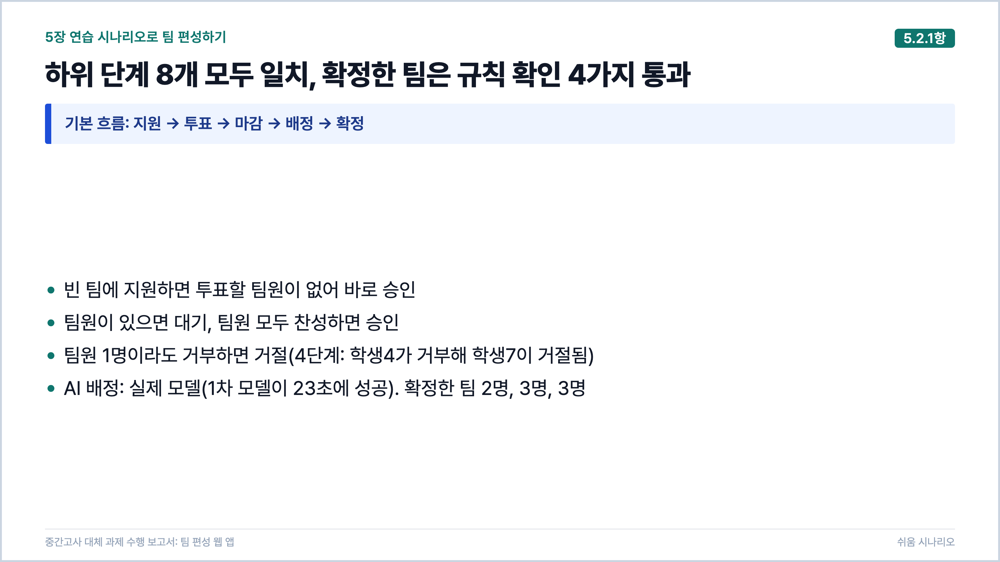

[슬라이드 5.2.1] 쉬움 시나리오

[](https://delightful-run-7c5.notion.site/409022e2cfe780c78c6ee12e76022ece#394aa6ac96e84578a92f9ce731d5017f)

[영상 17] 5.2.1항 슬라이드의 설명 영상(133초, 신 교수의 목소리로 합성한 설명과 자막). 그림을 누르면 노션에서 영상이 재생됨

- 쉬움 시나리오(공고 부록 1, 학생 8명, 팀 3개)의 하위 단계 8개가 모두 기대 결과와 같았고, 확정한 팀은 규칙 확인 4가지를 모두 통과했음([표 17])
  - 이 시나리오는 지원, 투표, 마감, 배정과 확정의 기본 흐름을 시험함(공고 6.1절)

[표 17] 쉬움 시나리오의 단계별 결과(11/4, 시나리오 실행 탭, 실제 AI 배정)

| 단계 | 일어난 일(탭의 문장을 줄임) | 기대 결과 | 실제 결과 |
|---|---|---|---|
| 1 | 학생1, 학생2, 학생3이 각각 팀1, 팀2, 팀3에 지원함 → 빈 팀이라 바로 승인되어 팀원이 됨 | 승인, 승인, 승인 | 승인, 승인, 승인 |
| 2 | 학생4가 팀1에 지원함 → 팀원 1명의 투표를 기다림 → 학생1 찬성 → 승인 | 대기, 승인 | 대기, 승인 |
| 3 | 학생5가 팀2에 지원함 → 팀원 1명의 투표를 기다림 → 학생2 찬성 → 승인 | 대기, 승인 | 대기, 승인 |
| 4 | 학생7이 팀1에 지원함 → 팀원 2명의 투표를 기다림 → 학생1 찬성, 학생4 거부 → 거절(까닭: 팀원이 거부함). 학생7은 팀이 없는 학생으로 돌아감([그림 10]) | 대기, 대기, 거절 | 대기, 대기, 거절 |
| 5 | 학생6이 팀3에 지원함 → 팀원 1명의 투표를 기다림 → 학생3 찬성 → 승인 | 대기, 승인 | 대기, 승인 |
| 6-1 | 모집 마감 → 대기 지원 0건을 거절하고 0명이 팀에서 빠짐 | 승인 | 승인 |
| 6-2 | AI 배정 → 1차 모델이 23초 만에 배정안을 만듦(검사 5가지 통과) | 승인 | 승인 |
| 6-3 | 배정 확정 → 배정안을 확정함. 규칙 확인 4가지 모두 통과 | 승인 | 승인 |

- 관리자 동작(마감, AI 배정, 확정)의 기대 결과 "승인"은 그 동작이 성공했다는 결과 안내의 첫 낱말임(예: "승인: 모집을 마감함…")
- [표 17]~[표 19]의 "일어난 일" 칸에서 →는 그다음에 일어난 일을 가리킴

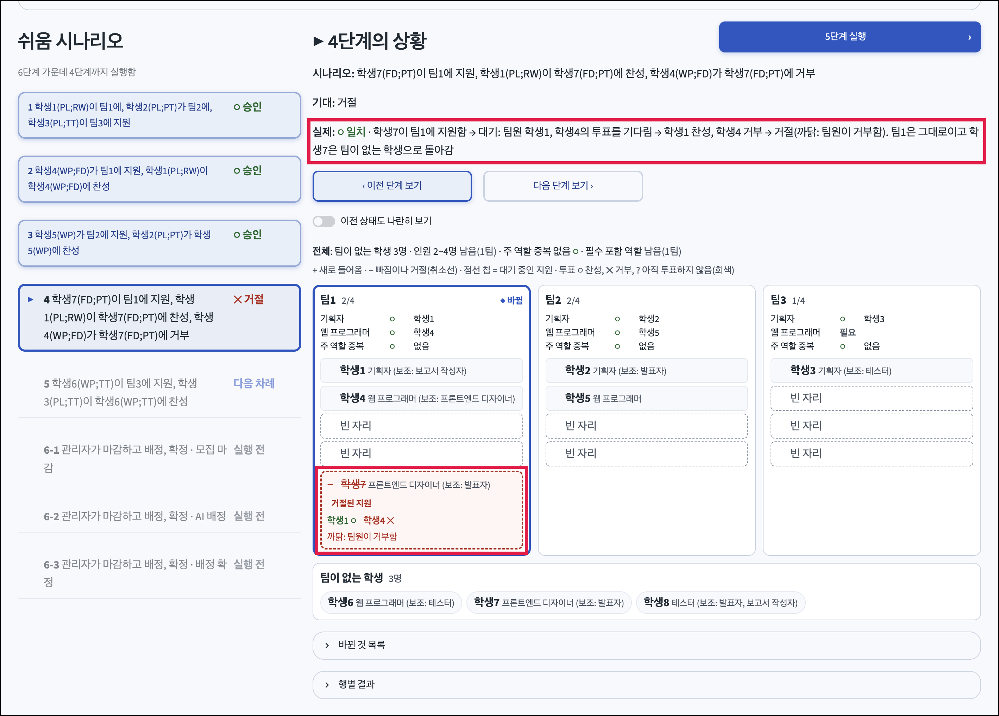

[그림 10] 쉬움 시나리오 4단계의 상황(11/1, 커밋 `b7c7f6d`). 빨간 상자는 앱이 한 일을 적은 "실제" 줄과, 팀1에서 거절된 학생7의 지원(학생1 찬성 ○, 학생4 거부 ✕, 까닭: 팀원이 거부함)임. "실제" 줄 위의 "시나리오" 줄은 공고 부록 1의 문장, "기대" 줄은 그 기대 결과임

- 단계마다 드러난 규칙은 다음과 같음
  - 빈 팀에 지원하면 투표할 팀원이 없어 바로 승인됨(1단계, 공고 2.4절)
  - 팀원이 있는 팀에 지원하면 대기가 되고, 팀원 모두가 찬성하면 승인됨(2단계, 3단계, 5단계)
  - 팀원 가운데 1명이라도 거부하면 거절됨(4단계, [그림 10]). 다른 팀원의 투표를 기다리지 않고 바로 거절한다는 것은 공고 2.4절의 규칙이고, 이 단계에서는 학생4의 거부가 마지막 투표였으므로 그 부분은 드러나지 않았음
  - 마감 때 대기 중인 지원도, 팀원이 1명뿐인 팀도 없어 거절된 지원과 팀에서 빠진 학생이 0명이었음(6-1단계)
- AI 배정과 확정
  - 11/4(다섯째 방법, 실제 AI 배정): 1차 모델(`cohere/north-mini-code:free`)이 22.8초에 검사 5가지를 통과하는 배정안을 냈고, 확정한 팀은 팀1 학생1, 4 / 팀2 학생2, 5, 7 / 팀3 학생3, 6, 8임(2명, 3명, 3명). 규칙 확인 4가지를 모두 통과했음([영상 17])
  - 같은 날 처음 찍은 녹화(5.2절)에서는 같은 모델이 25.5초에 학생7을 팀3에, 학생8을 팀2에 넣었음. 같은 모델에 같은 요청을 보내도 배정안은 달라질 수 있음. 두 배정안 모두 인원이 2명, 3명, 3명이라, AI에게 보낸 요청의 순서(인원 편차가 가장 작은 배정, 7.4절)에 맞았음
  - 10/31(둘째 방법): 1차 모델(`cohere/north-mini-code:free`)이 5.6초에 검사를 통과하는 배정안을 냈고, 확정한 팀은 팀1 학생1, 4, 7, 8 / 팀2 학생2, 5 / 팀3 학생3, 6임(4명, 2명, 2명, A4). 그때 AI에게 보낸 요청에는 규칙만 있고 인원을 고르게 하라는 기준이 없었음(7.4절)
  - 10/31(셋째 방법): 1차 모델이 18초에 성공함(다시 디자인하기 전의 탭, 녹화 영상은 보고서에서 뺌)
  - 앱이 직접 배정한 결과(11/1~11/2)는 5.3.1항에 적음
- 4단계에서 학생7을 거부한 팀1에, 마감 뒤의 배정이 학생7을 넣을 수 있음
  - 공고 2.5절의 배정 규칙에는 투표 결과를 따지는 조건이 없음(공고 2.5절을 읽음). 거부는 그 지원 1건만 떨어뜨리고, 마감 뒤의 배정까지 막지는 않음
  - 둘째 방법의 실제 모델(10/31)과 앱의 직접 배정(5.3.1항)은 학생7을 팀1에 넣었고, 11/4의 실제 모델은 2번 모두 학생7을 다른 팀에 넣었음

#### 5.2.2 중간 시나리오

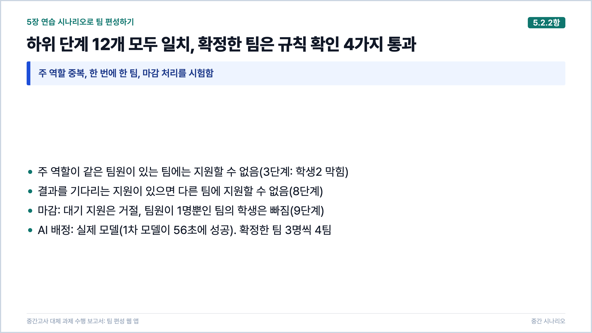

[슬라이드 5.2.2] 중간 시나리오

[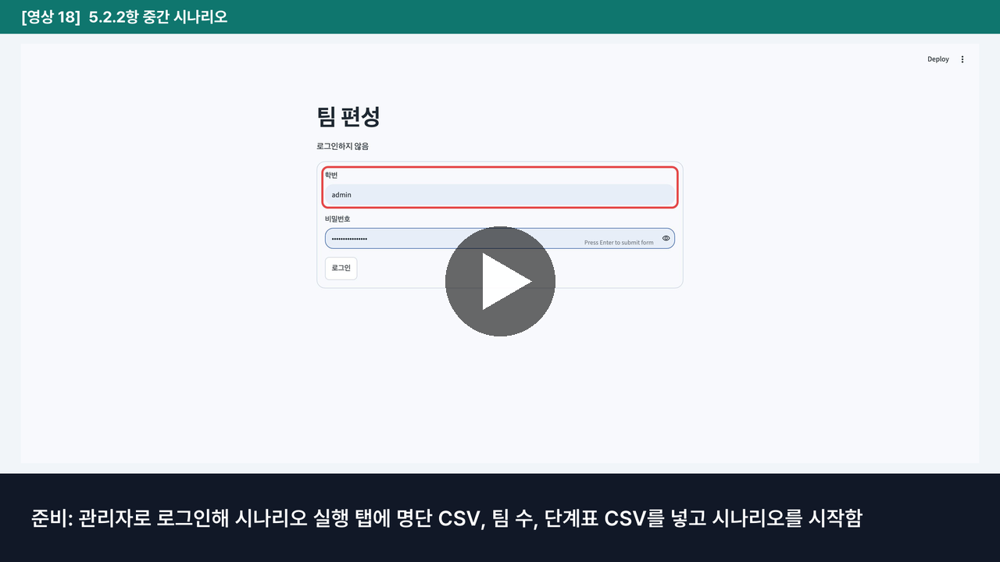](https://delightful-run-7c5.notion.site/409022e2cfe780c78c6ee12e76022ece#6403f22a68bb4f879c1f14b7aacde0e8)

[영상 18] 5.2.2항 슬라이드의 설명 영상(166초, 신 교수의 목소리로 합성한 설명과 자막). 그림을 누르면 노션에서 영상이 재생됨

- 중간 시나리오(공고 부록 2, 학생 12명, 팀 4개)의 하위 단계 12개가 모두 기대 결과와 같았고, 확정한 팀은 규칙 확인 4가지를 모두 통과했음([표 18])
  - 이 시나리오는 주 역할 중복, 거부, 한 번에 한 팀, 마감 처리와 배정안 검사를 시험함(공고 6.1절)

[표 18] 중간 시나리오의 단계별 결과(11/4, 시나리오 실행 탭, 실제 AI 배정)

| 단계 | 일어난 일(탭의 문장을 줄임) | 기대 결과 | 실제 결과 |
|---|---|---|---|
| 1 | 학생1이 팀1에 지원함 → 바로 승인되어 팀원이 됨 | 승인 | 승인 |
| 2 | 학생5가 팀1에 지원함 → 팀원 1명의 투표를 기다림 → 학생1 찬성 → 승인 | 대기, 승인 | 대기, 승인 |
| 3 | 학생2가 팀1에 지원함 → 막힘: 같은 주 역할의 팀원이 있음([그림 11]) | 막힘 | 막힘, 건너뜀, 건너뜀 |
| 4 | 학생6이 팀2에 지원함 → 바로 승인되어 팀원이 됨 | 승인 | 승인 |
| 5 | 학생9가 팀2에 지원함 → 팀원 1명의 투표를 기다림 → 학생6 찬성 → 승인 | 대기, 승인 | 대기, 승인 |
| 6 | 학생10이 팀2에 지원함 → 팀원 2명의 투표를 기다림 → 학생6 찬성, 학생9 거부 → 거절(까닭: 팀원이 거부함) | 대기, 대기, 거절 | 대기, 대기, 거절 |
| 7 | 학생3이 팀3에, 학생11이 팀4에 지원함 → 2명 모두 바로 승인되어 팀원이 됨 | 승인, 승인 | 승인, 승인 |
| 8 | 학생12가 팀4에 지원함 → 팀원 1명의 투표를 기다림 / 학생12가 팀3에 지원함 → 막힘: 결과를 기다리는 지원이 있음 | 대기, 막힘 | 대기, 막힘 |
| 9 | 모집 마감 → 대기 지원 1건을 거절하고 2명이 팀에서 빠짐([그림 12]) | 승인 | 승인 |
| 10 | 학생2가 팀3에 지원함 → 막힘: 모집이 마감됨 | 막힘 | 막힘 |
| 11-1 | AI 배정 → 1차 모델이 56초 만에 배정안을 만듦(검사 5가지 통과) | 승인 | 승인 |
| 11-2 | 배정 확정 → 배정안을 확정함. 규칙 확인 4가지 모두 통과 | 승인 | 승인 |

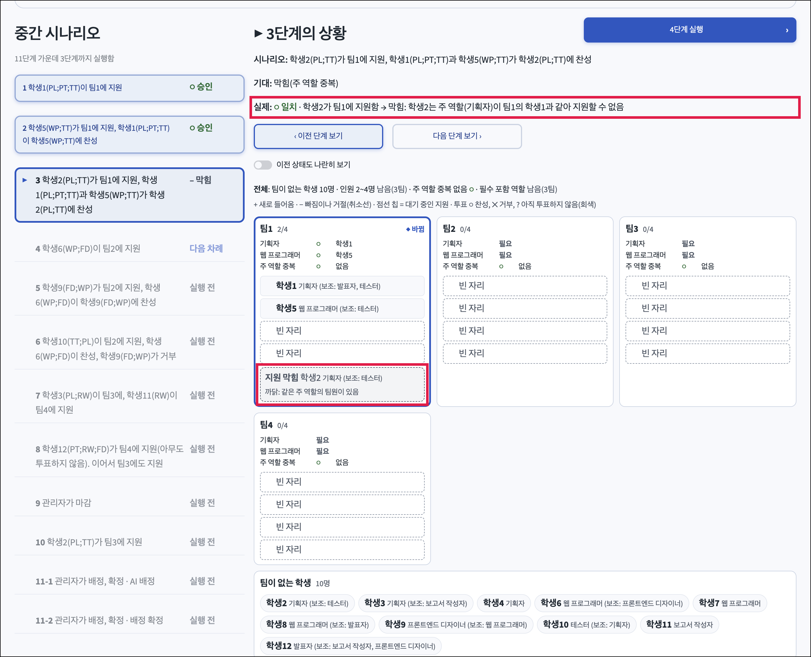

[그림 11] 중간 시나리오 3단계의 상황(11/1, 커밋 `b7c7f6d`). 빨간 상자는 "실제" 줄(막힘: 학생2는 주 역할(기획자)이 팀1의 학생1과 같아 지원할 수 없음)과, 팀1에 낸 학생2의 지원이 막혔다는 표시임

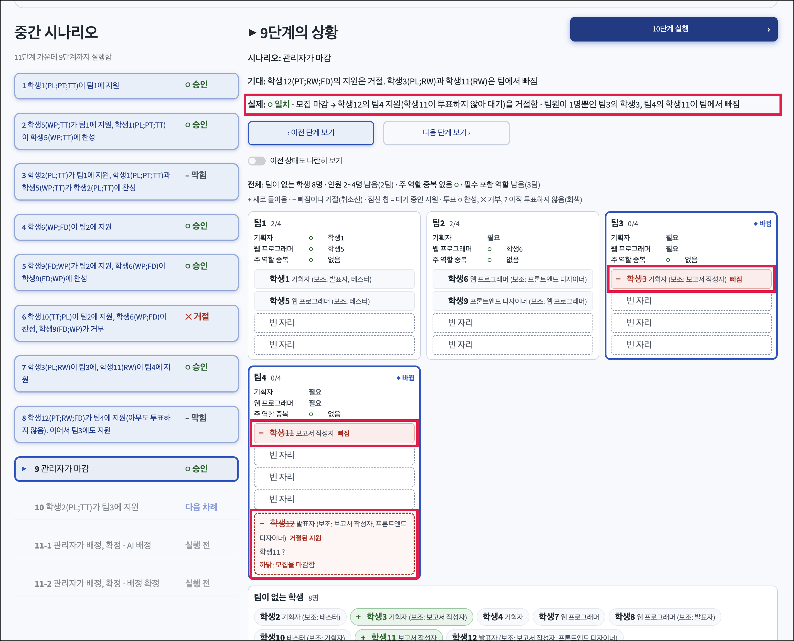

[그림 12] 중간 시나리오 9단계(모집 마감)의 상황(11/1, 커밋 `b7c7f6d`). 빨간 상자는 "실제" 줄, 팀3과 팀4에서 빠진 학생3과 학생11, 팀4에서 거절된 학생12의 대기 지원(까닭: 모집을 마감함)임

- 단계마다 드러난 규칙은 다음과 같음
  - 주 역할이 같은 팀원이 있는 팀에는 지원할 수 없음(3단계, [그림 11]). 학생2와 학생1은 둘 다 주 역할이 기획자임. 막힌 지원에 대한 학생1, 학생5의 투표는 공고 부록대로 건너뜀(실제 결과의 "건너뜀" 2개)
  - 결과를 기다리는 지원이 있으면 다른 팀에 지원할 수 없음(8단계, 공고 2.4절). 학생 화면에서는 이때 지원 단추가 숨겨져 누를 수 없음(공고 2.8절). 공고 2.7절은 "단추가 없거나 비활성이면 막힘으로 봄"이라고 하므로, 첫째와 둘째 방법에서도 기대 결과와 같다고 판정했음. 마감 뒤의 지원(10단계)도 같음
  - 마감하면 대기 중인 지원은 거절되고, 팀원이 1명뿐인 팀의 학생은 팀에서 빠짐(9단계, 공고 2.5절 2항). 학생12의 팀4 지원이 거절되었고, 팀3의 학생3과 팀4의 학생11이 팀이 없는 학생이 되어 팀이 없는 학생은 8명이 됨([그림 12])
- AI 배정과 확정
  - 11/4(다섯째 방법, 실제 AI 배정): 1차 모델(`cohere/north-mini-code:free`)이 56.3초에 검사 5가지를 통과하는 배정안을 냈고, 확정한 팀은 팀1 학생1, 5, 12 / 팀2 학생6, 9, 4 / 팀3 학생2, 7, 10 / 팀4 학생3, 8, 11임(3명씩). 규칙 확인 4가지를 모두 통과했음([영상 18])
  - 같은 날 처음 찍은 녹화(5.2절)에서는 같은 모델이 62.6초에 다른 배정안(팀1 학생1, 5, 10 / 팀2 학생6, 9, 2 / 팀3 학생3, 7, 11 / 팀4 학생4, 8, 12)을 냈고, 이것도 3명씩이었음. 이 배정안은 앱이 직접 배정한 결과(5.3.2항)와 같음
  - 10/31(둘째 방법): 1차 모델(`cohere/north-mini-code:free`)이 56.7초에 검사를 통과하는 배정안을 냈고, 확정한 팀은 팀1 학생1, 5, 10, 11 / 팀2 학생6, 9, 4, 12 / 팀3 학생2, 7 / 팀4 학생3, 8임(4명, 4명, 2명, 2명, A4)
  - 10/31(셋째 방법): 1차 모델이 112초에 성공함(다시 디자인하기 전의 탭, 녹화 영상은 보고서에서 뺌)
  - 앱이 직접 배정한 결과(11/1~11/2)는 5.3.2항에 적음
  - 둘째 방법(10/31)과 넷째 방법(11/1, 5.3.2항)의 배정은 팀2~팀4에 들어간 기획자가 다르나, 둘 다 팀마다 주 역할이 기획자인 학생과 웹 프로그래머인 학생이 1명씩 있고 주 역할이 겹치지 않음. 규칙을 지키는 배정은 하나가 아님

#### 5.2.3 어려움 시나리오


[슬라이드 5.2.3] 어려움 시나리오

[](https://delightful-run-7c5.notion.site/409022e2cfe780c78c6ee12e76022ece#f4e2e33049a9422591e9ec59595a9590)

[영상 19] 5.2.3항 슬라이드의 설명 영상(206초, 신 교수의 목소리로 합성한 설명과 자막). 그림을 누르면 노션에서 영상이 재생됨

- 어려움 시나리오(공고 부록 3, 학생 16명, 팀 4개)의 하위 단계 16개가 모두 기대 결과와 같았고, 확정한 팀은 규칙 확인 4가지를 모두 통과했음([표 19])
  - 이 시나리오는 승인 직전 재검사, 필수 포함 역할 자리, 보조 역할을 쓴 배정을 시험함(공고 6.1절). AI 실패 처리와 대기 안내는 3.3절에서 다룸

[표 19] 어려움 시나리오의 단계별 결과(11/4, 시나리오 실행 탭, 실제 AI 배정)

| 단계 | 일어난 일(탭의 문장을 줄임) | 기대 결과 | 실제 결과 |
|---|---|---|---|
| 1 | 학생1이 팀1에 지원함 → 바로 승인되어 팀원이 됨 | 승인 | 승인 |
| 2 | 학생4가 팀1에 지원함 → 학생1 찬성 → 승인 | 대기, 승인 | 대기, 승인 |
| 3 | 학생7이 팀1에 지원함 → 팀원 2명의 투표를 기다림 → 학생1 찬성, 학생4 찬성 → 승인 | 대기, 대기, 승인 | 대기, 대기, 승인 |
| 4 | 학생2가 팀2에 지원함 → 바로 승인되어 팀원이 됨 | 승인 | 승인 |
| 5 | 학생8이 팀2에 지원함 → 학생2 찬성 → 승인 | 대기, 승인 | 대기, 승인 |
| 6 | 학생5와 학생6이 차례로 팀2에 지원함 → 2명 모두 팀원 2명의 투표를 기다림 | 대기, 대기 | 대기, 대기 |
| 7 | 팀원들이 학생5의 팀2 지원에 투표함 → 학생2 찬성, 학생8 찬성 → 승인 | 대기, 승인 | 대기, 승인 |
| 8 | 팀원들이 학생6의 팀2 지원에 투표함 → 학생2, 학생8, 학생5 찬성 → 거절(까닭: 승인 직전 검사: 같은 주 역할의 팀원이 있음)([그림 13]) | 대기, 대기, 거절 | 대기, 대기, 거절 |
| 9 | 학생11이 팀3에 지원함 → 바로 승인되어 팀원이 됨 | 승인 | 승인 |
| 10 | 학생15가 팀3에 지원함 → 학생11 찬성 → 승인 | 대기, 승인 | 대기, 승인 |
| 11 | 학생14가 팀3에 지원함 → 막힘: 필수 포함 역할(기획자, 웹 프로그래머)을 맡을 학생의 자리가 모자람([그림 14]) | 막힘 | 막힘, 건너뜀, 건너뜀 |
| 12 | 학생10이 팀4에 지원함 → 바로 승인되어 팀원이 됨 | 승인 | 승인 |
| 13 | 학생13이 팀1에 지원함 → 팀원 3명의 투표를 기다림 → 학생1 찬성 → 아직 결과가 나지 않음 | 대기, 대기 | 대기, 대기 |
| 14 | 모집 마감 → 대기 지원 1건을 거절하고 1명이 팀에서 빠짐 | 승인 | 승인 |
| 15-1 | AI 배정 → 1차 모델이 54초 만에 배정안을 만듦(검사 5가지 통과) | 승인 | 승인 |
| 15-2 | 배정 확정 → 배정안을 확정함. 규칙 확인 4가지 모두 통과(11/1의 확정은 [그림 15]) | 승인 | 승인 |


[그림 13] 어려움 시나리오 8단계의 상황(11/1, 커밋 `b7c7f6d`). 빨간 상자는 "실제" 줄과, 팀원 3명의 찬성을 받고도 승인 직전 검사로 거절된 학생6의 팀2 지원임


[그림 14] 어려움 시나리오 11단계의 상황(11/1, 커밋 `b7c7f6d`). 빨간 상자는 "실제" 줄과, 팀3에 낸 학생14의 지원이 필수 포함 역할 때문에 막혔다는 표시임

- 승인 직전 재검사(6~8단계, [그림 13])
  - 주 역할이 둘 다 웹 프로그래머인 학생5와 학생6이 차례로 팀2에 지원해 2명 모두 대기가 되었음
  - 7단계에서 학생5가 먼저 승인되어 팀원이 되었음. 8단계에서 학생6은 학생5를 포함한 팀원 3명 모두에게 찬성을 받았으나, 승인 직전 검사에서 같은 주 역할의 학생5가 이미 팀에 있어 거절되었음
  - 학생5가 학생6에 투표한 것은 투표할 사람이 "투표하는 때의 팀원"이기 때문임(공고 2.4절)
  - 지원할 때만 검사하는 앱(공고 3장 표의 쉬운 해결)이면, 학생6이 지원할 때는 팀2에 웹 프로그래머가 없었으므로 8단계에서 승인되어 주 역할 중복이 생김
- 필수 포함 역할 자리(11단계, [그림 14])
  - 팀3에는 학생11(주 역할 테스터, 보조 발표자)과 학생15(주 역할 발표자, 보조 프론트엔드 디자이너)가 있어, 기획자와 웹 프로그래머를 맡을 학생이 없음
  - 남은 자리 2개로 필수 포함 역할 2개를 채워야 하는데, 기획자도 웹 프로그래머도 맡을 수 없는 학생14(주 역할 보고서 작성자, 보조 테스터)가 들어가면 남는 자리 1개로 2개를 채울 수 없으므로 막힘(공고 3장 표 아래의 계산)
- 마감(13~14단계): 학생13의 팀1 지원은 팀원 3명 가운데 학생1만 찬성해 대기로 남았다가 마감 때 거절되었음. 팀원이 1명뿐이던 팀4의 학생10은 팀에서 빠졌음
- AI 배정과 확정
  - 11/4(다섯째 방법, 실제 AI 배정): 1차 모델(`cohere/north-mini-code:free`)이 54.3초에 검사 5가지를 통과하는 배정안을 냈고, 확정한 팀은 팀1 학생1, 4, 7, 10 / 팀2 학생2, 8, 5, 14 / 팀3 학생11, 15, 3, 6 / 팀4 학생9, 12, 13, 16임(4명씩). 규칙 확인 4가지를 모두 통과했음([영상 19])
  - 같은 날 처음 찍은 녹화에서도 같은 모델이 71.4초에 같은 배정안을 냈음. 다시 찍던 첫 실행에서는 모델 3개가 모두 실패해 앱이 직접 배정했음(5.3.3항)
  - 팀4에는 주 역할이 기획자나 웹 프로그래머인 학생이 없음. 학생12(주 역할 테스터, 보조 기획자)가 기획자를, 학생9(주 역할 프론트엔드 디자이너, 보조 웹 프로그래머)가 웹 프로그래머를 맡아 필수 포함 역할을 채움(보조 역할을 쓴 배정, 공고 2.3절)
  - 10/31(둘째 방법): 1차 모델의 배정안이 검사에서 걸러졌고(검사 4번: 팀4에 주 역할이 같은 학생이 있음, 43.6초), 2차 모델(`nvidia/nemotron-3-ultra-550b-a55b:free`)이 109.6초에 검사를 통과하는 배정안을 냈음. 확정한 팀은 11/1에 앱이 직접 배정한 팀과 같았음(5.3.3항, A4)
  - 10/31(셋째 방법): 1차 모델이 120초에 시간 초과로 끊기고, 2차 모델이 58초에 성공함(다시 디자인하기 전의 탭, 녹화 영상은 보고서에서 뺌)
  - 앱이 직접 배정한 결과(11/1~11/2, 11/4)는 5.3.3항에 적음
  - 둘째 방법은 AI가 낸 배정안을 앱이 검사로 걸러 내고 다음 모델로 넘어간 실제 사례임(공고 2.5절 4항, 5항)


[그림 15] 어려움 시나리오 15-2단계(배정 확정)의 상황(11/1, 커밋 `b7c7f6d`). 빨간 상자는 확정한 팀의 규칙 확인 4가지임. 오른쪽 위의 "○ 시나리오 끝" 줄은 모든 단계를 실행한 뒤의 완료 안내임. 아래의 팀 카드에서 "+"와 "새 팀원"이 배정으로 들어온 학생임

### 5.3 앱이 직접 한 배정(AI 모델이 모두 실패했을 때와 같은 방식)

- 5장의 연습 시나리오 실행 기록은 두 가지임
  - 5.2절: 2차례 더 고친 시나리오 실행 탭(커밋 `b7c7f6d`, 지금 배포한 판)으로 연습 시나리오 3개를 실행하고, AI 배정까지 실제 모델을 불러 확정한 결과(11/4). 단계별 결과는 11/1~11/2의 실행과도 같았음
  - 5.3절: 같은 탭에서 앱이 직접 배정한 결과. 실제 모델 호출을 끄고 실행한 11/1~11/2의 결과와, 11/4에 실제로 1~3차 모델이 모두 실패해 앱이 배정한 실행을 적음. 토글을 끈 배정은 모델이 모두 실패했을 때의 배정과 같은 방식임
- 앱은 AI 배정 때 1차, 2차, 3차 모델을 차례로 부르고, 3차까지 실패하면 규칙을 지키는 배정을 스스로 찾음(공고 2.5절 6항, 3.3절 [그림 8])
  - 탭의 "실제 AI 모델 호출" 토글을 끄면 모델을 부르지 않고 같은 함수로 바로 배정함. 부를 모델 목록이 비면 3차까지 실패했을 때와 같은 앱의 배정안을 돌려주기 때문임(`mp/ai.py`의 `propose`를 읽어 확인함, 11/4). 토글을 끄면 무료 호출을 쓰지 않음(5.2절)
  - 이 절은 1~3차 모델이 모두 실패했을 때 앱이 스스로 찾은 배정으로 확정한 팀도 규칙을 지키는지를 보이려고 둠(공고 2.5절 6항)
  - 실제 호출에서도 3차까지 실패해 앱이 직접 배정한 일이 4번 있었고, 4번 모두 확정한 팀이 규칙을 지켰음(10/30 22:41~22:42와 22:44~22:46, 3.3절 [표 12]. 10/31 19:02의 기록 id 411~413, 6.4절의 사례 C. 11/4 15:12~15:17, 5.3.3항)
  - 앱의 배정은 규칙을 지키는 배정 가운데 팀 인원의 편차가 가장 작은 것, 그다음 필수 포함 역할을 주 역할로 채운 것을 고름. 11/1 1차 고침 전(넷째 방법)에는 규칙을 지키는 첫 배정을 골라 앞 번호 팀에 학생이 몰렸음(5.2절, 7.4절)
- 이 절의 영상은 AI 배정과 확정 단계만 보임. [영상 20], [영상 21]은 11/2 23:13~23:21의 시연 녹화(다섯째 방법, 토글을 끔)이고, [영상 22]는 11/4에 모델 3개가 모두 실패한 실행의 녹화임. 그 앞 단계는 5.2절의 11/4 녹화와 결과가 같으므로 싣지 않음
#### 5.3.1 쉬움 시나리오(앱이 직접 배정)

[](https://delightful-run-7c5.notion.site/409022e2cfe780c78c6ee12e76022ece#03a05092de2d438fae483fedbb07ca6d)

[영상 20] 5.3.1항의 시연 영상(117초, 시연 녹화와 신 교수의 목소리로 합성한 설명과 자막). 그림을 누르면 노션에서 영상이 재생됨

- 11/1(넷째 방법): 앱이 직접 배정했고, 확정한 팀은 팀1 학생1, 4, 7, 8 / 팀2 학생2, 5 / 팀3 학생3, 6임(4명, 2명, 2명). 규칙 확인 4가지를 모두 통과했음. 규칙을 지키는 첫 배정을 골라 남은 학생 2명이 모두 팀1에 들어감
- 11/1~11/2(다섯째 방법): 인원 편차를 줄이게 고친 뒤(5.2절) 확정한 팀은 팀1 학생1, 4, 7 / 팀2 학생2, 5, 8 / 팀3 학생3, 6임(3명, 3명, 2명). 규칙 확인 4가지를 모두 통과했음([영상 20])
- 11/4의 실제 모델(5.2.1항)은 2번 모두 인원을 2명, 3명, 3명으로 나눠 편차가 앱과 같았음. 학생7은 2번 모두 앱과 다른 팀에 넣었고, 학생8은 처음 녹화에서만 앱과 같은 팀2에 넣었음

#### 5.3.2 중간 시나리오(앱이 직접 배정)

[](https://delightful-run-7c5.notion.site/409022e2cfe780c78c6ee12e76022ece#eef7f2a79ebf433ab9e927a4151d5659)

[영상 21] 5.3.2항의 시연 영상(101초, 시연 녹화와 신 교수의 목소리로 합성한 설명과 자막). 그림을 누르면 노션에서 영상이 재생됨

- 11/1(넷째 방법): 앱이 직접 배정했고, 확정한 팀은 팀1 학생1, 5, 10, 11 / 팀2 학생6, 9, 2, 12 / 팀3 학생3, 7 / 팀4 학생4, 8임(4명, 4명, 2명, 2명. 11-2단계 화면으로 확인함. 작성자의 증빙 화면, 공개하지 않음). 규칙 확인 4가지를 모두 통과했음
- 11/1~11/2(다섯째 방법): 인원 편차를 줄이게 고친 뒤(5.2절) 확정한 팀은 팀1 학생1, 5, 10 / 팀2 학생6, 9, 2 / 팀3 학생3, 7, 11 / 팀4 학생4, 8, 12임(3명씩). 규칙 확인 4가지를 모두 통과했음([영상 21])
- 11/4의 실제 모델(5.2.2항)도 3명씩으로 나눴음. 처음 찍은 녹화의 배정안은 이 배정과 같았고, 다시 찍은 녹화의 배정안은 학생이 들어간 팀이 달랐음

#### 5.3.3 어려움 시나리오(앱이 직접 배정)

[](https://delightful-run-7c5.notion.site/409022e2cfe780c78c6ee12e76022ece#4ae640708bce4effa780c73c24631392)

[영상 22] 5.3.3항의 시연 영상(119초, 시연 녹화와 신 교수의 목소리로 합성한 설명과 자막). 그림을 누르면 노션에서 영상이 재생됨

- 11/1~11/2(넷째, 다섯째 방법): 앱이 직접 배정했고, 확정한 팀은 11/1의 2번과 11/2 녹화에서 모두 팀1 학생1, 4, 7, 10 / 팀2 학생2, 8, 5, 13 / 팀3 학생11, 15, 3, 6 / 팀4 학생9, 12, 14, 16임(4명씩). 규칙 확인 4가지를 모두 통과했음([그림 15])
- 팀4에는 주 역할이 기획자나 웹 프로그래머인 학생이 없음. 학생12(주 역할 테스터, 보조 기획자)가 기획자를, 학생9(주 역할 프론트엔드 디자이너, 보조 웹 프로그래머)가 웹 프로그래머를 맡아 필수 포함 역할을 채움(보조 역할을 쓴 배정, 공고 2.3절)
- 11/4(다섯째 방법)에 5.2.3항을 다시 찍던 중, 실제 모델 3개가 모두 실패해 앱이 직접 배정했음(15:12~15:17). 1차와 2차는 120초씩 기다려도 답하지 않았고, 3차는 HTTP 404(모델이 오픈라우터에서 없어짐, 7.3절)였음. 앱의 배정은 11/1~11/2와 같았고, 규칙 확인 4가지를 모두 통과했음([영상 22])
- 11/4의 실제 1차 모델(5.2.3항)은 학생13을 팀4에, 학생14를 팀2에 넣어, 앱의 배정과 두 학생의 팀만 서로 바뀌었음

## 6. 제출 전 확인

- 6장은 자체 채점표, 기능별 해결 방법, 감점 21개, README 사례, 제출물을 공고와 하나씩 대조한 결과를 적음
  - 감점 21개 모두 해당하는 것이 없음. 감점 항목 1번(마감 뒤 커밋)은 마감 전 마지막 커밋의 시각(11/1 17:32)으로 판정함. 마감 뒤의 커밋 3개는 공개 보고서를 위한 것이고 앱 코드는 바꾸지 않았음(6.3절 [표 22])

### 6.1 자체 채점표


[슬라이드 6.1] 자체 채점표

[](https://delightful-run-7c5.notion.site/409022e2cfe780c78c6ee12e76022ece#57da175c7f874866998827ade2bfcdc5)

[영상 23] 6.1절 슬라이드의 설명 영상(206초, 신 교수의 목소리로 합성한 설명과 자막). 그림을 누르면 노션에서 영상이 재생됨

- 공고의 채점 요소를 잘게 나눠, 요소마다 공고 근거, 보고서에서 확인할 곳, 확인 방법, 결과, 예상 점수를 [표 20]에 모았음. 예상 점수는 30점 만점에 30점임
  - 근거는 학생에게 공개한 공고의 3장 표(기능별 점수), 6.1절(점수 배분), 6.3절(감점)임
  - 시나리오 점수는 공개하지 않은 채점 시나리오로 매기므로, 연습 시나리오의 결과로 예상한 값임. 공고 6.1절의 묶음(쉬움 4점, 중간 8점, 어려움 12점)으로만 적고, 묶음 안의 요소별 점수는 나누지 않았음
  - 시나리오 밖 6점 가운데 공고가 점수를 밝힌 것은 README 5~7장 4점(공고 6.1절), DB 유일성 제약 0.5점, DB 일시정지 막기 0.5점(공고 3장 표)임. 남는 1점(6 − 4 − 0.5 − 0.5로 셈)은 PRD와 구현 계획, 키 관리에 걸리나 공고가 나누지 않았으므로 함께 적음

[표 20] 자체 채점표

| 번호 | 채점 요소 | 공고 근거 | 보고서에서 확인할 곳 | 확인 방법 | 결과 | 예상 점수 |
|---|---|---|---|---|---|---|
| 1 | 쉬움: 로그인, 지원, 투표, 마감, 배정과 확정의 기본 흐름 | 공고 6.1절, 공고 6.2절 | 5.2.1항 [표 17], [그림 10], A4 | 연습 시나리오를 5.1절 [표 15]의 방법으로 실행해(첫째 방법은 AI 배정 앞까지의 단계만 실행함), 단계마다 결과를 기대 결과와 비교함 | 하위 단계 8개 모두 일치. 확정한 팀이 규칙 확인 4가지 통과 | 4점(쉬움 묶음) |
| 2 | 쉬움: 다른 사람의 변경 보기 | 공고 3장 표(어려운 해결 1점) | 3.2절, 6.2절 [표 21] | 브라우저로 다른 학생의 지원이 새로 고치지 않아도 나타나는지 확인함 | 다른 학생의 지원이 새로 고치지 않아도 3초 안에 나타남 | 1번의 묶음에 포함 |
| 3 | 중간: 주 역할 중복, 거부, 한 번에 한 팀, 마감 처리 | 공고 6.1절, 공고 2.4절, 공고 2.5절 | 5.2.2항 [표 18], [그림 11], [그림 12] | 1번과 같음 | 하위 단계 12개 모두 일치 | 8점(중간 묶음) |
| 4 | 중간: 배정안 검사와 확정 뒤 규칙 | 공고 2.5절 4항, 공고 3장 표 아래(확정 뒤 규칙 2.5점) | 3.3절, 5.2.2항, 5.3.2항 | 실제 모델의 배정(10/31, 11/4)과 앱의 직접 배정(11/1~11/2)을 각각 확정해 규칙을 검사함 | 두 배정 모두 규칙을 지킴 | 3번의 묶음에 포함 |
| 5 | 어려움: 승인 직전 재검사 | 공고 3장 표(어려운 해결 3점), 공고 2.4절 | 5.2.3항 6~8단계, [그림 13] | 1번과 같음 | 8단계가 "거절(승인 직전 검사)" | 12점(어려움 묶음) |
| 6 | 어려움: 필수 포함 역할 자리 | 공고 3장 표(어려운 해결 7점) | 5.2.3항 11단계, [그림 14] | 1번과 같음 | 11단계가 "막힘" | 5번의 묶음에 포함 |
| 7 | 어려움: 보조 역할을 쓴 배정 | 공고 6.1절, 공고 2.3절 | 5.2.3항의 확정한 팀, [그림 15] | 확정한 팀의 역할을 공고 부록 3의 명단과 대조함 | 팀4의 기획자와 웹 프로그래머를 보조 역할의 학생12, 학생9가 맡음 | 5번의 묶음에 포함 |
| 8 | 어려움: AI 응답이 늦을 때 | 공고 3장 표(어려운 해결 1점) | 3.3절 [표 12], [그림 7] | 실제 호출 기록(`tf_mp_ai_logs`)을 질의함. [그림 7]은 가짜 서버로 재현한 화면임 | 120.0초에 끊고 다음 모델로 넘어감 | 5번의 묶음에 포함 |
| 9 | 어려움: AI 대기 중 화면 | 공고 3장 표(어려운 해결 1점) | 5.2절 [영상 17]~[영상 19], 3.3절 [그림 6] | 실제 호출의 대기 화면을 녹화함([그림 6]은 가짜 서버로 재현한 화면) | 몇 차 모델을 몇 초째 기다리는지 보임 | 5번의 묶음에 포함 |
| 10 | 어려움: 3차 모델까지 실패해도 확정 뒤 규칙을 지킴 | 공고 3장 표 아래(확정 뒤 규칙 4점) | 3.3절 [그림 8], 5.3.3항 [영상 22] | 실제 호출에서 4번(10/30 2번은 [표 12], 10/31 기록 id 411~413, 11/4 [영상 22]). [그림 8]은 가짜 서버로 재현한 화면임 | 앱이 직접 배정한 배정안이 검사를 통과함 | 5번의 묶음에 포함 |
| 11 | 시나리오 밖: PRD와 구현 계획 | 공고 6.1절 | 2.3절 [표 9] | 저장소 `docs/`의 PRD 3개와 구현 계획을 읽고 공고와 대조함 | 공고와 다른 3건을 구현 전에 고침 | 1점(12번과 함께) |
| 12 | 시나리오 밖: 키 관리 | 공고 6.1절, 공고 4.1절 | 2.1절, 6.3절 [표 22]의 감점 항목 7번, 8번 | 모든 커밋에서 실제 비밀 값을 `git grep -F`로 찾음 | 0건 | 11번에 포함 |
| 13 | 시나리오 밖: DB 유일성 제약 | 공고 3장 표(0.5점), 공고 5장 | 2.4절 [표 10], [그림 4] | `schema.sql`을 읽음 | `tf_mp_members`의 `(team_id, slot_no)` 기본 키와 `tf_mp_members.student_id` 유일 제약이 있음 | 0.5점 |
| 14 | 시나리오 밖: DB 일시정지 막기 | 공고 3장 표(0.5점), 공고 4.4절 | 4.4절 | 깃허브 Actions의 실행 기록을 확인함 | 수동 실행 2번, 예약 실행 1번 성공 | 0.5점 |
| 15 | 시나리오 밖: README 5~7장의 사례 | 공고 6.1절(4점), 공고 7.1절 | 6.4절 [표 24] | 사례마다 근거(커밋, 기록 id, 화면)를 저장소와 DB에서 찾음 | README 5장 3건, 6장 2건, 7장 3건. 모두 근거가 있음 | 4점 |
| 16 | 감점 21개 | 공고 6.3절 | 6.3절 [표 22] | 항목마다 대조함 | 21개 모두 해당 없음(감점 항목 1번은 마감 전 마지막 커밋 시각으로 판정함) | 감점 없음(0점) |
| 합계 | | | | | | 30점 |

- 학생 앱의 채점은 11/3에 끝났음(1회차는 54명 전체, 2회차는 시나리오 점수를 셀 수 있는 44명(제출하지 않은 5명 등 10명을 뺌), 3회차는 1회차와 2회차가 다른 14명). 이 앱은 학생에게 보고서 작성의 시범을 보이려고 만든 것이라 채점하지 않았음. 그래서 이 표에 "실제 점수" 열은 없음
  - 채점 결과를 점수로 바꾸는 규칙은 신 교수가 11/1에 정했음(일부는 공고와 대조한 뒤 신 교수의 위임으로 고쳐 정함). 공고의 문구를 어기지 않는 범위에서 엄격하게 채점한다는 방침임
  - 요지: 채점 항목마다 판정 단계가 모두 맞아야 그 항목의 점수를 줌(앞 단계의 결과 때문에 할 수 없게 된 단계만 빼고 판정함, 공고 6.2절 4항). 어려운 해결의 점수는 시나리오의 단계 결과나 화면, 코드로 확인될 때만 주고, README의 주장만으로는 주지 않음. 1회차와 2회차 채점의 점수가 같으면 그 점수, 다르면 3회차까지 채점해 가운데 값을 씀
  - 채점 시나리오의 내용은 아직 밝히지 않았음

### 6.2 기능별 해결 방법과 점수의 대조


[슬라이드 6.2] 기능별 해결 방법과 점수의 대조

[](https://delightful-run-7c5.notion.site/409022e2cfe780c78c6ee12e76022ece#563975fc9eee4eb6a157b346914a0f7d)

[영상 24] 6.2절 슬라이드의 설명 영상(206초, 신 교수의 목소리로 합성한 설명과 자막). 그림을 누르면 노션에서 영상이 재생됨

- 공고 3장 표의 기능 8개를 모두 어려운 해결로 만들었고, 기능마다 확인한 방법을 [표 21]에 모았음
  - "확인" 칸의 "시험"은 클로드가 만든 자동 시험이고, 작성자가 마지막 커밋에서 다시 돌린 336개에 들어 있음(7.1절)

[표 21] 기능별 해결 방법과 확인(공고 3장 표)

| 기능 | 어려운 해결의 점수 | 이 앱의 해결 | 확인 |
|---|---|---|---|
| 다른 사람의 변경 보기 | 1점 | `st.fragment(run_every="3s")`로 3초마다 바뀐 부분만 다시 그림 | 브라우저로 다른 학생의 지원이 자동으로 나타나는 것을 확인함(3.2절) |
| 필수 포함 역할을 지킬 수 없는 팀 | 7점 | 지원할 때 필수 역할 자리가 모자라게 되는 지원을 막음 | 공고 부록 3(어려움) 11단계의 막힘(5.2.3항, [그림 14], [영상 19]) |
| 같은 팀에 대기 중인 지원이 여럿 | 3점 | 승인 직전 재검사, 투표가 끝난 순서로 처리 | 공고 부록 3(어려움) 8단계의 거절(5.2.3항, [그림 13], [영상 19]) |
| 마지막 자리에 2명이 동시에 들어감 | 0.5점 | `tf_mp_members`의 `(team_id, slot_no)` 기본 키와 `tf_mp_members.student_id` 유일 제약 | `schema.sql`(2.4절 [표 10]). 시험 `test_two_inserts_for_the_last_slot_only_one_succeeds`: 동시에 실행되는 작업(스레드) 2개가 같은 팀의 마지막 자리에 동시에 넣으면 1개만 성공하고 1개는 유일 제약 위반으로 막힘 |
| AI 응답이 늦을 때 | 1점 | 모델마다 120초 전체 대기 시간을 재서 끊음 | 10/30의 실제 호출에서 120.0초 시간 초과 4번([표 12]의 22:44, 23:02 행과, 3.3절의 고친 뒤 다시 돌린 시험(중간, 어려움)에서 1차가 끊긴 2번) |
| 3차 모델까지 실패 | 점수 칸 없음(3차까지 실패해도 확정한 팀이 규칙을 지켜야 시나리오의 규칙 점수를 잃지 않음) | 배정안 검사 5가지(공고 2.5절 4항)를 모두 통과하는 배정을 앱이 끝까지 찾음 | 실제 호출에서 4번(10/30 22:41~22:42와 22:44~22:46은 [표 12], 10/31 기록 id 411~413은 6.4절의 사례 C, 11/4는 5.3.3항 [영상 22]). 가짜 서버로 재현한 화면([그림 8])과 시험도 있음 |
| AI 대기 중 화면 | 1점 | 몇 차 모델을 몇 초째 기다리는지 1초마다 보여 줌 | 실제 호출에서 확인함(5.2절 [영상 17]~[영상 19]의 1차 모델 대기, 5.3.3항 [영상 22]의 1차와 2차 모델 대기). 가짜 서버로 재현한 화면은 [그림 6] |
| DB 일시정지 막기 | 0.5점 | 깃허브 Actions 예약 실행이 매일 DB에 질의함 | 깃허브 Actions에서 수동 실행 2번, 예약 실행 1번 성공(4.4절) |

### 6.3 감점 항목 21개의 대조


[슬라이드 6.3] 감점 항목 21개의 대조

[](https://delightful-run-7c5.notion.site/409022e2cfe780c78c6ee12e76022ece#3d9826ff9b064907b020220f09aacb8d)

[영상 25] 6.3절 슬라이드의 설명 영상(198초, 신 교수의 목소리로 합성한 설명과 자막). 그림을 누르면 노션에서 영상이 재생됨

- 공고 6.3절의 감점 21개를 하나씩 대조했고, 해당하는 것이 없었음([표 22]). 감점 항목 1번(마감 뒤 커밋)은 마감 뒤에 확인함

[표 22] 감점 항목의 대조(공고 6.3절)

| 번호 | 사유(요약) | 결과 | 확인 방법 |
|---|---|---|---|
| 1 | 마감 뒤 커밋 | 해당 없음 | 마감 뒤 `git log`로 확인함. 마지막 커밋 `b7c7f6d`가 11/1 17:32로 마감(11/2 23:59) 전임. 마감 뒤의 커밋은 `gh-pages` 브랜치의 점수 분포 그림 2개(11/3)와, 공개 보고서를 위해 `main`의 `README.md` 표기만 고친 커밋 `a8f72ed`(11/4, 칸 번호를 항에서 장으로)임. 앱 코드는 `b7c7f6d` 그대로임. 학생이었다면 이 커밋들로 이 항목에 해당함. 마감 뒤에 `README.md`만 고쳐 커밋해도 같음(공고 6.3절). 이 앱은 채점하지 않는 시범 앱이라 마감 전 마지막 커밋 `b7c7f6d`로 판정했음 |
| 2 | 배포 주소가 열리지 않음 | 해당 없음 | 로그인하지 않은 브라우저에서 로그인 화면이 열림(4.1절) |
| 3 | 저장소 공개와 압축 파일 모두 없음 | 해당 없음 | 저장소를 마감 뒤 11/3 00:01에 공개했음([표 1]). 압축 파일은 e-class가 아닌 깃허브 Release(저장소에 파일을 내려받을 수 있게 올려 두는 곳)에 올렸음. 학생은 압축 파일을 e-class에 올림(공고 7장) |
| 4 | 관리자 비밀번호 틀림 | 해당 없음 | 배포한 앱에 그 비밀번호로 로그인함(4.1절). 같은 값을 쓰는 로컬 앱에서도 로그인함(3.2절). e-class에 내는 것은 학생만 함 |
| 5 | 기본 브랜치가 아닌 코드로 배포 | 해당 없음 | 배포 양식의 브랜치가 `main`임([그림 9]) |
| 6 | Streamlit이 아닌 곳에 배포 | 해당 없음 | Streamlit Community Cloud |
| 7 | 키나 관리자 비밀번호를 코드나 깃허브에 올림 | 해당 없음 | 마지막 커밋 `b7c7f6d`까지 커밋 37개에서 실제 비밀 값을 `git grep -F`로 찾았고 없었음(11/1 17:38). 그 전 10/31 00:40, 11/1 14:07(커밋 35개, 비밀 값 6개), 16:21(커밋 36개)에도 검사함(실습 기록) |
| 8 | 화면에 키나 DB 주소를 출력 | 해당 없음 | 코드가 "있음, 없음"만 출력함. 화면에 접속 정보가 나오지 않는 시험이 있음 |
| 9 | 실제 사람의 이름이나 학번 | 해당 없음 | 명단은 공고의 가상 학생. README 작성자는 깃허브 아이디만 |
| 10 | 비밀번호를 해시하지 않음 | 해당 없음 | `password_hash`(bcrypt), `schema.sql` |
| 11 | 학생 계정으로 관리자 기능 | 해당 없음 | 서비스 함수가 DB의 `is_admin`으로 다시 확인함(시험) |
| 12 | 틀린 비밀번호로 로그인됨 | 해당 없음 | 틀린 비밀번호가 화면에서 막힘(3.1절, 클로드의 보고) |
| 13 | 테이블 이름이 `tf_`로 시작하지 않음 | 해당 없음 | 모두 `tf_mp_` |
| 14 | `openrouter/free` 사용 | 해당 없음 | 모델 이름 검사 함수가 막음(`mp/config.py`) |
| 15 | 화면 `key`가 표와 다름 | 해당 없음 | 공고 2.7절의 `key`로 단추를 찾아 연습 시나리오를 실행함(3.2절, 5.1절) |
| 16 | 채점 기간에 DB 일시정지 | 해당 없음 | 예약 작업이 깃허브 Actions에서 수동 2번, 예약 1번 성공함(4.4절) |
| 17 | 채점 기간에 관리자 비밀번호를 바꿈 | 해당 없음 | 바꾸지 않음 |
| 18 | AI 배정이 10분을 넘음 | 해당 없음 | 모델마다 120초, 최악 약 6분(모델 3개 × 120초 = 360초, 그 뒤 앱의 직접 배정은 5초 안에 끝남, `mp/rules.py` 234행) |
| 19 | 연습 시나리오에 맞춰 결과를 정해 둔 코드 | 해당 없음 | 앱 코드(`mp/`, `streamlit_app.py`)에 연습 시나리오의 학번, 학생 이름 꼴, 연습 파일 경로가 0건임을 `grep`으로 찾음(10/31 11:53, 시나리오 실행 탭을 더한 뒤, 5.2절) |
| 20 | README 사례를 꾸며 냄 | 해당 없음 | 사례마다 실제 기록, 화면, 커밋을 근거로 둠 |
| 21 | 베낌 | 해당 없음 | 혼자 수행함 |

### 6.4 README.md 사례 8건과 다시 쓴 까닭


[슬라이드 6.4] README.md 사례 8건과 다시 쓴 까닭

[](https://delightful-run-7c5.notion.site/409022e2cfe780c78c6ee12e76022ece#23e5cebcabc1466994dbc23a5ac3d92a)

[영상 26] 6.4절 슬라이드의 설명 영상(271초, 신 교수의 목소리로 합성한 설명과 자막). 그림을 누르면 노션에서 영상이 재생됨

- README 5~7장의 사례는 처음 쓴 판이 근거는 모두 맞았지만 읽는 사람에게 뜻이 전달되지 않아, 신 교수가 짚은 뒤 사례마다 "요지 → 배경 → 문제 → 한 일 → 결과 → 남은 것" 순서로 다시 썼음([표 23])
  - 예: README 6장 사례 B의 제목이 처음 판은 "사례 B: PRD에서 `max_tokens`를 4000으로 정함"이었고, 다시 쓴 판은 "6장 사례 B: '넉넉하게' 정한 응답 한도 4000이 모자라 빈 응답이 옴"임(`git show 0568ecb:README.md`와 지금의 `README.md` 140행)
  - 공고 7.1절은 사례만 적으면 부분 점수, 근거까지 적으면 점수를 다 줌. 그래서 처음에는 근거(화면, 커밋, 기록 id)가 실제로 있는지만 하나씩 대조했음(10/31 02:40~02:44, `git cat-file`과 DB 질의)
  - 그러나 근거가 맞아도 글이 무엇을 말하는지 안 읽히면 채점자가 사례를 알아보기 어려움. [표 23]의 3가지가 처음 판의 문제였음

[표 23] README 사례를 다시 쓰게 된 까닭(10/31 19:46~20:18)

| 사례 | 처음 판의 문제 | 다시 쓴 판 |
|---|---|---|
| README 6장 사례 B(`max_tokens` 4000) | 커밋 번호와 문서 위치가 먼저 나오고, "넉넉하다던 한도가 모자라 빈 응답이 왔다"는 핵심 한 문장이 없음 | 제목과 첫 줄에 핵심을 두고, 클로드가 한 말 → 실제로 일어난 일 → 왜 잘못된 추론인가 순서로 씀 |
| README 7장 문제 1(팀 수 칸) | "원인은 확인하지 않았음. 고치지 않고 사례로 남김"이라고 적음 | 원인을 시험으로 밝히고 고침(아래 문단). 고친 뒤에도 README 7장 사례로 남김 |
| README 7장 문제 2, 3 | "개선", "확인하지 못한 것"처럼 무엇을 했는지 안 보이는 말과 권한 목록만 있음 | 배경(왜 그렇게 되었나) → 그대로 두면 생길 일 → 한 일 → 결과를 숫자로 씀 |

- README 7장 문제 1을 고치지 않은 것은 작성자 역할을 맡은 기록 세션(클로드)의 잘못된 지시 때문이었음
  - 사실: 10/31 00:28에 클로드에게 "7항 사례로 남기려고 고치지 말라"고 지시했음(A2의 프롬프트 15)
  - 판단이 틀린 까닭: 공고 7.1절 7항은 "문제 없음"을 인정하지 않을 뿐, 문제를 고치지 말라는 것이 아님. 찾고, 원인을 밝히고, 고친 문제도 README 7장의 사례가 됨
  - 조치: 신 교수가 "문제를 찾고도 원인을 확인하지 않고 고치지도 않은 게 말이 되나"라고 짚어, 원인을 밝히고 고쳤음(커밋 `d70e08a`)
  - 원인: 팀 수 칸의 처음값이 3으로 고정되어 있었고, 칸을 직접 바꾸지 않은 세션(다시 로그인한 관리자 등)에서는 Streamlit이 처음값 3을 보여 줌. 재현 시험 7개로 확인했고, 고치기 전에는 그 가운데 4개가 실패했음(클로드의 보고)
  - 고침: 칸이 DB에 있는 지금 팀 수에서 시작하게 함. 공고 2.7절의 key는 그대로 둠
  - 확인: 고친 앱을 실제 브라우저로 열어 팀 4개로 시작하고 마감했더니, 마감 직후와, 화면이 3초마다 다시 그려지므로 2번 넘게 다시 그려진 8초 뒤에 팀 수 칸이 모두 DB의 팀 수인 4였음(10/31 22:25, 작성자의 증빙 화면, 공개하지 않음). 전체 시험은 219개 통과, 4개 건너뜀이었음(클로드가 남긴 시험 기록 파일)
- 다시 쓴 뒤의 사례 목록은 [표 24]와 같음. 근거 칸의 "기록 id"는 AI 호출 기록 테이블 `tf_mp_ai_logs`의 행 번호임
  - README 5장에는 한도를 12000으로 올린 뒤에도 빈 응답이 1번 나온 사례 C를 더했음. 처음 판의 "고친 뒤 빈 응답이 없었음"이 10/31의 기록으로는 더 이상 맞지 않았기 때문임
  - README 5장의 가짜 서버 화면 3장은 실제 실패가 아님을 README에 밝혔음. 재현 화면만 넣으면 공고 6.3절 감점 항목 20번(사례를 꾸며 냄)으로 오해받을 수 있으므로, 실제 호출 기록을 사례의 근거로 삼았음

[표 24] 다시 쓴 README의 사례와 근거(커밋 `e6d3553`)

| 항목 | 사례(제목의 요지) | 근거 |
|---|---|---|
| README 5장 AI 호출 실패 | A. 응답 한도 4000에서 2차, 3차 모델이 생각하는 데 한도를 다 써서 빈 응답을 4번 보냄 | 기록 id 3, 4, 6, 7, 커밋 `91257f3`, `cd00595` |
| | B. 1차 모델이 120초 동안 답하지 않아 관리자가 AI 배정에 2분 반을 기다림 | 기록 id 59~62 |
| | C. 한도를 12000으로 올린 뒤에도 1차 모델이 빈 응답을 1번 보냄. 2차는 120초 시간 초과, 3차는 배정안 검사에서 걸려 앱이 직접 배정함 | 기록 id 411~413 |
| README 6장 클로드의 잘못된 추론 | A. 공고의 README 양식 항목 수를 8개라고 잘못 요약함(실제 7개) | 대화 화면 2장 |
| | B. "넉넉하게" 정한 응답 한도 4000이 모자라 빈 응답이 옴 | 커밋 `a174c72`의 PRD 문장, 기록 id 3, 4, 6, 7, 8, 10 |
| README 7장 앱의 문제 | 1. 팀 수 칸이 DB의 팀 수와 달리 3으로 보였음(고침) | 공고 부록 2(중간) 9단계, 화면 1장, 시험 7개, 커밋 `d70e08a` |
| | 2. AI 배정 1번에 2분 반이 걸림(1차 모델 순서를 바꿈) | 기록 id 59~62, 커밋 `c678a56`, 10/31 기록 21번 |
| | 3. 앱의 DB 접속 권한이 넓어 다른 앱의 테이블까지 지울 수 있었음(고침) | 커밋 `884a0f4`, `docs/보안 점검.md` 07 |

### 6.5 제출물의 확인


[슬라이드 6.5] 제출물의 확인

[](https://delightful-run-7c5.notion.site/409022e2cfe780c78c6ee12e76022ece#ec3b1d7b4a1d4ba48984914d254768e2)

[영상 27] 6.5절 슬라이드의 설명 영상(192초, 신 교수의 목소리로 합성한 설명과 자막). 그림을 누르면 노션에서 영상이 재생됨

- 공고 7장 표의 제출물 5가지(공고 1장의 4가지에 보고서 `README.md`를 더한 것) 가운데 배포 주소, 관리자 비밀번호, 압축 파일은 마감 전에 확인을 마쳤고, 저장소는 마감 뒤 11/3 00:01에 공개했음([표 25])
  - 압축 파일은 마지막 커밋 `b7c7f6d`에서 만들어 저장소와 같음. 공개는 공고가 마감 뒤로 정했음

[표 25] 제출물의 확인(공고 7장, 11/2 18:23 기준. 남은 일 칸은 11/4에 고침)

| 제출물 | 값 | 확인한 것 | 남은 일 |
|---|---|---|---|
| 깃허브 저장소 | `logistex/prj_mid_26` | 마감까지 비공개였음(`gh api`, 11/2). 커밋 37개(마지막 커밋 `b7c7f6d`까지)에서 실제 비밀 값이 없음(`git grep -F`, 11/1 17:38). 11/1 14:07의 검사(커밋 35개)는 비밀 값 6개(오픈라우터 키, 관리자 비밀번호, DB 주소 2개와 각 비밀번호)로 했음 | 없음. 11/3 00:01에 공개함. 그때 마지막 커밋은 `b7c7f6d`였고, 로그인 없이 저장소 페이지와 README가 열림(HTTP 200, 11/3 00:01과 11/4) |
| 배포 주소 | <https://prj-mid-26.streamlit.app/> | 로그인하지 않은 브라우저에서 로그인 화면이 열림(4.1절, 11/1 14:09에도 확인함) | 없음 |
| 관리자 비밀번호 | 공개하지 않음([표 1]) | 배포한 앱에 그 비밀번호로 로그인함(4.1절) | 없음. 학생은 e-class 제출 칸에 적음 |
| 보고서 `README.md` | 저장소 첫 화면 | 7항목이 공고 7.1절의 순서와 같음. README 5~7장 사례의 근거가 저장소에 있음(6.4절). 보안 점검 07을 고친 내용은 커밋 `884a0f4`로 푸시함(10/31 19:08) | 없음. 공개된 `README.md`에 1~7장이 있음을 11/4에 다시 확인함 |
| 저장소 압축 파일 | `prj_mid_26_b7c7f6d.zip` | 마지막 커밋 `b7c7f6d`에서 `git archive`로 만듦. 파일 74개이고 `.env`는 없음(`unzip -l`, 11/2 18:23) | 없음. 깃허브 Release(저장소에 파일을 내려받을 수 있게 올려 두는 곳) `submit-b7c7f6d`에 올렸음(11/2, [표 1]에 링크). 학생은 같은 파일을 e-class에 올림(공고 7장) |
| (제출물 밖) 배포한 앱의 화면 시간 | 해당 없음 | 화면 시간(화면 1번을 그리는 데 걸리는 시간, 4.2절 [표 13])을 재려면 관리자 로그인이 필요한데, 기록 세션의 클로드는 로컬 앱이 아닌 배포한 앱에는 비밀번호를 넣지 않으므로 초 단위로 재지 못함. 신 교수가 11/1 저녁 직접 실행해 큰 문제가 없다고 판단함(7.3절) | 없음. 이 앱은 학생에게 보고서 작성의 시범을 보이려고 만든 것이라 채점하지 않았으므로 채점으로는 판정되지 않았음 |

- 압축 파일은 마지막 커밋 `b7c7f6d`에서 `git archive --format=zip -o prj_mid_26_b7c7f6d.zip b7c7f6d`로 만들었고, `unzip -l`의 목록에 `.env`가 없음을 확인했음(11/2 18:23). 학생은 공고가 준 문장("이 저장소에서 커밋한 파일만 zip으로 압축해 줘. …")으로 클로드에게 만들게 하면 같은 결과를 얻음
  - 폴더를 그대로 압축하면 숨은 파일 `.env`가 들어갈 수 있음. 커밋한 파일만 담는 방법(`git archive`)은 `.gitignore`에 있는 `.env`를 넣지 않음
  - 압축 파일에는 커밋 기록이 없어, README 6장의 커밋 근거는 저장소를 공개해야 확인됨. 그래서 공개를 빠뜨리지 않도록 할 일 목록에 시각과 함께 적어 두었고, 11/3 00:01에 공개함

## 7. 결론


[슬라이드 7] 결론의 개요

[](https://delightful-run-7c5.notion.site/409022e2cfe780c78c6ee12e76022ece#db94f53ca86f4ece94000971619aa77c)

[영상 28] 7장 슬라이드의 설명 영상(77초, 신 교수의 목소리로 합성한 설명과 자막). 그림을 누르면 노션에서 영상이 재생됨

- 7장은 결과를 요약하고, 클로드가 노트, 공고, 기록과 다르게 한 점, 남은 문제와 공고 보완 제안, 앱을 더 발전시키는 방향, 배운 점을 적음

### 7.1 결과의 요약


[슬라이드 7.1] 결과의 요약

[](https://delightful-run-7c5.notion.site/409022e2cfe780c78c6ee12e76022ece#4918ca4970334cfcb92e51522dd6a1ef)

[영상 29] 7.1절 슬라이드의 설명 영상(194초, 신 교수의 목소리로 합성한 설명과 자막). 그림을 누르면 노션에서 영상이 재생됨

- 공고가 요구한 앱을 만들어 배포했고, 연습 시나리오 3개의 모든 단계가 기대 결과와 같았으며, 확정한 팀은 모두 규칙을 지켰음
  - 기능 8개를 모두 어려운 해결로 만들었음(6.2절 [표 21])
  - 연습 시나리오는 채점 프로그램과 같은 방식 2가지와 이 앱에만 있는 시나리오 실행 탭 3가지, 모두 5가지로 실행했음(5.1절 [표 15])
  - 자동 시험은 마지막 앱 코드(커밋 `b7c7f6d`)에서 336개가 통과하고 4개를 건너뜀(11/1 20:41 끝남, 시험에 걸린 시간 102.7초). 시험은 접속 주소를 따로 주지 않으면 `.env`의 `DATABASE_URL`, 곧 배포한 앱과 같은 DB를 씀(`mp/config.py` 8행, 23~34행). 작성자는 접속 주소만 이 맥에 새로 만든 시험용 Postgres로 바꿔 돌렸음. 자동 시험은 시험마다 명단, 팀, 지원, 투표를 지우고 새로 만듦(`mp/service.py`의 `start_roster`). 시험끼리는 이렇게 초기화해도 되지만, 배포한 앱의 DB로 돌리면 그때 배포한 앱에 있던 명단과 팀까지 지워지고, 시험이 끝날 때까지 가짜 모델의 호출 기록이 실제 호출 기록에 섞임(`tests/conftest.py`). 채점 기간이었다면 채점 프로그램이 실행하던 명단과 팀이 지워졌을 것임(3.3절, 7.3절)
  - 공고 6.3절의 감점 21개 가운데 해당하는 것이 없음(6.3절). 저장소는 마감 뒤 11/3 00:01에 공개함(6.5절). 비밀 값 검사는 마지막 커밋까지 마쳤고, 압축 파일은 11/2에 만들었음
  - 자체 채점표의 예상 점수는 30점 만점에 30점임. 이 앱은 학생에게 보고서 작성의 시범을 보이려고 만든 것이라 채점하지 않았으므로 실제 점수는 없음(6.1절)
- 실제 무료 모델의 실패를 기록으로 찾아 고쳤음
  - 빈 응답의 원인이 추론에 `max_tokens`를 다 쓴 것임을 `finish_reason`으로 밝혔고, 한도를 늘리고 모델 순서를 바꾼 뒤 1차 모델은 10/31에 21번 가운데 18번 성공했음(3.3절, 4.2절)
- 배포 뒤에도 앱을 고쳤음
  - 배포한 앱을 누구나 열 수 있게 공개했고(4.1절), 앱의 DB 접근 권한을 이 앱의 테이블로 제한해(앱 전용 DB 계정) 다른 앱의 테이블을 지울 수 없도록 제한했음(4.3절)
  - 채점 프로그램으로 시험하다가 확정 단추가 배정안 없이 눌리는 결함을 찾아 고쳤음(5.2절)
  - 신 교수가 배포한 앱을 직접 써 보고 낸 의견 18개로 시나리오 실행 탭을 2차례 고쳤고, 앱이 직접 배정할 때 팀 인원이 고르게 되도록 바꿨음(5.2절)
- 클로드가 노트의 절차, 공고의 문구, 기록과 다르게 한 것은 5건이었음(앱의 결함은 5.2절, 6.4절에 따로 적음). 3건은 공고 원문, 작업 폴더, 호출 기록과 대조해 알아챘고, 1건은 클로드가 스스로 바로잡았고, 1건은 11/2 교수 검토에서 드러났음(7.2절)

### 7.2 클로드가 노트, 공고, 기록과 다르게 한 점의 해석


[슬라이드 7.2] 클로드가 노트, 공고, 기록과 다르게 한 점의 해석

[](https://delightful-run-7c5.notion.site/409022e2cfe780c78c6ee12e76022ece#7307d6182a54432c8a0b97577c0622d4)

[영상 30] 7.2절 슬라이드의 설명 영상(278초, 신 교수의 목소리로 합성한 설명과 자막). 그림을 누르면 노션에서 영상이 재생됨

- 6장 노트의 절차는 이 과제에 그대로 적용되었으나, 클로드가 노트의 절차, 공고의 문구, 기록과 다르게 한 것이 5건 있었음([표 26]). 앱 코드의 결함(확정 단추, 팀 수 칸 등)은 이 표에 세지 않고 5.2절과 6.4절에 적음
  - 1~3번은 클로드의 보고만 읽어서는 알 수 없었음. 작업 폴더, 공고 원문, 호출 기록을 직접 확인하고서야 드러났음
  - 4번은 클로드가 README를 쓰며 기록과 대조해 스스로 바로잡았음. 작성자는 오히려 클로드가 처음 보고한 5번을 기록과 대조하지 않고 작업 기록과 보고서 초안에 옮겨 적었다가 뒤늦게 고쳤음(3.3절)
  - 5장 노트 5.0.2.4목이 밝힌 것처럼 클로드는 같은 요구에도 실행마다 다른 결과를 낼 수 있음(참고 문헌 [5]가 이 목을 인용함, 노션 검색으로 확인함). 학생은 노트와 같은 결과가 나왔는지보다, 요청한 것과 공고의 규칙을 지켰는지를 확인해야 함

[표 26] 노트, 공고, 기록과 다르게 진행된 사례

| 번호 | 사실 | 알아챈 방법 | 조치 | 결과 | 절 |
|---|---|---|---|---|---|
| 1 | "git으로 관리할 거야"에 `git init`을 하지 않음(노트 6.3.3.2목에서는 함) | 작업 폴더를 `ls -la`로 확인함 | A2의 프롬프트 2에서 다시 지시함 | `git init`이 됨 | 2.1절 |
| 2 | 공고의 README 양식을 "8개 항목"으로 요약함(실제 7개) | 공고 7.1절과 대조함 | A2의 프롬프트 3에서 공고 7.1절을 다시 확인하게 함 | 7개로 바로잡음 | 2.2절 |
| 3 | 공고 4.3절의 경고를 인용하면서도 `max_tokens`를 4000으로 정하고 "넉넉하게 줌"이라고 적음 | 실제 호출 기록의 `finish_reason=length` | A2의 프롬프트 10에서 원인을 파악하게 하고, 프롬프트 12에서 12000으로 올림 | 원인을 확인했고 빈 응답이 줄었으나, 10/31에 1번 더 있었음(README 5장 사례 C, [표 24]) | 3.3절 |
| 4 | 빈 응답 횟수를 5번으로 보고함(기록에는 4번) | 클로드가 README를 쓰며 기록과 대조함 | 클로드가 스스로 바로잡음. 작성자는 대조 없이 옮긴 숫자를 고침 | 4번으로 바로잡음 | 3.3절 |
| 5 | 프롬프트 8을 쓴 기록 세션의 클로드가 구현 2단계의 브라우저 확인 범위를 부록 1, 2로만 정해 부록 3(어려움)을 뺐고, 프롬프트 9에 "직접 해 봤고 모두 기대 결과와 같았어"라고 써서 빠진 것이 가려짐 | 11/2 신 교수가 보고서를 검토하며 슬라이드 3.2의 확인 범위에 어려움이 없음을 짚음 | 11/2 같은 커밋 `89bb211`로 부록 3 1~13단계의 동작 23개와 14단계 마감을 보충 확인함 | 동작 23개와 마감이 모두 기대 결과와 같음. 승인 직전 재검사와 필수 포함 역할 자리를 이때 처음 브라우저로 확인함 | 3.2절 |

- 5번은 클로드가 앱을 만들 때가 아니라, 기록 세션의 클로드가 확인 범위를 정할 때 낸 실수임
  - 확인한 27개는 모두 맞았으므로 결과만 읽으면 다 확인한 것처럼 보였음. 범위 밖은 확인되지 않았다는 것이 보이지 않았음
  - 학생에게는 확인 범위를 정할 때 "무엇을 뺐고 왜 뺐는지"를 함께 적기를 권함. 예: "부록 1, 2, 3에서 AI 배정 앞까지의 단계를 모두 확인해 줘. 뺀 단계와 그 까닭도 적어 줘."
- 1번은 노트 6.3.3.2목 b.2)에 같은 지시와 `git init` 결과가 있어, 노트를 클로드에게 읽혔다면 피했을 수도 있음
- 학생에게는 노트를 클로드에게 읽히기를 권함. 읽힐 때는 공고가 노트보다 우선이라고 함께 지시해야 함
  - 지시의 예: "6장 노트(파일)를 읽고 그 절차를 따라 줘. 노트와 공고가 다르면 공고를 따르고, 다른 곳을 먼저 알려 줘."
  - 이번 수행에서는 노트를 읽히지 않았으므로 이 방법은 써 보지 않았음
- 3번은 클로드가 위험을 알고 있었다는 점에서 눈여겨볼 만함
  - PRD에 "추론 토큰이 `max_tokens`를 소모해 빈 응답이 나올 수 있으므로 넉넉하게 줌"이라고 적고, 문서도 확인했다고 밝혔음(커밋 `a174c72`의 `docs/PRD_step3.md` 101행)
  - 그러나 4000이 넉넉한지는 시험하지 않았고, 한도를 12000으로 올린 뒤 재어 보니 추론에만 6,000~8,000토큰을 썼음(3.3절)
  - 클로드가 "확인했다"고 한 것은 문서에 적힌 일반적인 주의였고, 이 앱의 요청으로 재어 본 값이 아니었음. 학생은 "확인했다"는 말이 무엇을 어떻게 확인한 것인지 되물어야 함

### 7.3 남은 문제와 공고, 노트의 보완 제안


[슬라이드 7.3] 남은 문제와 공고, 노트의 보완 제안

[](https://delightful-run-7c5.notion.site/409022e2cfe780c78c6ee12e76022ece#69b04328cfa74c8396512e979dc331a8)

[영상 31] 7.3절 슬라이드의 설명 영상(332초, 신 교수의 목소리로 합성한 설명과 자막). 그림을 누르면 노션에서 영상이 재생됨

- 앱에 남은 문제는 3가지임(11/4에 드러난 3차 모델의 HTTP 404는 이 절의 아래에 따로 적음. 이때도 앱이 직접 배정해 확정한 팀은 규칙을 지킴). 1번은 채점 결과에 영향이 없다고, 3번은 채점 기간에 시험을 돌리지 않으면 영향이 없다고 판단하여 조치하지 않았음. 2번은 원인을 찾지 못했으나, 자동 채점은 가상 학생마다 새 브라우저로 로그인하고 로그아웃을 쓰지 않으므로 영향이 적다고 판단하여 조치하지 않았음
  1. 1차 모델이 가끔 120초 동안 답하지 않아 끊김
     - 순서를 바꾼 뒤 10/31의 실제 호출 21번 가운데 1번이었음(README 7장 문제 2)
     - 그때는 2차 모델로 넘어가 배정이 끝났고, 배정 1번에 걸린 시간은 공고 6.3절 감점 항목 18번(AI 배정이 10분을 넘음)의 한도인 10분보다 훨씬 짧았음(가장 길었던 것은 207.2초)
  2. 로그아웃 뒤 로그인 칸이 나오지 않은 일이 1번 있었음(10/31 02:50 이전)
     - 18번 되풀이해도 다시 일어나지 않아 원인을 찾지 못했음. 새로 고치면 로그인 칸이 나옴
     - 채점 프로그램은 가상 학생마다 새 브라우저 문맥을 열고 로그아웃을 쓰지 않으므로, 이 문제를 만날 일은 적다고 판단함
  3. 자동 시험이 기본 설정으로는 배포한 앱과 같은 DB를 씀
     - 접속 주소를 따로 주지 않으면 `.env`의 `DATABASE_URL`, 곧 배포한 앱과 같은 DB를 씀(`mp/config.py` 8행). 7.1절의 마지막 시험은 접속 주소만 이 맥의 시험용 Postgres로 바꿔 돌렸음
     - 작성자와 클로드가 같은 DB로 동시에 시험하면 서로의 데이터를 지웠음(3.3절)
     - 자동 시험은 시험마다 명단, 팀, 지원, 투표를 지우고 새로 만듦(`mp/service.py`의 `start_roster`). 시험끼리는 이렇게 초기화해도 되지만, 배포한 앱의 DB로 돌리면 그때 배포한 앱에 있던 명단과 팀까지 지워지고, 시험이 끝날 때까지 가짜 모델의 호출 기록이 실제 호출 기록에 섞임(`tests/conftest.py`). 채점 기간이었다면 채점 프로그램이 실행하던 명단과 팀이 지워졌을 것임
     - 시험이 남긴 가짜 모델(`m1:free` 등)의 호출 기록이 AI 호출 기록 표에 섞임. 10/31 09:00부터 17:44까지(한국 시각) 기록된 22건 가운데 14건이 그것이었음. 오픈라우터는 무료 호출 수를 한국 시각 오전 9시에 새로 세므로(4.4절), 이 구간이 그날의 하루 호출 수임. 시나리오 실행 탭은 오늘 쓴 호출 수를 AI 호출 기록의 행 수로 세어 경고하므로, 시험이 남긴 가짜 모델의 기록도 실제 호출로 셈(`mp/service.py`의 `count_ai_calls_today`)
     - 마감 전에 기본 설정을 바꾸지 않은 까닭: DB에 접속하는 시험 파일 10개(시험 125개)가 같은 접속 주소(`DATABASE_URL`)와 테이블 이름을 쓰고 있어, 시험용 DB(시험용 Supabase 프로젝트나 테이블 접두어)를 기본으로 쓰게 하려면 이 파일들을 고치고 시험 전체를 다시 확인해야 함. 마감까지 하루가 남아 그 위험이 더 크다고 판단했음
     - 대신 채점 기간(11/3~11/4)에는 이 앱의 시험을 돌리지 않기로 해 막았음. 학생은 처음부터 시험용 DB를 따로 두기를 권함(아래 공고 보완 제안)
- 11/4 시연을 찍다가 3차 모델(`poolside/laguna-s-2.1:free`)이 오픈라우터에서 없어진 것을 알았음. 부르면 HTTP 404가 오고, 오픈라우터의 모델 목록에도 없음(11/4 15:18 확인함)
  - 그래서 지금은 1차와 2차가 모두 실패하면, 3차는 부르자마자 HTTP 404로 실패하고(11/4에는 3.0초) 곧바로 앱이 직접 배정하게 됨. 확정한 팀은 규칙을 지키므로 채점 결과에는 영향이 없다고 판단했고, 채점 기간이라 앱은 고치지 않았음(5.3.3항)
  - 고친다면 `mp/config.py`의 3차 모델을 지금 있는 무료 모델로 바꾸고, 연결 시험(2.2절)으로 다시 고름. 무료 모델은 예고 없이 없어질 수 있으므로, 모델 목록을 비밀 값으로 바꿀 수 있게 하는 편이 나음
- 처음에 남은 문제로 적었던 "마감 뒤 팀 수 칸이 3으로 돌아감"은 원인을 밝혀 고쳤음(6.4절)
- 보안 점검의 Med 4건(로그인 시도 제한 없음, 비밀 값 교체 절차 문서 없음, 감사 기록 없음, 인증의 약한 비밀번호)은 진단만 하고 남겼음(4.3절)
- 배포한 앱의 화면 시간(화면 1번을 그리는 데 걸리는 시간)은 초 단위로 재지 못했음. 화면 시간은 관리자로 로그인해야 잴 수 있는데, 기록 세션의 클로드는 배포한 앱에 비밀번호를 넣지 않기 때문임(6.5절 [표 25])
  - 대신 신 교수가 11/1 저녁 배포한 앱에 관리자로 로그인해 어려움 시나리오를 시나리오 실행 탭으로 끝까지 실행했고, "큰 문제는 없어 보인다"고 판단했음. 이때 AI 배정은 실제 1차 모델이 94.9초에 성공했음(기록 id 566, 11/2 질의)
  - 채점 프로그램은 단추가 나타나기를 7초까지 기다리므로(공고 2.7절), 느린 화면이 채점에 영향을 주는지는, 이 앱이 학생에게 보고서 작성의 시범을 보이려고 만든 것이라 채점하지 않았으므로 판정되지 않았음
- 공고 보완 제안 4가지(다음 학기 공고에 반영할 것)
  - 공고 4.2절(DB)은 6장 프로젝트를 재사용하게 하므로, 학생 앱도 대부분 `postgres` 계정으로 접속함. 다른 앱의 테이블까지 지울 수 있다는 점과 앱 전용 DB 계정을 만드는 방법(4.3절)을 선택 과제로 알리면 좋음
  - 공고 4.3절의 `max_tokens` 경고에 "추론 모델은 배정 요청 1번에 추론만 6,000토큰 넘게 쓸 수 있음"이라는 구체적인 값을 넣으면, 이번처럼 4000으로 정하는 일을 줄일 수 있음
  - 공고 2.7절 표에 "확정 단추는 배정안이 없을 때 비활성"을 규칙으로 넣음. 이번 공고에는 이 규칙이 없어, 확정 단추를 늘 눌리게 둔 앱은 공고를 어기지 않고도 고치기 전의 채점 프로그램에서 AI 배정이 끝나기 전에 확정될 수 있었음. 이번 채점에서는 채점 프로그램을 고치고, 최종 검사에서 실패한 앱은 채점자가 다시 해 보는 것으로 이 일을 줄였음(5.2절)
  - 다음 학기 공고에 "채점 기간에는 배포한 앱과 같은 DB로 자동 시험을 돌리지 말 것"을 넣음. 처음부터 시험용 DB를 따로 두면 이 걱정이 없음
    - 이번 학기에는 채점 기간에 자동 시험을 돌리지 말라는 주의를 e-class 두 반의 공지사항에 올렸음("[중간 과제] 채점 기간(11/3~11/4)에 지켜 주실 것", 11/1 13:31)

- 노트 보완 제안(6장 노트에 반영할 것)
  - 클로드가 설정 화면을 읽을 때 비밀 값이 도구 출력에 담길 수 있음을 알림(4.3절의 실수)
  - 노트를 클로드에게 읽히는 방법과 지시의 예를 알림(7.2절)

### 7.4 앱을 더 발전시키는 방향


[슬라이드 7.4] 앱을 더 발전시키는 방향

[](https://delightful-run-7c5.notion.site/409022e2cfe780c78c6ee12e76022ece#c281c738d66146719ef564d7bd6b70a3)

[영상 32] 7.4절 슬라이드의 설명 영상(321초, 신 교수의 목소리로 합성한 설명과 자막). 그림을 누르면 노션에서 영상이 재생됨

- 가장 아쉬운 것은 무엇이 잘한 배정인지(최적화 목표)를 처음부터 정하고, AI에게 그 목표를 이루도록 요구하고, 앱이 그 목표를 이루었는지 확인하는 기능을 만들지 못한 것임. 규칙만 지키면 통과하므로, 학생이 한 팀에 몰린 배정도 확정될 수 있었음(5.2.1항)
- 기회가 되면 더 하고 싶은 것은 AI 배정의 최적화 목표를 분명히 하는 것, 기능 3가지를 더하는 것, 웹 접근성의 한계 8개를 고치는 것임. 모두 과제의 범위 밖이고, 앱은 고치지 않았음
- AI 배정의 최적화 목표
  - 처음 프롬프트는 AI에게 지킬 규칙 4가지(모두 배정, 2~4명, 주 역할 중복 없음, 필수 포함 역할)만 주고, 규칙을 지키는 배정이 여럿일 때 어느 것이 더 잘한 배정인지는 주지 않았음(`mp/ai.py`, 10/30~11/1 16:14). 이 4가지는 앱의 배정안 검사 5가지(3.3절)와 같은 규칙이며, 앱의 검사는 "한 학생을 한 번만, 있는 팀에만"을 따로 셈. 쉬움 시나리오에서 실제 모델이 학생7과 학생8을 모두 팀1에 넣어 4명, 2명, 2명이 된 것도 규칙은 지킨 배정이었음(5.2.1항)
  - 11/1 16:14에 고르는 순서(가. 팀 인원의 편차가 가장 작은 배정, 나. 기획자와 웹 프로그래머를 주 역할로 채운 팀이 많은 배정)를 더했음(커밋 `2c4b7ff`, A2의 프롬프트 42의 8번)
  - 남은 빈틈은 3가지임
    1. 앱은 AI의 배정안이 규칙을 지키는지만 검사하고, 고르는 순서를 지켰는지는 검사하지 않음. 편차가 큰 배정안도 규칙만 지키면 통과함
    2. 프롬프트에서 "편차"를 정의하지 않았음. 앱이 직접 배정할 때는 팀 인원의 제곱합(인원이 같으면 작을수록 고름)으로 셈하지만(`mp/rules.py`의 `_min_square_sum`), AI에게는 그 셈을 알리지 않았음
    3. 실제 무료 모델이 새 순서를 지키는지는 몇 번만 확인했음. 11/4 5.2절 시연에서 1차 모델의 배정안은 쉬움 2번이 모두 2명, 3명, 3명, 중간 2번이 모두 3명씩이어서 인원 편차가 가장 작았음(5.2.1항, 5.2.2항). 어려움은 학생 16명을 4팀에 넣으므로 규칙을 지키는 배정이면 모두 4명씩이라 가릴 수 없음(11/4의 성공 2번과 11/1 저녁 신 교수의 실행에서 1차 모델이 94.9초에 성공한 기록 id 566). 쉬움과 중간의 배정안 4개(시험용 DB의 기록 id 1, 2, 4, 8)로는 늘 지키는지 알 수 없고, 앱도 이를 검사하지 않음(빈틈 1)
  - 메우는 방법: 앱과 같은 셈(팀 인원의 제곱합)을 예와 함께 프롬프트에 적음. 앱이 직접 배정한 결과의 제곱합을 기준으로 삼아, AI의 배정안이 그보다 크면 다음 모델로 넘김
- 규칙 검사는 AI가 아니라 앱의 코드가 맡는 것이 맞다고 판단했음
  - 지금의 규칙(팀 인원, 주 역할 중복, 필수 포함 역할, 팀이 없는 학생)은 참과 거짓이 분명함. 코드는 같은 입력에 늘 같은 답을 내고, AI 호출보다 훨씬 빠르며, 호출 한도를 쓰지 않음
  - AI는 같은 입력에도 답이 달라질 수 있고, 이 앱에서도 무료 모델이 답하지 않거나 형식이 틀린 답을 낸 일이 있었음(3.3절). 검사까지 AI에게 맡기면 그 검사를 다시 검사해야 함
  - AI가 나을 수 있는 곳은 규칙이 글로 되어 있어 코드로 옮기기 어려운 경우임. 아래 기능 1이 그 예임
- 기능 3가지([표 27])

[표 27] 더하고 싶은 기능

| 번호 | 기능 | 지금 앱 | 근거 |
|---|---|---|---|
| 1 | 학생이 함께하고 싶은 팀원을 글로 적으면 AI 배정에 반영함 | 없음 | AI에게 보내는 데이터는 팀 구성, 팀이 없는 학생, 역할뿐임(`mp/ai.py`의 `build_messages`) |
| 2 | 배정안마다 그렇게 배정한 까닭을 AI가 문장으로 설명함 | 없음. 오히려 막음 | 프롬프트가 "설명, 풀이 과정을 쓰지 않습니다"라고 함(`mp/ai.py` 75행). JSON만 받아야 앱이 안정적으로 읽을 수 있기 때문임 |
| 3 | 교수가 배정안을 직접 고친 뒤 규칙 검사를 다시 돌리고 확정함 | 없음 | 배정안을 고치는 단추나 칸이 없음. 배정에 쓰는 관리자 단추는 "AI 배정"과 "배정안 확정"뿐임(`streamlit_app.py` 326행, 334행) |

- 웹 접근성의 한계 8개([표 28])
  - 웹 접근성의 국제 표준인 WCAG 2.2[11]와, 쓰는 사람에게 불편이나 설계 누락이 있는가를 기준으로 판정했음. 중요한 것부터 적었음
  - 클로드가 앱 코드(커밋 `b7c7f6d`)를 읽고, 색의 대비를 계산하고, 로그인 화면만 헤드리스 크롬으로 열어 판정했음(11/1, 클로드의 보고). 작성자는 표의 근거 행 번호를 코드에서 다시 확인했고, 화면 낭독기로 실제로 읽어 보지는 않았음
  - 3번은 Streamlit의 기본값이라 앱 코드로 고칠 수 없음. 나머지는 공고 2.7절의 `key`를 바꾸지 않고 고칠 수 있음. 다만 2번은 채점 프로그램의 조작과 맞는지 먼저 확인해야 함

[표 28] 웹 접근성의 한계

| 번호 | 한계 | 근거 | 고칠 방향 |
|---|---|---|---|
| 1 | 단추를 누른 뒤의 결과 안내(승인, 대기, 거절, 막힘)와 AI 배정 진행 안내가 화면 낭독기에 알려지지 않음 | WCAG 4.1.3(상태 메시지). 결과를 `st.markdown`으로, 진행 안내를 `st.text`로 그림(`streamlit_app.py` 143~153행, 327~329행) | 막힘, 거절은 `st.error`, 승인, 대기는 `st.info`로 그려 알림 속성(`st.error`는 화면 낭독기가 바뀐 글을 바로, `st.info`는 하던 낭독을 마친 뒤 읽게 하는 표시)을 줌. `result` 컨테이너와 `key`는 그대로 둠 |
| 2 | "명단으로 처음 상태 만들기"(기존 팀, 지원, 투표를 지움)와 "모집 마감"에 확인 단계가 없음 | WCAG 3.3.4(오류 예방). `streamlit_app.py` 222~225행. 시나리오 실행 탭에는 동의 확인 칸이 있음 | 동의 확인 칸이나 확인 창을 둠. 채점 프로그램의 조작과 맞는지 공고 6.2절과 대조해야 함 |
| 3 | 페이지 언어가 영어(`lang="en"`)로 선언되어, 화면 낭독기가 한국어를 영어 음성으로 읽을 수 있음 | WCAG 3.1.1(페이지 언어). Streamlit 1.66.1의 기본값이고 설정 항목이 없음 | 한계로 밝혀 둠 |
| 4 | 팀 카드에 제목, 목록, 표 구조가 없어 화면 낭독기로 팀 사이를 건너가기 어려움 | WCAG 1.3.1(정보와 관계). 팀 이름이 굵은 글자일 뿐임(`streamlit_app.py` 159~166행, `mp/practice_board.py` 263행) | 팀 이름을 제목으로, 팀원을 목록으로, 역할 줄을 표로 그림 |
| 5 | "찬성", "거부" 단추의 이름에 지원자가 없어, 대기 지원이 2건이면 같은 이름의 단추가 2쌍 생김 | WCAG 2.4.6(제목과 레이블). `streamlit_app.py` 175~179행 | 단추 글을 "학생2 찬성"처럼 만듦(`key`는 그대로) |
| 6 | 역할 줄의 ○ ✕, 지금 보는 단계의 ▶, 빠진 학생의 −와 취소선에 낱말이 없음. 뜻은 화면의 범례로만 알 수 있음 | WCAG 1.3.1. `mp/practice_board.py` 209~251행, 270행, `mp/practice_view.py` 184행. 투표 표시에는 화면 밖 낱말을 붙였음 | 투표 표시처럼 화면 밖 낱말(충족, 미충족, 빠짐)을 붙임 |
| 7 | 시나리오 실행 탭에서 아직 실행하지 않은 단계를 흐리게 해 글자 대비가 2.47~3.45:1임 | WCAG 1.4.3(대비, 본문은 4.5:1 이상). `mp/style.py` 53~56행의 불투명도 0.55 | 불투명도 대신 진한 회색 글자(#4b5563, 7.17:1)와 점선 테두리로 나타냄 |
| 8 | 학번 칸에는 입력 목적이 없고 비밀번호 칸은 "새 비밀번호"로 선언되어 자동 완성이 로그인 칸으로 알아보지 못하고, 입력 칸의 경계가 바탕과 1.11:1로만 구별됨 | WCAG 1.3.5(입력 목적), 1.4.11(비텍스트 대비). `streamlit_app.py` 273~274행, `.streamlit/config.toml` | `autocomplete`를 `username`, `current-password`로 주고, 입력 칸 테두리를 3:1 이상의 색으로 둠 |

### 7.5 배운 점, 느낀 점, 다짐한 점


[슬라이드 7.5] 배운 점, 느낀 점, 다짐한 점

[](https://delightful-run-7c5.notion.site/409022e2cfe780c78c6ee12e76022ece#35a51be832744694b6573683011ed345)

[영상 33] 7.5절 슬라이드의 설명 영상(206초, 신 교수의 목소리로 합성한 설명과 자막). 그림을 누르면 노션에서 영상이 재생됨

- 배운 점: 클로드의 "확인했다"를 다른 방법으로 다시 확인하는 일이 이 과제의 대부분이었고, 결함은 거의 모두 거기서 나왔음
  - `max_tokens` 4000은 클로드가 문서를 "확인했다"고 한 값이었으나, 이 앱의 입력으로 시험한 값은 아니었음(7.2절)
  - 확정 단추의 결함은 연습 시나리오를 화면으로 해 볼 때는 드러나지 않았고, 채점 프로그램으로 돌렸을 때 드러났음(5.2절). 채점 프로그램은 눌러지는 확정 단추를 배정안이 온 신호로 받아들이기 때문임. 앱이 실제로 쓰이는 방식(이 앱에서는 채점 프로그램의 조작)으로 써 봐야 드러나는 결함이 있었음
  - AI에게는 여러 배정 가운데 하나를 고르는 일을 맡기고, 맞고 틀림이 분명한 규칙 검사는 코드가 맡는 것이 맞았음(7.4절)
- 느낀 점: AI에게 지킬 규칙만 강조하고, 팀 배정을 어떻게 하는 것이 잘하는 것인지(최적화 목표)를 제대로 전달하지 못해 아쉬움이 남음
  - 규칙만 받은 AI와 앱은 규칙을 지키는 배정 가운데 아무것이나 냈고, 학생이 한 팀에 몰린 배정도 통과했음(5.2.1항, 5.3.1항). 고르는 순서를 더한 뒤에도 AI의 배정안이 그 순서를 지켰는지는 앱이 검사하지 않음(7.4절)
- 느낀 점: 공고에 규칙이 빠져 있어 채점 결과가 달라질 수 있었음
  - 확정 단추를 늘 눌리게 둔 앱은 공고를 어기지 않았는데도 자동 채점에서 AI 배정이 끝나기 전에 확정될 수 있었음. 공고를 쓰는 쪽이 직접 과제를 해 봐야 이런 빈틈을 미리 찾을 수 있음을 느꼈음
  - 이번 채점에서는 채점 프로그램이 AI 배정이 끝날 때까지 기다리게 고쳐 쓰고 실패한 앱은 채점자가 다시 해 봤으며(5.2절), 다음 학기 공고에는 이 규칙을 넣기로 함(7.3절)
- 다짐한 점
  - AI에게 일을 맡길 때는 지킬 규칙과 함께 무엇이 잘한 결과인지를 처음부터 적고, 그 목표를 지켰는지도 코드로 확인함
  - 다음 학기 공고에 7.3절의 보완 4가지를 반영함
    1. 앱 전용 DB 계정(이 앱의 테이블만 다루는 계정)을 만드는 방법을 선택 과제로 알림
    2. `max_tokens` 경고에 "추론 모델은 배정 요청 1번에 추론만 6,000토큰 넘게 쓸 수 있음"이라는 구체적인 값을 넣음
    3. "확정 단추는 배정안이 없을 때 비활성"을 화면 규칙(공고 2.7절 표)에 넣음
    4. "채점 기간에는 배포한 앱과 같은 DB로 자동 시험을 돌리지 말 것"을 넣음
  - 비밀 값이 든 설정 화면은 단추와 칸의 목록을 도구로 읽지 않고, 칸의 글자 수만 재거나 사람이 화면을 보고 판단함(4.3절의 실수). 학생에게도 클로드가 설정 화면을 읽을 때 비밀 값이 도구 출력에 담길 수 있음을 6장 노트에 알림

## A1. 참고 문헌

1. 강맹규 원저, 신해웅 편집, 보고서 작성 지침(PDF), 2025. <https://github.com/logistex/Study03_Quiz_261009/blob/master/report/%EC%B0%B8%EA%B3%A0/%EB%B3%B4%EA%B3%A0%EC%84%9C%20%EC%9E%91%EC%84%B1%20%EC%A7%80%EC%B9%A8.pdf>
2. 신해웅, "6장. 클로드 코드에서 API 설정하기(냉장고 사진에서 레시피 추천)", Vibe Coding for DSMP 강의 노트(노션), <https://delightful-run-7c5.notion.site/6-API-3fb022e2cfe7819ca15fc822cca78c3a>, 2026.
3. 신해웅, "중간 과제 공고: 팀 프로젝트를 위한 팀을 편성하는 웹 앱 만들기", 데이터과학 미니프로젝트(AI-X) e-class 과제 107968, 2026-10-16.
4. 신해웅, 중간 과제 시연 동영상, <https://youtu.be/ti-mDlKlfqg>, 2026-10-14.
5. 신해웅, "퀴즈 게임 앱 구현 2단계 보고서", <https://delightful-run-7c5.notion.site/2-3f8022e2cfe781709914d0c9a741e6c6>, 2026-10-11.
6. OpenRouter, "Reasoning Tokens", <https://openrouter.ai/docs/guides/best-practices/reasoning-tokens>, 2026-10-31 열람. 한도가 작아 추론에 다 쓰면 `finish_reason: "length"`와 빈 응답이 돌아온다는 설명이 있음.
7. Streamlit, "st.fragment", <https://docs.streamlit.io/develop/api-reference/execution-flow/st.fragment>, 2026-10-31 열람.
8. Supabase, "Row Level Security", "Billing FAQ", "Project Transfers", Supabase Docs, <https://supabase.com/docs>, 2026-10-30 열람.
9. Streamlit, "Secrets management", <https://docs.streamlit.io/develop/concepts/connections/secrets-management>, 2026-10-31 열람.
10. GitHub, "Events that trigger workflows"(schedule), GitHub Docs, <https://docs.github.com/actions/reference/events-that-trigger-workflows>, 2026-10-31 열람.
11. W3C, "Web Content Accessibility Guidelines (WCAG) 2.2", <https://www.w3.org/TR/WCAG22/>, 2026-11-01 열람.

## A2. 사용한 프롬프트

- 클로드에게 보낸 프롬프트 43개의 원문임. 시각은 한국 시각이고, 괄호 안에 따른 6장 노트의 항목이나 보낸 까닭을 적음
- 보낸 그대로 옮겼음(프롬프트 15만 긴 목록이라 요지를 적음). 원본은 작성자의 프롬프트 기록임(공개하지 않음)
- 프롬프트 24와 25는 학생 말투가 아닌 업무 요청 말투(목적, 따를 결정, 못 할 것)로 보냈음. 그대로 두었음

### 프롬프트 1(10/30 21:26, 노트 6.3.3.2목)

```txt
OpenRouter에서 받은 API 키, Supabase DB 주소, 관리자 비밀번호를 `.env` 파일로 저장했어. 이 키를 안전하게 사용할 수 있도록 준비해 줘. 키 값은 화면에 출력하지 말고, 있는지 확인할 때는 "있음, 없음"만 보여 줘. git으로 관리할 거야. 커밋은 나중에 할게.
```

### 프롬프트 2(10/30 21:29, 노트 6.3.4.1목)

```txt
git으로 관리한다고 했는데 아직 git 저장소가 아니네. 이 폴더를 git 저장소로 만들어 줘(커밋은 아직 하지 마).
그다음 이 폴더의 `중간과제 공고.pdf`를 끝까지 읽고, 내가 만들 앱, 꼭 지킬 것, 채점 방법, 제출물을 요약해 줘.
마지막으로 오픈라우터의 무료 텍스트 모델 후보 4개가 .env의 키로 응답하는지 시험해 줘: `nvidia/nemotron-3-ultra-550b-a55b:free`, `google/gemma-4-31b-it:free`, `thinkingmachines/inkling:free`, `poolside/laguna-s-2.1:free`. 모델마다 짧은 질문을 보내고 응답 시간과 결과(성공, 빈 응답, 429 같은 오류)를 표로 보여 줘. 그 결과를 보고 1차, 2차, 3차로 쓸 모델 3개를 추천해 줘.
```

### 프롬프트 3(10/30 21:32, 노트 6.4.4.1목)

```txt
요약에서 README 양식이 8개 항목이라고 했는데, 공고 7.1절을 다시 확인해 줘.
3차 후보로 `nvidia/nemotron-3.5-lightning:free`, `cohere/north-mini-code:free` 2개를 같은 방법으로 시험하고, 1차, 2차, 3차 모델을 확정해 줘.

그다음, 확정한 OpenRouter 모델 3개와 .env의 Supabase DB를 이용해서 공고의 팀 편성 웹 앱을 만들고 싶어. 다음과 같이 3단계로 나누어서 PRD를 만들어 줘.
1단계는 DB 테이블, 학번과 비밀번호 로그인, 관리자의 명단 올리기와 팀 만들기야. 같은 DB에 다른 앱의 `tf_` 테이블이 이미 있으니, 이 앱의 테이블 이름은 모두 `tf_mp_`로 시작하게 해.
2단계는 지원, 투표, 모집 마감과 공고 2.3절~2.5절의 규칙, 그리고 다른 사람의 변경 보기야.
3단계는 AI 배정(1차, 2차, 3차 모델로 넘어감, 모델마다 120초 제한, 3차까지 실패하면 앱이 스스로 배정), 배정안 검사, 확정이야.
공고 3장 표의 기능은 모두 어려운 해결로 하고, 화면 요소의 key는 공고 2.7절 표를 그대로 따라 줘.
각 단계를 `docs/PRD_step1.md`, `docs/PRD_step2.md`, `docs/PRD_step3.md`로 나누어 저장하고, 구현 계획도 `docs/구현 계획.md`로 만들어 줘. 구현은 아직 하지 마.
```

### 프롬프트 4(10/30 21:48, 노트 6.4.4.2목)

클로드가 "구현 계획 5장의 일정으로 T0 준비부터 시작할까요?"라고 물었고, 그 답으로 보냄.

```txt
구현은 아직 시작하지 말고, 먼저 지금까지 만든 것을 깃허브에 올리자.
현재 폴더에서 문서와 코드의 저장 폴더를 구분하여 파일을 정리하고, 깃 허브 저장소에 올려줘.
- 저장소 이름은 prj_mid_26이고, 공고 4.4절대로 비공개(Private)로 만들어 줘. gh는 이 컴퓨터에 로그인되어 있어.
- 커밋 작성자 이름은 내 깃허브 사용자 이름 logistex로, 이메일은 깃허브 noreply 주소로 해 줘.
- 공고 PDF와 연습 CSV 3개는 저장소에 넣어 줘(시험할 때 쓰고, 다시 받을 수 있게).
- 올리기 전에 커밋 대상에 .env가 없는지 확인해서 알려 줘.
```

### 프롬프트 5(10/30 21:51, 승인 전달)

```txt
신 교수님이 저장소 생성과 올리기를 승인했으니 다시 실행해 줘.
신 교수님이 기록 세션에서 쓴 말 그대로: "깃허브 저장소 이름은 prj_mid_26으로 하고", "아니다. 과제 마감까지는 내 저장소도 비공개로 하자.", "네가 나를 대신해서 승인해라."
- 할 일: gh로 비공개 저장소 logistex/prj_mid_26을 만들고, 지금의 로컬 커밋을 올림. 다른 저장소나 공개 저장소는 만들지 않음
- 올린 뒤 깃허브의 저장소가 Private인지, 올라간 파일 목록에 .env가 없는지 확인해서 알려 줘
- 그래도 자동 권한 판정이 막으면 우회하지 말고 막혔다고만 알려 줘
```

### 프롬프트 6(10/30 21:54, PRD 수정)

```txt
저장소는 내가 올렸어. 비공개 저장소 https://github.com/logistex/prj_mid_26 의 main에 지금 커밋 a174c72가 있고, 이 폴더의 origin으로 연결되어 있어. 앞으로 푸시는 내가 할 테니 커밋까지만 해 줘.

PRD를 공고와 다시 읽어 보니 고칠 곳이 3개 있어. PRD만 고치고 커밋해 줘. 구현은 아직 하지 마.
1. PRD_step2 5.1절: 이미 결과가 난 지원에 찬성이나 거부를 누르면 "막힘"을 보여 주게 되어 있어. 공고 2.7절은 찬성, 거부 단추를 누르면 그 지원의 지금 상태(승인, 대기, 거절)를 보여 주라고 해. 화면이 3초 늦게 갱신되는 사이에 거절된 지원의 찬성을 누르면 "거절"이 나와야 해.
2. PRD_step3 5.2절: AI에게 보내는 팀 목록에 기존 팀원의 학번만 넣는 것으로 읽혀. 공고 2.5절 3항대로 기존 팀원의 이름, 주 역할, 보조 역할도 보내야 해.
3. PRD_step1 5.3절과 PRD_step3 6장이 서로 안 맞아. 명단을 다시 올리면 assign_status(배정 진행 안내)도 지워져야 해. 안 그러면 앞 시나리오의 배정 안내가 남아.
그리고 구현 계획 10장에 "공고 PDF는 올리지 않음"이라고 되어 있는데 이미 docs에 커밋했으니, 올리는 것으로 고쳐 줘.
```

### 프롬프트 7(10/30 21:56, 노트 6.4.5.1목)

```txt
PRD_step1.md를 실행해.
- 다 만들면 로컬에서 앱을 띄워서, 관리자로 로그인해 tests/data/쉬움.csv와 팀 수 3으로 처음 상태를 만들어 보고, 학생 2026101(비밀번호 1234)로 로그인되는지, 비밀번호가 틀리면 막히는지 확인해 줘.
- 확인한 결과는 화면에서 본 것과 명령으로 확인한 것을 나눠서 알려 줘.
- 확인이 끝나면 커밋까지만 해 줘(푸시는 내가 함).
```

### 프롬프트 8(10/30 22:06, 노트 6.4.6.1목)

```txt
PRD_step2.md를 실행해.
- 다 만들면 공고 부록 1(쉬움) 1~5단계와 부록 2(중간) 1~10단계를 이 앱으로 해 보고, 단계마다 결과 안내의 첫 낱말이 공고의 기대 결과와 같은지 표로 보여 줘. 화면으로 한 것과 시험 코드로 한 것을 나눠서 적어 줘.
- 하나 더: Supabase 점검에서 새로 만든 tf_mp_ 테이블 5개가 RLS(행 수준 보안)가 꺼져 있다고 나왔어. 앱은 DATABASE_URL로 직접 접속하니까, anon 키로는 못 읽게 RLS를 켜는 문장을 schema.sql에 넣고 DB에도 적용해 줘. 적용한 뒤 앱이 그대로 동작하는지 확인해 줘.
- 확인이 끝나면 커밋까지만 해 줘.
```

### 프롬프트 9(10/30 22:27, 노트 6.4.7.1목)

```txt
2단계는 나도 브라우저로 쉬움 1~5단계, 중간 1~10단계를 직접 해 봤고 모두 기대 결과와 같았어. 이제 3단계로 가자.

PRD_step3.md를 실행해.
- 다 만들면 공고 부록 1(쉬움), 부록 2(중간), 부록 3(어려움)을 처음부터 마지막 단계(배정과 확정)까지 이 앱으로 해 보고, 단계마다 기대 결과와 같은지 표로 보여 줘. 확정한 팀 구성이 공고 2.3절 규칙을 모두 지키는지도 검사해 줘.
- AI 실패 처리도 확인해 줘: 1차 모델이 120초를 넘기면 끊고 2차로 넘어가는지, 3차까지 실패하면 앱이 스스로 배정하는지, 대기 중에 몇 차 모델을 기다리는지 화면에 보이는지. 실제 무료 모델이 실패하기를 기다리지 말고, 시험용으로 모델 이름을 일부러 틀리게 주거나 짧은 시간 제한을 주는 식으로 재현해 줘. 그 화면도 남겨 줘(README 5항의 근거로 쓸 거야).
- 무료 모델 호출은 오늘 남은 한도 안에서만 써 줘. 몇 번 썼는지 알려 줘.
- 확인이 끝나면 커밋까지만 해 줘.
```

### 프롬프트 10(10/30 22:52, 노트 6.4.14.1목)

```txt
3단계 잘 봤어. 가짜 서버 화면 3장도 확인했어. 그런데 실제 모델 7번 가운데 성공이 1번뿐이고 2차, 3차가 5번 모두 빈 응답인 건 그냥 두기 어려워. 채점 때도 거의 앱이 직접 배정하게 되니까. 원인을 확인하고 고치자.
1. 먼저 tf_mp_ai_logs에 finish_reason과 토큰 수(prompt, completion, reasoning)와 응답 본문 앞부분(500자)을 남기게 해 줘. 원인을 기록으로 보이게 하려는 거야.
2. 그다음 2차, 3차 모델을 각각 1번씩, max_tokens를 넉넉히(예: 12000) 늘려서 실제로 불러 보고, 빈 응답의 원인이 추론 토큰 때문인지 기록으로 확인해 줘.
3. 늘려도 빈 응답이면, 아까 시험에서 응답했던 poolside/laguna-s-2.1:free 같은 다른 무료 모델로 바꾸는 안을 제안해 줘. 바꾸는 건 내가 정할게.
- 실제 호출은 이번에 최대 4번까지만 써 줘(오늘 누적 19번 이하).
- 끝나면 커밋까지만 해 줘.
```

### 프롬프트 11(10/30 23:11, DB 이전)

```txt
.env를 고쳤어. DATABASE_URL은 이제 logistex 계정의 recipe4fridge(싱가포르) 주소이고, 옛 shopping-list-app 주소는 OLD_DATABASE_URL에 있어. 값은 출력하지 마.

할 일:
1. 새 DB(DATABASE_URL)에 지금 있는 테이블 목록을 먼저 확인해. tf_, tfm_, diary 스키마, users, saved_recipes는 다른 앱 것이니 절대 지우거나 고치지 마. tf_mp_로 시작하는 테이블만 만들어.
2. schema.sql로 새 DB에 tf_mp_ 테이블을 만들어(RLS 포함). scripts/apply_schema.py가 tf_mp_ 말고 다른 테이블을 건드리지 않는지도 코드로 확인해 줘.
3. 옛 DB(OLD_DATABASE_URL)의 tf_mp_ai_logs에 있는 실제 모델 호출 기록을 새 DB로 옮겨 줘. 오늘 실험 기록까지 모두. 학생, 팀, 지원 같은 다른 데이터는 옮기지 마.
4. 새 DB로 전체 시험을 돌리고(실제 모델 호출은 하지 마), 로컬 앱으로 관리자 로그인과 쉬움 명단 올리기가 되는지 확인해 줘.
5. 끝나면 옛 DB에 남은 tf_mp_ 테이블 목록과 행 수만 알려 줘. 지우는 건 내가 신 교수님 승인을 받아서 할게.
6. 그리고 아까 2차, 3차 모델 실험(오늘 누적 19회가 된 그 실험)의 결과도 표로 다시 정리해 줘.
코드 변경이 있으면 커밋까지만 해 줘.
```

### 프롬프트 12(10/30 23:29, 노트 6.4.14항, 6.4.9항)

```txt
이전 확인 고마워. 커밋 6개는 내가 푸시했어(origin/main = 90d0a80).

빈 응답 원인이 추론 토큰이라는 걸 기록으로 확인한 건 좋았어. 대응은 이렇게 하자.
1. max_tokens를 12000으로 늘려(A).
2. 3차를 nvidia/nemotron-3.5-lightning:free에서 poolside/laguna-s-2.1:free로 바꿔(B). 3차가 120초 안에 못 끝냈고 laguna는 성공했으니까.
3. 프롬프트를 보강해(D): 이미 팀이 있는 학생은 배정하지 말라는 것과, 응답 형식(JSON만, 설명 없이)을 분명히. 2차의 "검사 실패(이미 팀이 있는 학생의 학번이 들어 있음)"를 줄이려는 거야.
4. 고친 뒤 실제 모델로 시나리오 3개(쉬움, 중간, 어려움)의 배정을 1번씩 돌려 줘. 실제 호출은 이번에 최대 9번(오늘 누적 28번 이하). 결과는 모델마다 결과, 소요 시간, finish_reason, 토큰 수를 표로.

그리고 새 DB에서 시험 시간이 170초에서 852초로 늘어난 게 걱정이야. 배포한 앱은 미국 오리건의 Streamlit 서버에서 돌고 DB는 싱가포르야. 채점 프로그램은 단추가 나타나기를 7초까지만 기다려(공고 2.7절).
5. 학생 화면과 관리자 화면을 한 번 그릴 때 DB 질의를 몇 번 하는지, 지금 걸리는 시간이 얼마인지 재 줘.
6. 질의 횟수를 줄일 수 있으면 줄여 줘(예: 여러 번 나눠 읽는 것을 한 번에 읽기). 줄인 뒤 같은 방법으로 다시 재서 전후를 표로 보여 줘.
끝나면 커밋까지만 해 줘.
```

### 프롬프트 13(10/31 00:01, 노트 6.4.13항, 6.4.14.2목)

노트 6.4.13항의 "코드를 먼저 읽어 둬" 메시지와 15개 항목 점검 프롬프트를 한 메시지로 합쳐 보냄. 노트의 안내대로 [코드 붙여넣기] 줄은 지우고, 상태의 "A 부분"은 "△ 부분"으로, 스택 줄은 이 앱에 맞게 고침.

```txt
나도 전체 시험을 돌려 135개 통과를 확인했어.

1. 모델 순서를 바꾸자. 1차 cohere/north-mini-code:free, 2차 nvidia/nemotron-3-ultra-550b-a55b:free, 3차 poolside/laguna-s-2.1:free. 고친 뒤 실제 모델 호출은 하지 마(오늘 한도를 아끼려고. 하루 한도는 한국 시각 오전 9시에 초기화돼). 시험 코드와 문서의 모델 이름도 같이 고쳐 줘.

2. 이 작업 폴더는 팀 프로젝트의 팀을 편성하는 Streamlit 앱이야. 배포 전에 보안 점검을 부탁하려고 해. 먼저 이 폴더의 코드를 읽어 둬. 아래에서 "아래 코드"라고 하면 지금 읽은 이 폴더의 코드를 말하는 거니까, 그 코드로 점검하면 돼.

# 아래 코드를 배포 전 보안 리뷰해줘.

스택: Streamlit + Streamlit Community Cloud + Supabase(Postgres, 앱이 DATABASE_URL로 직접 접속)/학번과 비밀번호 로그인(bcrypt)

# 15개 항목을 현재 코드 기준으로 진단
01. CORS
02. CSRF
03. XSS + CSP
04. SSRF
05. AuthN/AuthZ
06. RBAC · 테넌트
07. 최소권한
08. Input + SQLi
09. Rate Limit
10. 쿠키 · 세션
11. Secret . Rotation
12. HTTPS · 보안헤더
13. Audit Log
14. 에러 노출
15. 의존성 취약점

# 출력 형식
| 항목 | 상태 | 위험도 | 수정 방향 |
상태: ☑ 구현 / △ 부분 / × 없음 / − 해당없음
위험도: High / Med / Low

진단까지만 하고 코드는 고치지 마. 위험도 High가 있으면 고칠지는 내가 정할게. 의존성 취약점은 pip-audit을 실제로 돌려서 확인해 줘(설치가 필요하면 .venv에).

3. 배포한 앱은 12시간 방문이 없으면 잠들었다가 깨어나. 그때 연결 풀에 남은 DB 연결이 죽어 있으면 화면이 오류로 바뀔 수 있어(6장에서 recipe4fridge 앱에 실제로 있었던 일이야). 우리 앱의 연결 풀이 죽은 연결을 알아채고 새로 만드는지 코드로 확인하고, 소켓을 강제로 끊는 식으로 재현해서 시험해 줘. 안 되면 고쳐 줘(이건 고쳐도 돼).

끝나면 커밋까지만 해 줘.
```

### 프롬프트 14(10/31 00:09, 보안 점검 결과에 대한 답)

```txt
점검 고마워. 죽은 연결을 실제로 재현해서 고친 건 잘했어.
07(최소권한) High는 지금 고치지 말고 보류하자. 전용 DB 역할을 만들면 새 비밀번호가 생기고 DATABASE_URL을 로컬, Streamlit, GitHub 세 곳에서 바꿔야 해서, 배포 전날 밤에 혼자 정할 일이 아니야. 같은 DB를 쓰는 다른 앱 쪽과도 맞춰야 하고. 내가 아침에 정할게.
나머지 Med와 Low도 이번에는 진단만 남기고 고치지 마. 관리자 비밀번호는 내가 정한 값이라 그대로 둬.
지금 돌고 있는 전체 시험이 끝나면 결과를 확인하고 커밋까지만 해 줘. 그다음엔 멈춰 줘. 내가 확인 시험을 돌릴 거야.
```

### 프롬프트 15(10/31, README.md 작성)

공고 7.1절의 7개 항목과, 5~7항에 쓸 사례와 근거 화면의 위치를 줌. 원문은 클로드와의 대화 기록에 있음(긴 목록이라 요지만 적음).

- 1~4항: 배포 주소(예정), PRD와 구현 계획의 위치, 기능 8개의 해결 방법, 모델 3개
- 5항: 실제 호출 기록 화면을 근거로 2차와 3차의 빈 응답(max_tokens 4000), 1차의 120초 시간 초과. 가짜 서버 화면은 재현 화면으로 따로 밝힘
- 6항: 공고 요약의 "README 8개 항목" 오류(대화 캡처 005, 007), PRD의 max_tokens 4000
- 7항: 공고 부록 2 9단계의 팀 수 칸이 3으로 돌아감, 1차 모델의 시간 초과로 배정이 2분 반 걸림, 보안 점검 07 보류
- 작성자는 깃허브 아이디만 적음(공고 6.3절 9번). 팀 수 칸 문제는 고치지 않음

### 프롬프트 16(10/31 03:05, README 용어 고침)

```txt
README.md 5행의 "(중간과제 공고 2절)"을 "(중간과제 공고 2장)"으로 고쳐 줘.
공고에서 "2. 앱이 하는 일"은 장 제목이라서 그래. 나머지 문구는 그대로 둬.
커밋까지만 하고 푸시는 하지 마. 고친 뒤 커밋 해시만 알려 줘.
```

### 프롬프트 17(10/31 09:43, 디자인 개선 의견, 노트 6.4.10.2목의 프롬프트를 따름)

```txt
배포한 앱을 열어 보니 기능은 되는데 디자인이 별로야. 디자인을 개선하고 싶어.

https://figr.design/blog/reinventing-design-systems-ai

https://github.com/nextlevelbuilder/ui-ux-pro-max-skill/blob/main/.claude/skills/ui-ux-pro-max/SKILL.md

https://claudemarketplaces.com/skills/samhvw8/dot-claude/ui-ux-design

https://uithings.com/ai-for-designers

https://uxdesign.cc/becoming-an-ai-native-designer-828365b71109

이 5개 링크에 나온 내용을 우리 앱의 디자인에 적용할 수 있을까?

지켜야 할 조건이 있어.
- 공고 2.7절 표의 key 18개는 그대로 둬야 해. 채점 프로그램이 key로 화면을 찾아.
- result 안의 글은 "승인", "대기", "거절", "막힘" 가운데 하나로 시작해야 해. 글 앞에 아이콘이나 이모지가 붙어서 첫 단어가 바뀌면 안 돼.
- whoami, team_N, unassigned에는 이름이 보여야 하고, 3초마다 다시 그리는 기능은 그대로 둬.
- 아직 코드는 고치지 말고, 적용할 수 있는지와 무엇을 바꾸면 좋을지 의견부터 줘.
```

### 프롬프트 18(10/31 09:46, 디자인 점검, 노트 6.4.10.2목의 "점검 부탁해."를 따름)

```txt
점검 부탁해.
지금 로컬 앱의 로그인, 학생, 관리자 화면을 실제로 열어서 명도 대비, 글자 크기, 단추 크기, 화면 너비 375px와 데스크톱에서의 배치를 재 보고 문제를 표로 줘.
범위는 (나) 1~5번 전부로 하자. 점검 결과를 보고 고칠 순서는 내가 정할게. 아직 코드는 고치지 마.
로컬 앱은 localhost:8710에 떠 있고 DB는 녹화용 데이터가 들어 있으니, 명단 올리기나 마감 같은 단추는 누르지 말고 화면만 봐.
```

### 프롬프트 19(10/31 09:50, 디자인 1차와 2차, 노트 6.4.10.4목처럼 두 커밋으로 나눔)

```txt
점검 고마워. st.text 글꼴을 스스로 재서 정정한 건 잘했어.
관리자 화면은 내가 찍어 둔 캡처가 있어: ../증빙/앱 화면/03_디자인_개선_전/admin_top.png, admin_mid.png (학생 화면은 student_top.png, student_mid.png). 관리자 화면에서는 명단, 마감, AI 배정, 배정안이 한 줄로 길게 흩어져 있고, 모든 데이터를 지우는 "명단으로 처음 상태 만들기" 단추가 다른 단추와 똑같이 생긴 것도 문제야.

이렇게 두 번에 나눠서 고쳐 줘.
1차: 테마([theme]), 글 위계(팀 이름 굵게, 역할은 보조 글씨), 결과 안내에 색 입히기(첫 단어는 그대로), "내 팀" 배지, set_page_config. 고친 뒤 커밋해 줘. 메시지는 "디자인 1차: 테마, 글 위계, 결과 안내 색, 내 팀 표시"로.
2차: 관리자 화면의 구역 나누기(명단과 마감 / 팀이 없는 학생 / AI 배정과 확정), 주요 단추와 위험한 단추의 모양 구별, 단추 높이 44px. 2차가 Streamlit 내부 구조를 건드려 위험하면 1차 상태로 되돌리고 이유를 알려 줘. 성공하면 "디자인 2차: 관리자 화면 구역, 단추 구별과 높이"로 커밋해 줘.

지킬 것:
- key 17종과 result 첫 단어, 3초 갱신은 그대로.
- whoami 글은 지금처럼 "이름 (학번)" 꼴을 유지해 줘. 녹화 도구가 이 꼴로 로그인을 확인해.
- 각 커밋 전에 전체 시험을 돌려 통과를 확인해. 지금은 내가 DB를 쓰지 않으니 시험을 돌려도 돼.
- 고친 뒤 학생 화면과 관리자 화면을 375px와 1440px에서 캡처해서 docs/img/에 넣어 줘. 관리자 화면은 내가 확인할 테니 학생 화면까지만 찍어도 돼.
- 푸시는 하지 마. 끝나면 커밋 해시 2개와 시험 결과를 알려 줘.
```

### 프롬프트 20(10/31 10:47, 시나리오 진행 보기 기능의 PRD)

신 교수가 디자인 1, 2차를 보고 "별로 바뀐 것이 없다"고 하며, 시나리오 진행 상태를 앱 안에서 보고 싶다고 함. 감점 19번을 피하는 조건(단계표를 코드가 아닌 CSV로 올림)을 붙여 보냄

```txt
디자인 고친 건 확인했어. 그런데 화면이 크게 달라 보이지 않아서, 기능을 하나 더하고 싶어.

연습용 시나리오의 진행 상태를 앱에서 볼 수 있으면 좋겠어.
- 시작하면 시나리오의 단계 전체가 표로 보여.
- 단계를 하나 누르면 그 단계를 실제로 실행하고, 그 단계를 하기 전과 한 뒤의 팀 배정 상태를 나란히 비교해서 보여 줘. 새로 들어온 팀원, 빠진 팀원, 대기 지원의 변화, 팀이 없는 학생이 눈에 띄면 좋겠어.
- 각 단계의 결과 안내(승인, 대기, 거절, 막힘)가 기대 결과와 같은지도 표에 보여 줘.

조건:
- 공고 6.3절 감점 19번("연습 시나리오에 맞춰 결과를 정해 둔 코드")에 걸리면 안 돼. 그래서 연습 시나리오의 학번이나 단계를 코드에 넣지 말고, 관리자가 단계표 파일(CSV)을 올리면 앱이 그 단계를 지금 있는 지원, 투표, 마감, 배정 기능으로 하나씩 실행하게 해 줘. 결과를 미리 정해 두면 안 되고, 실제 기능이 낸 결과를 보여 줘야 해.
- 이 기능은 관리자만 쓸 수 있게 하고, 공고 2.7절의 key 17종과 지금 화면은 그대로 둬. 채점 프로그램이 쓰는 화면과 섞이지 않게 별도 페이지나 탭으로 해 줘.
- 단계표 CSV 형식은 공고 부록의 단계표를 옮길 수 있게 정해 줘. 공고 부록 1~3의 단계표를 그 형식으로 옮긴 파일 3개도 만들어 줘(코드가 아니라 데이터 파일로).
- AI 배정 단계는 실제로 모델을 부르니 하루 호출 한도를 생각해 줘.

아직 코드는 쓰지 말고, PRD로 먼저 정리해 줘. docs/PRD_step4.md에 기능, 화면 구성, CSV 형식, 감점 19번을 피하는 방법, 시험 계획을 적고 알려 줘.
```

이어서 신 교수가 화면 구성의 예를 주어 덧붙임

```txt
앞 요청에 화면 구성을 덧붙일게. PRD에 이대로 넣어 줘.
- 화면을 좌우로 나눠. 좌측에는 시나리오가 단계별로 보이고, 우측에는 배정 현황이 보여.
- 좌측에서 시나리오 단계를 누르면, 우측에 그 단계 이전의 배정 현황과 단계 이후의 배정 현황이 함께 보여.
- 데스크톱 기준으로 짜되, 좁은 화면에서 어떻게 보일지도 PRD에 적어 줘.
```

신 교수의 두 번째 덧붙임

```txt
하나 더 덧붙일게. PRD에 넣어 줘.
- 배정이 모두 끝난 뒤에도 좌측에서 앞 단계를 누르면, 우측에 그 단계의 이전과 이후 배정 현황이 다시 보여야 해.
- 그러려면 단계를 실행할 때마다 이전과 이후의 배정 현황을 저장해 둬야 할 거야. 이미 실행한 단계를 누를 때는 다시 실행하지 말고 저장한 것을 보여 줘. 어디에 저장할지(세션 상태인지 DB인지)와 그 까닭도 PRD에 적어 줘.
```

### 프롬프트 21(10/31 11:05, PRD_step4의 결정과 구현 요청)

```txt
PRD 잘 읽었어. 3가지 덧붙임이 모두 들어갔고 감점 19번 대책도 좋아. 몇 가지 정하고 바꿀 게 있으니 PRD에 반영한 뒤 구현해 줘.

1. 배포한 앱에서도 이 페이지는 켜 둬(10장 1번). 페이지를 꺼도 코드는 저장소에 그대로 있으니 감점 19번 위험은 줄지 않아. 그 위험은 6.2절의 규칙과 시험으로 막아. 대신 "시나리오 시작"이 기존 팀, 지원, 투표를 모두 지우니, 채점 프로그램이 이 앱을 조작하는 동안에는 이 페이지를 쓰지 말라는 안내를 페이지 위쪽과 README에 한 줄로 적어 줘. ENABLE_PRACTICE 설정은 빼도 되고, 둔다면 기본값을 켜짐으로 해 줘.
2. 마지막 단계를 마감, AI 배정, 확정의 3개 하위 단계로 나눠서 좌측에서 각각 누를 수 있게 해 줘(예: 11-1 마감, 11-2 AI 배정, 11-3 확정. 쉬움처럼 마감이 같은 단계에 있으면 그것도 나눠). 단계 기록도 하위 단계마다 이전과 이후를 저장해.
   - AI 배정을 고르면 이전 열에는 마감 뒤의 팀과 팀이 없는 학생, 이후 열에는 배정안(팀마다 새로 들어갈 학생을 +로)을 보여 줘. 이후 열 아래에 검사 5가지의 통과 여부, 배정안의 출처(1차, 2차, 3차 모델 또는 앱이 직접 배정), 실패한 모델의 기록(예: "1차: 검사 4번 실패 → 2차")을 둬. 실행 중에는 그 자리에 기본 화면처럼 "2차 모델 응답을 기다리는 중: 24초 / 120초"를 보여 줘.
   - 확정을 고르면 이전 열은 배정안을 반영하기 전, 이후 열은 확정한 최종 팀이고, 아래에 규칙 확인(모든 학생 배정, 팀마다 2~4명, 주 역할 중복 없음, 필수 역할 있음)을 둬.
   - CSV 형식은 지금처럼 같은 step 번호에 마감, 배정, 확정 행을 두고, 화면에서 하위 단계로 나누는 쪽이 좋겠어. 더 나은 방법이 있으면 PRD에 이유와 함께 적어 줘.
3. AI 배정은 PRD 7장대로 체크 칸으로 골라. 다만 "켜면 실제 모델을 부른다"는 것이 단계 행에서 잘 보이게 해 줘. 녹화할 때는 켜서 실제 모델을 부를 거야.
4. 나머지 미결 2~6번은 PRD의 권고대로 해.

구현은 PRD 8장 시험 계획대로 시험을 먼저 쓰고 통과시켜 줘. 커밋은 PRD와 데이터 파일을 먼저 한 번, 구현을 한 번으로 나눠 줘. 커밋 메시지는 네가 정하고, 각 커밋 전에 전체 시험을 돌려. 실제 모델 호출 시험(V-2)과 관리자 로그인이 필요한 화면 확인(V-1)은 하지 말고 나에게 넘겨. 푸시는 하지 마.
지금 로컬 앱(8710)과 DB는 내가 쓰지 않으니 시험을 돌려도 돼. 끝나면 커밋 해시와 시험 결과를 알려 줘.
```

### 프롬프트 22(10/31 11:53, PRD_step4 문구를 구현에 맞춤)

```txt
목적: PRD_step4.md가 구현과 맞아 학생이 읽어도 틀린 설명이 없게 함. 따를 결정: 네가 보낸 지적 1번(practice_run.py 48, 80, 85, 93행을 내가 원본으로 확인함). 못 할 것: 코드는 고치지 않음, 푸시하지 않음.
6.2절 규칙 3을 "서비스 함수가 낸 결과는 가공 없이 보여 줌. 서비스를 부를 수 없는 경우(명단에 없는 학번, 알 수 없는 동작)와 건너뜀만 앱이 사유를 적음"처럼 사실대로 고쳐 줘. 지적 2번(토글을 끄면 앱이 직접 배정하므로 채점 경로의 성공을 보증하지 않음)도 7장에 한 줄로 적어 줘. 문서만 고쳐서 커밋해 줘. 지금 내가 전체 시험을 돌리는 중이니 시험은 돌리지 마.
```

### 프롬프트 23(10/31 13:00, 확정 단추 결함과 두 화면 합치기)

신 교수가 "둘 다 진행"으로 정함. 원문은 클로드에게 보낸 메시지 그대로임

```txt
목적: 채점 프로그램이 이 앱을 처음부터 끝까지 채점할 수 있고, 관리자는 한 화면에서 팀 편성과 시나리오 실행을 오갈 수 있음. 따를 결정: 공고 2.7절(key 17종, result 첫 단어), 아래 1, 2번. 못 할 것: 푸시, 실제 모델 호출, 배포한 앱 확인(내가 함).

두 가지를 차례로 해 줘. 각각 따로 커밋하고, 커밋 전마다 전체 시험을 돌려 줘.

1. 확정 단추 결함(먼저)
- 채점 프로그램(../../yr26-2 wk09 중간과제/중간과제 제안/자동 채점/grade.js 148~160행)으로 이 앱을 돌려 보니, AI 배정을 누른 지 2초 만에 "배정안 받음"으로 보고 확정을 눌러 버렸어. 3개 시나리오 모두 남은 학생이 배정되지 않고 끝났어. 채점 프로그램은 눌리는 확정 단추(admin_confirm)를 배정안이 왔다는 신호로 써.
- 배정안이 없을 때와 AI 배정이 도는 동안에는 확정 단추를 비활성으로 해 줘. 배정안이 생기면 눌리게. key는 그대로.
- 이 경우를 재현하는 시험을 먼저 쓰고 통과시켜 줘.

2. 두 화면 합치기
- 지금 /practice로 따로 있는 시나리오 실행 화면을 기본 화면 안으로 옮겨 줘. 관리자로 로그인하면 기본 화면 위쪽에 탭 2개("팀 편성", "시나리오 실행")가 보이고, 학생에게는 탭 없이 지금 화면 그대로.
- "팀 편성" 탭이 처음 열린 탭이고, 그 안에 지금 기본 화면(3초 갱신, AI 배정과 확정 포함)이 그대로 있어야 해. 채점 프로그램은 탭을 누르지 않고 첫 화면에서 key로 찾아.
- "시나리오 실행" 탭은 st.tabs(..., on_change="rerun")로 열렸을 때만 실행해 줘(설치판 1.66.1에서 지원함). 로그인은 기본 화면 것을 같이 쓰고, 이 탭의 key는 지금처럼 practice_로 시작.
- 좌우 분할이 좁지 않게 해 줘. 다만 학생 화면과 "팀 편성" 탭은 지금 모양에서 크게 달라지지 않게. 어떻게 맞췄는지 알려 줘.
- 따로 있던 pages/practice.py와 그 설정은 정리하고, README와 PRD_step4의 설명도 고쳐 줘.

끝나면 커밋 해시 2개와 시험 결과를 알려 줘. 채점 프로그램과 관리자 화면 확인은 내가 할게.
```

### 프롬프트 24(10/31 15:22, DB 접속 권한 줄이기, 보안 점검 07)

신 교수 지시 "앱의 DB 접속 권한을 줄여라"에 따라 보냄.

```txt
목적: 앱이 쓰는 DB 접속이 tf_mp_ 테이블 8개만 다룰 수 있게 되어, 접속 정보가 새거나 코드에 결함이 있어도 같은 DB의 다른 앱 테이블을 지울 수 없음. 따를 결정: docs/보안 점검.md 07번(최소권한), 신 교수 지시 "앱의 DB 접속 권한을 줄여라"(10/31 오후, 내가 받은 말을 그대로 옮김). 못 할 것: Streamlit Secrets와 깃허브 비밀 값은 신 교수가 바꿈(명령만 만들어 줘), 푸시하지 않음, 다른 앱의 테이블은 건드리지 않음.

앞서 보류했던 보안 점검 07을 이제 고치자.
- tf_mp_ 테이블 8개만 읽고 쓰는 로그인 역할(예: tf_mp_app)을 만들어 줘. 권한은 public 스키마 USAGE, 8개 테이블의 SELECT, INSERT, UPDATE, DELETE, 그 테이블들의 시퀀스 USAGE, SELECT만. 다른 테이블과 CREATE 권한은 주지 마. BYPASSRLS도 주지 마.
- 8개 테이블은 RLS가 켜져 있고 정책이 없어서, 새 역할은 지금 그대로면 행을 하나도 못 읽어. 그 역할에게만 모든 행을 허용하는 정책을 schema.sql에 더해 줘.
- 새 역할은 공용 풀러로 접속할 때 사용자 이름이 "역할.프로젝트번호" 꼴이래(Supabase 문서 「Connecting to Postgres」). 직접 확인해 줘.
- 비밀번호는 무작위로 만들고 화면에 출력하지 마. .env의 DATABASE_URL을 새 역할의 주소로 바꾸고, 지금 주소는 DATABASE_ADMIN_URL로 남겨서 schema.sql 적용(scripts/apply_schema.py)처럼 큰 권한이 필요한 일에만 써. 앱과 keepalive는 새 주소만 쓰게.
- 확인: 새 주소로 다른 앱의 테이블 1개에 DELETE를 시도해 권한 거부가 나는지(트랜잭션 안에서 하고 되돌려), tf_mp_ 테이블은 읽고 쓰는지 보고, 새 주소로 전체 시험을 돌려 통과시켜 줘.
- docs/보안 점검.md 07번과 README 7항 문제 3을 고친 대로 바꿔 줘.
- 끝나면 커밋하고, 신 교수가 할 일 2가지의 명령을 만들어 줘: Streamlit Secrets에 넣을 새 DATABASE_URL을 화면에 내지 않고 클립보드에 복사하는 명령, 깃허브 비밀 값 DATABASE_URL을 새 주소로 바꾸는 명령.
DB에 역할과 정책을 만드는 것은 신 교수가 지시한 일이야. 지금 로컬 앱(8710)과 DB는 내가 쓰지 않아.
```

### 프롬프트 25(10/31 17:35, DB 접속 권한 줄이기의 마무리)

역할을 DB에 적용한 뒤 보냄. 클로드가 앞 답에서 "아직 DB에는 적용하지 않았다"고 해, 적용한 사실을 함께 알림.

```txt
DB 최소 권한(tf_mp_app 역할) 작업의 마무리를 요청합니다: 문서 고침, 전체 시험, 커밋(푸시는 하지 않음).

- 목적: 학생이 저장소를 받았을 때 보안 점검 07(앱이 postgres 역할로 접속해 다른 앱 테이블을 지울 수 있음)이 해결된 상태로 문서와 코드가 맞고, 시험이 새 역할로 통과함
- 따를 결정: 신 교수가 10/31 "DB에 tf_mp_app 역할을 만들어도 좋다"고 승인함. 기록 세션이 이미 DB에 적용함(아래 사실)
- 못 할 것: 푸시는 신 교수의 "올려" 승인이 있어야 함. .env와 비밀 값은 출력하지 않음

앞 답의 "아직 DB에는 적용하지 않았고"는 사실과 다릅니다. 확인한 사실:
1. 작업 트리의 schema.sql(끝의 tf_mp_app 절), scripts/apply_schema.py(DATABASE_ADMIN_URL 우선), scripts/set_app_role_password.py(새 파일)는 기록 세션이 고친 것이며, 10/31 15시대에 DB에 적용함(apply_schema.py 실행). Supabase의 postgres는 슈퍼유저가 아니어서 NOSUPERUSER를 뺐음
2. .env의 DATABASE_URL은 tf_mp_app 역할 주소이고, DATABASE_ADMIN_URL에 postgres 주소를 둠
3. tf_mp_app으로 접속해 tf_mp_ 테이블 읽기와 쓰기는 됨, 다른 앱 테이블(users, saved_recipes) DELETE와 CREATE TABLE은 거부됨
4. 신 교수가 Streamlit Secrets와 깃허브 Actions 비밀 값을 새 주소로 바꿨음. 배포한 앱은 다시 시작한 뒤 tf_mp_app으로 접속함(pg_stat_activity), keepalive 실행 41177476295 성공

할 일:
1. docs/보안 점검.md 07을 "해결함"으로 고침(무엇을 했고 어떻게 확인했는지)
2. README 7항의 문제 3(같은 내용)과 설치 안내에 DATABASE_ADMIN_URL과 set_app_role_password.py 사용법을 맞춤. 학생이 자기 DB에서 따라 할 순서가 보여야 함
3. 전체 시험(pytest)을 새 역할의 .env로 돌림. 시험이 DDL을 쓰면 실패할 수 있으니 그때는 어디서 실패했는지 알려 주십시오
4. 위 3개 파일과 문서 고침을 커밋함(푸시하지 않음)
끝나면 커밋 해시와 시험 결과(통과 수, 실패 수)를 알려 주십시오.
```

### 프롬프트 26(10/31 19:26, README 6행 문구)

신 교수가 README의 "만든 것"에 오픈라우터 무료 모델이 들어 있는 것을 짚어 보냄.

```txt
README.md 6행의 "만든 것"이 사실과 맞지 않아 고쳐 줘. OpenRouter 무료 모델은 우리가 만든 게 아니라 가져다 쓴 거고, Supabase DB도 6장 프로젝트를 다시 쓰면서 그 안에 tf_mp_ 테이블 8개를 만든 거야.

- 6행을 "쓴 것"과 "만든 것"이 구분되게 고쳐 줘. 예: "구성: Streamlit으로 만든 앱, Supabase(Postgres)에 만든 `tf_mp_` 테이블 8개, AI 배정에 쓰는 OpenRouter 무료 모델 3개"
- README의 나머지 곳에도 남이 만든 서비스나 모델을 우리가 만든 것처럼 쓴 문구가 있으면 같이 고쳐 줘. 고친 곳은 행 번호로 알려 줘
- README만 고치고 커밋해 줘. 푸시는 하지 마
끝나면 커밋 해시를 알려 줘.
```

### 프롬프트 27(10/31 19:27, README 23행의 공고 용어 풀어 쓰기)

신 교수가 README 23행의 "다른 사람의 변경 보기"가 무슨 뜻인지 물어, 풀어 쓰게 함.

```txt
README.md 23행의 "다른 사람의 변경 보기"는 공고의 기능 이름만 옮긴 거라 공고를 안 읽은 사람은 뜻을 모르겠어. 풀어서 써 줘.

- 예: "2단계: 지원, 투표, 모집 마감, 팀 규칙, 다른 사람의 지원과 투표를 3초마다 자동으로 표시"
- README에서 공고의 기능 이름이나 용어를 풀이 없이 옮긴 곳이 더 있으면 같이 풀어 써 줘. 다만 3항(고른 해결 방법) 표의 첫 열처럼 공고 3장 표와 대응시키는 자리는 공고 이름을 그대로 두고, 뜻을 괄호로 덧붙여 줘
- 고친 곳은 행 번호로 알려 줘
- README만 고치고 커밋해 줘. 푸시는 하지 마
끝나면 커밋 해시를 알려 줘.
```

### 프롬프트 28(10/31 19:29, README 24행의 실패 처리와 55행의 DB 일시정지 막기 확인 칸)

커밋 4e74b46을 읽고 남은 2곳을 고치게 함.

```txt
README에서 2곳을 더 고쳐 줘. README만 고치고 커밋하고, 푸시는 하지 마.

1. 24행 "실패 처리(모델이 모두 실패하면 앱이 직접 배정)": 실패 처리에는 다음 모델로 넘어가는 것도 들어가. "실패 처리(모델이 실패하면 다음 모델로 넘어가고, 3차까지 실패하면 앱이 직접 배정)"처럼 고쳐 줘.
2. 55행(DB 일시정지 막기)의 확인 칸이 지금 사실과 달라. "로컬에서 성공함 … 배포한 뒤에 확인해야 함(아직 확인하지 않았음)"을 아래 사실로 바꿔 줘. `gh run list --workflow keepalive.yml`로 직접 확인해서 써.
   - 저장소 Secrets에 DATABASE_URL을 등록했음
   - 수동 실행 2번 성공: 41176215654(10/31 15:20 KST), 41177476295(DB 역할을 바꾼 뒤)
   - 예약 실행 첫 성공: 41189925843(event schedule, 2026-10-31T09:44:40Z = 한국 시각 18:44)
   - 예약 시각은 한국 시각 12:17이나, 깃허브가 예약 실행을 늦게 돌릴 수 있음
끝나면 커밋 해시를 알려 줘.
```

### 프롬프트 29(10/31 19:30, README 31행의 mp/ 구성)

신 교수가 README 31행 "mp/: 규칙"이 무슨 뜻인지 물어, 파일마다 풀어 쓰게 함.

```txt
앞 요청(24행, 55행)과 같은 커밋에 넣어도 되니 README 31행도 풀어 써 줘. README만 고치고, 푸시는 하지 마.

- 31행 "`mp/`: 규칙, DB, 서비스, AI 호출 코드"는 무슨 뜻인지 안 읽혀. 또 mp/ 안의 파일 10개 가운데 4개 분야만 말하고 있어
- `mp/`가 "앱의 파이썬 코드 폴더"라는 것을 먼저 쓰고, 그 아래에 파일마다 한 줄로 하는 일을 적어 줘. 각 파일 첫머리의 설명 문자열을 근거로 써 줘. 예:
  - `mp/rules.py`: 팀 규칙 검사(DB를 쓰지 않는 함수)
  - `mp/service.py`: 로그인, 명단 올리기, 지원, 투표, 마감, 확정처럼 화면의 단추가 부르는 일
  - `mp/db.py`: DB 연결 풀
  - `mp/ai.py`: OpenRouter 호출, 모델마다 120초 제한, 1차에서 3차로 넘어가기
  - config.py, roster.py, practice.py, practice_run.py, style.py도 같은 식으로
- 32행의 practice_view.py 설명과 겹치지 않게 정리해 줘
끝나면 커밋 해시와 고친 행 번호를 알려 줘.
```

### 프롬프트 30(10/31 19:34, 시나리오 실행 탭의 경고 문구)

신 교수가 "채점자가 README를 꼭 읽는다는 보장이 있나"라고 물어, 채점자가 반드시 보는 앱의 안내 문구를 고치기로 함.

```txt
"시나리오 실행" 탭의 경고 문구를 채점자에게 직접 말하도록 고쳐 줘. 지금 문구는 "채점 프로그램이 조작하는 동안"이라고만 해서, 프로그램이 멈춘 뒤 채점자가 손으로 조작할 때도 해당하는지 분명하지 않아.

- 고칠 곳: `mp/practice_view.py` 18행의 WARNING, README의 `mp/practice_view.py` 설명 줄, `docs/PRD_step4.md`에서 같은 문구를 적은 곳
- 문구 예: "채점하는 동안에는 이 탭을 쓰지 마십시오(채점 프로그램을 돌릴 때와 손으로 조작할 때 모두). \"시나리오 시작\"은 기존 팀, 지원, 투표를 모두 지웁니다."
- `tests/test_merged_screen.py`가 이 문구를 확인하니 시험도 맞춰 줘
- 시험은 이 문구에 관한 시험과 `tests/test_merged_screen.py`만 돌려 줘. 지금은 기록 세션이 DB를 쓰는 다른 시험을 돌리지 않으니 DB를 써도 됨
- 커밋하고, 푸시는 하지 마
끝나면 커밋 해시, 고친 파일과 행, 시험 결과를 알려 줘.
```

### 프롬프트 31(10/31 19:46, README 6장 사례 B 다시 쓰기)

신 교수가 README 6장 사례 B를 읽고 무슨 얘기인지 이해할 수 없다고 해 보냄.

```txt
README 6항 사례 B를 읽어도 무슨 얘기인지 안 들어와. 핵심은 "넉넉하게 준다고 정한 한도 4000이 실제로는 모자라서, 모델이 답을 쓰기 전에 한도를 다 써 버려 빈 응답이 왔다"는 건데, 지금 글은 커밋 번호와 문서 위치가 먼저 나와서 그게 안 보여. 다시 써 줘.

- 제목에 핵심을 넣어 줘. 예: "사례 B: '넉넉하게' 정한 응답 한도 4000이 모자라 빈 응답이 옴"
- 첫 줄에 한 문장 요지를 둬. 예: "클로드가 넉넉하다고 한 `max_tokens`(모델이 쓸 수 있는 토큰 한도) 4000은 실제로 모자랐음. 모델이 답을 쓰기 전에 생각하는 데(추론) 한도를 다 써서, 답이 비어서 왔음"
- 그다음 순서로 써 줘
  1. 클로드가 한 말: 커밋 a174c72의 docs/PRD_step3.md 101행 문장을 그대로 인용("…넉넉하게 줌. 문서 확인함…")
  2. 실제로 일어난 일: 2차와 3차 모델이 4번 모두 빈 응답, 끝난 까닭 finish_reason=length(길이 한도에 닿음). 한도를 12000으로 올리자 추론에만 6,325~8,145토큰을 씀(4000의 약 2배). 숫자는 호출 기록(tf_mp_ai_logs)에서 다시 확인해서 써
  3. 왜 잘못된 추론인가: 공고 4.3절의 경고와 문서를 확인했다고 적었지만, 4000이 이 앱의 입력에 충분한지는 재 보지 않고 "넉넉하다"고 단정했음
  4. 알아챈 방법과 고친 커밋(91257f3, cd00595)은 맨 끝에, 각 커밋이 무엇을 했는지 한마디씩 붙여서
- 5항 사례 B(1차 모델이 120초에 끊김)와 이름이 같아 헷갈려. 6항 사례들의 제목에 "6항"을 붙이든 해서 구별되게 해 줘
- README만 고치고 커밋해 줘. 푸시는 하지 마
끝나면 커밋 해시를 알려 줘.
```

### 프롬프트 32(10/31 19:49, README 6장 사례 B의 확인 못 함 문장)

DB를 질의해 클로드의 "확인하지 못했음"이 사실과 다름을 확인하고 보냄.

```txt
6항 사례 B의 "이 4번의 끝난 까닭이 finish_reason=length였다는 기록은 이 세션에서 확인하지 못했음" 문장은 사실과 달라. 고쳐 줘.

- 기록 세션이 방금 tf_mp_ai_logs를 질의했어: id 3, 4, 6, 7은 finish_reason 열은 비어 있지만(그 열은 커밋 91257f3에서 생김) detail 열에 모두 "finish_reason=length"가 남아 있어. 직접 `select id, outcome, finish_reason, detail from tf_mp_ai_logs where id in (3,4,6,7)`로 확인해서 써 줘
- 그래서 그 줄은 "4번 모두 끝난 까닭이 finish_reason=length(길이 한도에 닿아 끝남)였음(호출 기록의 detail 열)"처럼 짧게 쓰고, "확인하지 못했음"과 PRD 15장 실험 표 이야기는 빼 줘. 요지가 흐려져
- README만 고치고 커밋해 줘. 푸시는 하지 마
끝나면 커밋 해시를 알려 줘.
```

### 프롬프트 33(10/31 19:50, README 7장 문제 1(팀 수 칸) 재현, 원인, 고침)

신 교수가 "문제를 찾고도 원인을 확인하지 않고 고치지도 않은 게 말이 되나"라고 물어, 고치기로 함("고쳐").

```txt
README 7항 문제 1(마감 뒤 관리자 화면의 팀 수 칸이 3으로 돌아가고 명단 CSV 칸이 빔)을 이제 고쳐 줘. 앞서 내가 "사례로 남기려고 고치지 말라"고 했는데, 문제를 찾고도 원인을 안 보고 남겨 두는 건 잘못이었어. 찾고, 원인을 밝히고, 고치는 것까지가 맞아. 앞 요청(사례 B 한 줄 고침)을 먼저 끝내고 이어서 해 줘.

1. 재현: 연습용 시나리오 부록 2(중간)의 준비(중간.csv, 팀 4개)부터 9단계(관리자가 모집 마감)까지 해서, 마감 뒤 팀 수 칸과 명단 CSV 칸이 어떻게 되는지 시험으로 재현해 줘. 화면 시험(streamlit testing의 AppTest 등)으로 해도 돼
2. 원인: 왜 3으로 돌아가는지 근거와 함께 밝혀 줘. `streamlit_app.py` 214행 `st.number_input("팀 수", min_value=1, value=3, step=1, key="admin_team_count")`의 처음값 3이 의심됨. 짐작이 아니라 재현한 시험으로 확인해 줘. Streamlit의 위젯 상태 동작은 context7으로 지금 판(1.66.1) 문서를 확인해 줘
3. 고침: 원인에 맞게 고쳐 줘. 예: 팀 수 칸의 처음값을 DB에 있는 지금 팀 수로 둠. 공고 2.7절의 key(`admin_team_count`, `admin_roster_file`)는 바꾸지 마. 채점 프로그램이 이 칸에 값을 채우고 Enter를 누르는 흐름이 그대로 되어야 해
4. 시험: 1번의 재현 시험이 고친 뒤 통과하게 하고, 관련 시험을 돌려 줘. 지금은 기록 세션이 DB를 쓰는 다른 시험을 돌리지 않으니 DB를 써도 됨. 전체 시험은 오래 걸리니 관련 시험만 먼저 돌리고, 전체 시험은 따로 돌려서 결과를 알려 줘
5. README 7항 문제 1을 "무슨 일 → 찾은 단계와 화면 → 원인 → 고친 것과 커밋 → 확인"으로 다시 써 줘. 고쳐도 7항 사례로 남는 게 맞아(공고 7.1절 7번은 발견한 문제점과 그 단계, 화면을 요구함). 화면 docs/img/team-count-reset.png는 고치기 전 화면으로 그대로 둬
6. 커밋해 줘. 푸시는 하지 마
끝나면 원인, 고친 파일과 행, 커밋 해시, 시험 결과를 알려 줘.
```

### 프롬프트 34(10/31 19:50, README 7장 문제 2 다시 쓰기)

신 교수가 문제 2도 무엇이 문제고 어떻게 했는지 모호하다고 해 보냄.

```txt
문제 1을 끝낸 뒤 README 7항 문제 2도 다시 써 줘. 지금 글은 뭐가 문제고 그래서 어떻게 했는지가 모호하고, "확인하지 못한 것"은 이제 사실과 달라.

- 제목에 문제를 한 문장으로: 예 "문제 2: AI 배정 1번에 2분 반이 걸림(1차 모델이 120초 동안 답하지 않음)"
- 순서: 무슨 문제 → 원인 → 한 일 → 결과
  - 무슨 문제: 관리자가 "AI 배정"을 누르고 2분 반을 기다렸음. 어느 단계, 몇 초인지(기록 id 59~62)
  - 원인: 1차였던 nemotron-3-ultra가 120초 제한까지 답하지 않아 끊기고, 그 뒤에야 2차가 답함. 1차 nemotron-3-ultra의 10/30 결과(시간 초과 몇 번, 성공 몇 번)를 호출 기록에서 세어서 써
  - 한 일: 1차와 2차의 순서를 바꿈(커밋 c678a56). 왜 cohere를 1차로 골랐는지 한 줄
  - 결과: 바꾼 뒤 10/31의 실제 호출에서 1차 cohere가 몇 번 가운데 몇 번 성공했고, 배정 1번이 2분을 넘은 것이 몇 번인지. 기록 세션이 센 값은 "1차 10번 가운데 8번 성공, 배정 10번 가운데 2분 넘은 것 2번(153초, 178초), 기록 id 132~135, 340~343, 371~374"임. 시험이 남긴 가짜 모델(m1:free 등) 행은 빼고, tf_mp_ai_logs를 직접 질의해서 맞는지 확인하고 써
  - 남은 것: 1차가 아직 가끔 120초에 끊김(10번 가운데 1번)
- "확인하지 못한 것" 줄은 위 결과로 바꿔 줘
- 7항의 다른 문제(1, 3)와 5항, 6항에서도 "개선", "확인하지 못함"처럼 무엇을 했는지 안 보이는 말이 있으면 같은 식으로 풀어 줘. 고친 행을 알려 줘
- README만 고치고 커밋해 줘. 푸시는 하지 마
```

### 프롬프트 35(10/31 19:51, README 7장 문제 3 다시 쓰기)

신 교수가 문제 3도 배경, 예상되는 문제, 고친 것의 순서로 써야 한다고 짚어 보냄.

```txt
문제 2 다음에 README 7항 문제 3도 다시 써 줘. 지금 글은 권한 목록(NOSUPERUSER, NOBYPASSRLS, USAGE…)만 늘어놓아서, 왜 권한이 넓었고 그대로 두면 무슨 일이 생기며 그래서 무엇을 했는지가 안 읽혀.

- 짜임: 배경 → 그대로 두면 생길 문제 → 한 일 → 확인 → 남은 것
  - 배경: 왜 넓을 수밖에 없었나. 공고 4.2절이 6장에서 만든 Supabase 프로젝트를 다시 쓰고 DATABASE_URL로 직접 접속하게 하는데, 그 주소의 기본 사용자가 postgres(프로젝트 전체를 다루는 역할)임. 그래서 앱이 같은 프로젝트에 있는 다른 앱의 테이블 20개까지 지우고 고칠 수 있었음
  - 그대로 두면 생길 문제: 접속 주소가 새거나 앱 코드에 결함이 있으면, 이 앱과 관계없는 다른 앱(6장 냉장고 앱 등)의 자료까지 지워질 수 있음
  - 한 일: 이 앱의 테이블 8개만 읽고 쓸 수 있는 전용 역할 tf_mp_app을 만들고, 앱은 그 역할로 접속하게 바꿈(커밋 884a0f4). 권한 목록은 한 줄로 줄이고 schema.sql 위치만 가리켜
  - 확인: 새 역할로 tf_mp_ 테이블 읽기와 쓰기는 됨, 다른 앱 테이블 삭제와 새 테이블 만들기는 거부됨. 배포한 앱도 이 역할로 접속함
  - 남은 것: 한 줄
- 배경은 공고 4.2절을 직접 읽고 써 줘
- README만 고치고 커밋해 줘. 푸시는 하지 마
```

### 프롬프트 36(10/31 19:53, README 전체 다시 쓰기)

README 전체를 다시 검토하기로 함. README 150행을 처음 읽는 사람의 눈으로 읽고 고칠 곳을 모아 보냄.

```txt
README를 처음 읽는 사람의 눈으로 끝까지 읽어 보니, 사례와 문제마다 무엇이 문제이고 그래서 무엇을 했는지가 바로 안 보여. 문제 1(팀 수 칸 고침)을 끝낸 뒤, 앞서 보낸 문제 2, 문제 3 요청을 포함해 아래를 한 번에 고쳐 줘. README만 고치고, 커밋은 하되 푸시는 하지 마.

글 짜임의 기준(5항, 6항, 7항의 모든 사례와 문제에 적용):
- 제목에 핵심을 한 문장으로 둠
- 첫 줄은 요지 한 문장
- 그다음 배경 → 문제(그대로 두면 생길 일) → 한 일 → 결과와 확인 → 남은 것 순서
- 커밋 번호, 문서 위치, 기록 id는 근거로 각 줄 끝이나 맨 끝에 둠. 본문 앞에 두지 마
- 용어는 처음 나올 때 풀어 씀. "개선", "확인하지 못함", "고친 설정"처럼 무엇을 했는지 안 보이는 말은 쓰지 마
- 숫자는 호출 기록(tf_mp_ai_logs)과 git log에서 직접 확인해서 써

고칠 곳:
1. 14행: "배포 전에 쓴 주소임 … 이 주석을 지울 것" 주석을 지워. 배포한 주소는 로그인하지 않은 브라우저에서 열리는 것을 확인했음(10/31 15:09, 19:09)
2. 2항: 43행(단계표 CSV 기대 결과의 출처)과 46~50행(자기 DB에서 따라 하는 순서)이 "PRD와 구현 계획의 위치" 아래 파일 목록에 섞여 있어. 2항 안에서 "그 밖의 파일"과 "자기 Supabase DB에서 실행하는 순서"로 나눠. 43행은 `tests/` 설명 줄에 붙여
3. 42행: practice_view.py 설명과 경고가 한 문장에 섞였어. 설명 한 문장, 경고 한 문장으로 나눠
4. 3항 표 62행 "진짜 상수 120초에서 정확히 120.0초에 끊김"은 무슨 뜻인지 안 읽혀. 예: "시험에서 제한을 실제 값 120초로 두고 돌리자 120.0초에 끊고 다음 모델로 넘어감". 63행 "(되돌아가기)"도 풀어 써
5. 4항 73행: 순서를 바꾼 까닭을 한 줄로 쓰고 7항 문제 2를 가리켜
6. 5항 사례 A: 요지를 첫 줄에. 예: "응답 한도 4000에서 2차와 3차 모델이 생각하는 데 한도를 다 써서 답 없이 빈 응답을 4번 보냄". 85행 "3차는 부르지 않았으므로 … 확인하지 못했음"은 이제 사실과 달라. 10/31 19:04에 3차 laguna를 12000으로 불렀고 응답이 왔음(id 413, 배정안이 검사에서 걸림)
7. 5항에 새 사례를 더해 줘: 한도를 12000으로 올린 뒤에도 1차 cohere가 빈 응답을 1번 냄(id 411, 10/31 19:02, finish_reason=length, 추론 12,417토큰). 그 뒤 2차는 시간 초과(id 412), 3차는 검사 실패(id 413)여서 앱이 직접 배정했고, 확정한 팀은 규칙을 지켰음. 12000도 늘 충분하지는 않다는 것, 그래도 앱이 실패 처리로 규칙을 지켰다는 것을 적어. 이 실행은 교수 채점 프로그램의 시험이었다고만 적고 시나리오 내용은 쓰지 마
8. 5항 사례 B: 요지(1차 모델이 120초 동안 답하지 않아, 관리자가 AI 배정에 2분 반을 기다림)를 첫 줄에. "고친 설정으로 부록 3개를 돌린 시험"을 구체적으로 쓰고, 7항 문제 2와의 관계(5항은 실패 사례, 7항은 그 문제와 대응)를 한 줄로 밝혀
9. 5항 77행 "아래 시각은 2026-10-30임": 사례마다 날짜를 붙여(10/31 사례가 생기므로)
10. 7항 문제 1, 2, 3: 앞서 보낸 요청대로. 문제 1은 고친 결과까지 넣어
11. 다 고친 뒤 README 전체를 처음부터 끝까지 다시 읽고, 위 기준에 안 맞는 곳이 남았는지 스스로 점검해서 알려 줘
끝나면 커밋 해시와 고친 행을 알려 줘.
```

### 프롬프트 37(10/31 22:32, README에서 처음 읽는 사람에게 걸리는 5곳)

README를 처음 읽는 사람의 눈으로 다시 읽고, 걸리는 곳 5곳을 모아 보냄.

```txt
README가 많이 읽기 쉬워졌어. 처음 읽는 사람에게 걸리는 곳 5곳만 더 고쳐 줘. README만 고치고 커밋하고, 푸시는 하지 마.

1. "기록 세션"이라는 말이 3곳에 있어(5항 사례 C 요지의 괄호, 7항 문제 3의 "확인" 줄, 그리고 "(이 세션)"). README를 읽는 사람은 이 말을 몰라. 빼고, 무엇으로 확인했는지만 써 줘. 예: "새 역할로 접속해 질의해 보니 tf_mp_ 테이블 읽기와 쓰기는 되고 …"
2. 5항 사례 C 배경 "교수의 채점 프로그램을 돌려 본 시험": "앱을 자동으로 조작하는 프로그램으로 돌려 본 시험(2026-10-31 19:02)"으로 바꾸고, 시나리오 내용은 계속 쓰지 마
3. 7항 문제 1 "결과와 확인"의 "화면은 AppTest로만 확인했고 실제 브라우저에서 채점 프로그램으로 돌려 보지는 않았음"은 이제 사실과 달라. 2026-10-31 22:2x에 고친 앱을 로컬에서 띄워 실제 브라우저로 중간.csv와 팀 4개로 시작하고 마감했더니 마감 직후와 8초 뒤 모두 팀 수 칸이 4였음. 같은 앱에 자동 조작 프로그램을 돌려 쉬움과 중간이 모두 단계 일치(16/16, 18/18)와 최종 규칙 검사 통과였음. 이 사실로 바꿔 줘. 화면은 보고서 폴더에 있으니 README에는 넣지 않아도 돼
4. 7항 문제 1 "남은 것"의 마지막 두 문장(위 화면이 어느 경우에서 찍혔는지 추측하는 부분)은 읽는 사람에게 필요 없어. "고치기 전 화면이 두 원인 가운데 어느 쪽에서 생겼는지는 기록이 없어 알 수 없음" 한 문장으로 줄여 줘
5. 6항 사례 A의 "8번은 채점 안내임": 무엇의 8번인지 안 읽혀. 공고 7.1절을 직접 읽고, 클로드가 8번째 항목으로 센 것이 무엇이었는지 풀어 써 줘
끝나면 커밋 해시를 알려 줘.
```

### 프롬프트 38(10/31 22:34, 앞 요청의 시각 바로잡기)

프롬프트 37의 3번에 분 자리를 어림한 시각을 적어 보내, 실제 시각으로 바로잡음.

```txt
앞 요청 3번의 시각 "22:2x"는 어림한 값이야. 실제 브라우저 확인은 2026-10-31 22:25에 했어(로컬 앱을 22:24:59에 띄운 직후). README에는 22:25로 써 줘.
```

### 프롬프트 39(11/1 12:31, 시나리오 실행 탭 다시 디자인)

신 교수가 시나리오 실행 탭이 밋밋하고 한눈에 읽히지 않는다고 하여, 신 교수가 정한 화면 모양대로 보냄(5.2절).

```txt
"시나리오 실행" 탭 화면이 밋밋하고 한눈에 안 읽혀서 다시 디자인해 줘. 시나리오의 단계가 시간 순서로 보이고, 그 단계에서 지원, 투표, 배정이 어떻게 바뀌었는지 자연스럽게 읽히면 좋겠어. 아래 모양대로 해 줘. 코드는 mp/practice_view.py 중심이고, 필요하면 mp/practice.py의 계산을 써.

왼쪽(지금보다 좁게, 오른쪽이 넓게)
- 맨 위에 시나리오 이름(예: "쉬운 연습 시나리오", "부록 1" 같은 말은 쓰지 마)과 진행("6단계 가운데 4단계까지 실행함")
- 단계를 세로 시간 줄로: 번호, 한 줄 요약(예: "학생7이 팀1에 지원, 학생1 찬성, 학생4 거부"), 결과 배지(승인 초록, 거절 빨강, 대기 노랑, 막힘 회색)
- 지금 보는 단계는 강조. 실행한 단계를 누르면 그 단계의 상황이 오른쪽에 나옴. 아직 실행하지 않은 단계는 흐리게, 누를 수 없음. 다음에 실행할 단계에는 "다음 차례"

오른쪽
- 제목 "N단계의 상황"
- 그 단계에서 일어난 일을 한 문장으로. 예: "학생7이 팀1에 지원함 → 팀원 2명의 투표를 기다림 → 학생1 찬성, 학생4 거부 → 거절. 팀1은 그대로이고 학생7은 팀이 없는 학생으로 돌아감"
- 그 아래 한 줄: 기대 결과, 실제 결과, 일치 여부
- 팀마다 자리 4칸짜리 카드. 이전과 이후를 두 판으로 나란히 두지 말고 한 판에 겹쳐서 바뀐 것만 표시(diff 방식)
  - 그 단계에서 팀에 들어온 학생: 초록
  - 빠진 학생이나 거절된 지원: 빨간 취소선
  - 대기 중인 지원: 점선 칩
  - 지원 아래에 팀원마다 투표: 찬성 ○, 거부 ✕, 아직 투표하지 않음 –(회색)
  - 빈 자리: 점선 칸으로 남겨서 정원 4명이 보이게
  - 그 단계에서 바뀐 팀 카드는 테두리 강조
- 아래에 "팀이 없는 학생" 줄. 그 단계에서 들어오거나 나간 학생은 같은 색으로 표시
- "이전 상태도 나란히 보기"를 켜면 지금처럼 이전과 이후를 나란히 보여 줌

단추
- 보기용: "‹ 이전 단계", "다음 단계 ›"(실행한 단계 사이만 움직임)
- 실행용: 오른쪽 끝에 "▶ N단계 실행" 하나(다음 차례 단계를 실행)

지킬 것
- 기본 화면("팀 편성" 탭)과 공고 2.7절의 key는 바꾸지 마. 채점 프로그램은 그 탭만 씀
- 탭 위의 경고 문구, AI 배정 토글, 시작 전 동의 체크는 그대로 둬
- 색만으로 뜻을 나타내지 말고 글자나 기호도 함께(○, ✕, 취소선, "+" 등)
- 연습 시나리오의 결과를 코드에 넣지 마(공고 6.3절 19번). 단계표 CSV를 읽어 실제 기능으로 실행하는 지금 방식은 그대로
- 관련 시험을 고치거나 더하고, 전체 시험을 돌려 줘. 지금은 DB를 쓰는 다른 시험이 없으니 DB를 써도 돼
- 커밋하고 푸시는 하지 마. 마감(11/2 23:59) 전에 끝내야 해
끝나면 커밋 해시, 시험 결과, 화면을 어떻게 확인했는지 알려 줘. 화면은 내가 따로 확인할게.
```

### 프롬프트 40(11/1 12:43, 아직 투표하지 않은 표시)

신 교수가 아직 투표하지 않은 팀원의 표시를 "?"로 하자고 함.

```txt
앞 요청에서 투표 표시 하나만 바꿔 줘. 아직 투표하지 않은 팀원은 "–" 대신 "?"(회색)로 표시해 줘. 찬성 ○, 거부 ✕는 그대로야.
```

### 프롬프트 41(11/1 13:32, 일어난 일 문장의 결함 2개)

다시 디자인한 탭(8a6bdd7)으로 시나리오 3개를 끝까지 실행하다가, 일어난 일 한 문장에서 결함 2개를 찾았음. 신 교수가 고친 뒤 푸시하기로 정함(5.2절).

```txt
시나리오 실행 탭(8a6bdd7)의 "일어난 일" 한 문장에서 결함 2개를 찾았어. 고쳐서 커밋해 줘(푸시는 하지 마).

목적: 관리자가 시나리오 실행 탭에서 단계를 고르면, 그 단계에서 일어난 일과 그 까닭을 문장과 팀 카드만 읽고 알 수 있음. 이 화면은 보고서 그림으로 다시 찍음.
따를 것: 공고 6.3절 19번(시나리오에 맞춰 결과를 정해 둔 코드는 감점). 문장은 지금처럼 단계표의 행과 실행 기록의 실제 결과(status, message)로만 만들어.
하지 말 것: 판정(일치, 불일치) 로직과 "팀 편성" 탭, 공고 2.7절의 key는 건드리지 마.

결함 1. 같은 학생이 한 단계에서 지원을 2번 하면 앞의 지원이 문장에서 빠짐
- 재현: 중간.csv, 팀 4개, 중간_단계.csv로 8단계까지 실행
- 지금: "학생12가 팀3에 지원함 → 막힘: 결과를 기다리는 지원이 있음"
- 기대: "학생12가 팀4에 지원함 → 팀원 1명의 투표를 기다림 / 학생12가 팀3에 지원함 → 막힘: 결과를 기다리는 지원이 있음"
- 원인(내가 읽은 것): mp/practice.py의 narrate가 application_outcomes를 학생마다 하나로 묶어서, 같은 학생의 두 번째 지원이 첫 번째를 덮는 것으로 보여. 직접 확인하고 고쳐

결함 2. 거절된 까닭이 문장과 팀 카드에 없음
- 재현: 어려움.csv, 팀 4개, 어려움_단계.csv로 8단계까지 실행
- 지금: "학생6은 팀2에 낸 지원에 투표가 있었음 → 학생2 찬성, 학생8 찬성, 학생5 찬성 → 거절. 팀2는 그대로이고 …". 팀 카드에도 "거절된 지원"만 있음. 찬성이 3명인데 왜 거절됐는지 알 수 없어
- 기대: 실행 기록의 message에 있는 까닭(승인 직전 검사: 같은 주 역할의 팀원이 있음)을 문장에 넣고, 팀 카드의 거절된 지원 칸에도 까닭을 짧게 보여 줘. 팀원의 거부로 거절된 경우(쉬움 4단계, 중간 6단계)에도 같은 방식으로 까닭이 나오게
- 같은 문장의 "학생6은 팀2에 낸 지원에 투표가 있었음"도 어색해. 예: "팀원들이 학생6의 팀2 지원에 투표함"처럼 자연스럽게 바꿔(7단계도 같음)

두 결함마다 재현 시험을 먼저 써서 실패를 확인한 뒤 고쳐. 전체 시험을 돌린 결과(통과, 건너뜀 개수)와 커밋 해시, 세 시나리오에서 바뀐 문장 전부(단계 번호와 함께)를 알려 줘.
```

### 프롬프트 42(11/1 15:33, 시나리오 실행 탭 10가지 고침과 배정 순서)

신 교수가 배포한 앱(a2ea83d)의 시나리오 실행 탭을 직접 써 보고 낸 의견 10개를, 하나씩 방향을 정한 뒤 한 번에 보냄(5.2절, 커밋 `2c4b7ff`).

```txt
배포한 앱의 "시나리오 실행" 탭을 직접 써 보니 헷갈리는 곳이 많아. 아래 10가지를 고쳐서 커밋해 줘(푸시는 하지 마).

목적: 관리자가 설명 없이 이 탭을 써도, 무엇을 누를 수 있는지, 각 단계에서 무슨 일이 왜 일어났는지, 시나리오가 끝났고 결과가 어떤지를 한눈에 알 수 있음. 강제 배정(앱이 직접 배정)도 납득할 수 있는 팀을 냄
지킬 것: 기본 화면("팀 편성" 탭)의 모양과 공고 2.7절의 key는 바꾸지 마(채점 프로그램이 씀). 8번의 배정 방식만 기본 화면에도 적용됨. 연습 시나리오의 결과를 코드에 넣지 마(공고 6.3절 19번). 색만으로 뜻을 나타내지 말고 기호나 글자를 함께 써

1. 왼쪽 단계 목록: 높이 640 고정을 없애 모든 단계를 펼쳐. 카드를 1줄(번호, 요약, 오른쪽 끝에 결과)로 줄이고, 요약이 길면 줄을 넘겨도 되지만 결과는 첫 줄 오른쪽에 고정해
2. "모델 호출 없음 보는 중"처럼 표시들이 한 문장처럼 이어져 읽혀. 배정 단계의 AI 표시는 누가 배정했는지까지 써: 끔 "AI 안 부름 · 앱이 직접 배정", 켬 "AI N번 부름 · N차 모델의 배정안", 3차까지 실패하면 "AI 3번 부름 · 모두 실패해 앱이 직접 배정". 토글이 꺼진 채 배정 단계를 실행하면 확인 창(모달)을 띄워: "실제 AI 모델 호출이 꺼져 있습니다. 이대로 실행하면 AI를 부르지 않고 앱이 규칙에 맞는 배정을 직접 찾습니다." 단추는 "앱이 직접 배정으로 실행", "취소"
3. "보는 중" 글자를 없애. 지금 오른쪽에 보이는 단계의 카드는 굵은 파란 테두리, 옅은 파란 바탕, 왼쪽 끝 "▶"로만 나타내고, 오른쪽 제목 앞에도 같은 "▶"를 둬
4. 모든 단계를 실행하면 실행 단추 자리에 완료 안내를 둬. 예: "시나리오 끝 · 6단계를 모두 실행함 · 기대와 일치 8/8 · 확정한 팀이 규칙을 모두 지킴"(불일치나 위반이 있으면 그 수를 빨갛게). 마지막 단계를 실행한 직후에는 모달 창도 띄워: 제목 "시나리오가 끝났습니다", 실행한 단계 수, 기대와 일치한 하위 단계 수(다르면 그 번호), 규칙 확인 결과(5번의 표), 확정한 팀 목록, "닫기"
5. 규칙 확인: 번호를 없애고 표(규칙, 결과, 위반 내용)로. 결과는 "○ 통과"(초록), "✕ 위반"(빨강)으로, 팀 카드의 투표 표시와 같은 기호를 써. 위반이면 어긴 팀과 학생을 모두 적어
6. 팀 카드의 팀 이름 바로 아래 한 줄: "기획자 ○ 학생1 · 웹 프로그래머 ○ 학생4 · 주 역할 중복 없음 ○". 보조 역할로 채우면 "학생12(보조)". 못 채운 역할은 마감 전에는 "필요"(회색), 확정 뒤에는 "✕"(빨강). 팀 카드들 위에는 전체 상황을 한 줄로: "전체: 팀이 없는 학생 N명 · 인원 2~4명 ○ · 주 역할 중복 없음 ○ · 필수 포함 역할 ○"를 단계마다 보이고, 마감 전에 못 채운 것은 "남음"(회색), 확정 뒤에는 "✕"(빨강)
7. "실제 AI 모델 호출" 토글의 기본값을 켬으로 바꿔. 무료 모델이라 비용은 문제가 아니고 AI로 배정하는 편이 나아. 실행 단추 위에는 지금처럼 오늘 호출 수와 하루 50번을 보이고, 이 실행 뒤 남는 횟수가 30번 아래면 경고해(공고 4.3절). 토글을 끄고 실행하면 2번의 확인 창을 띄우고, 실행 뒤 오른쪽 문장에 "AI를 부르지 않음(실제 AI 모델 호출을 껐음). 앱이 규칙에 맞는 배정을 직접 찾음"을 써. 모델은 지금의 1차, 2차, 3차를 그대로 써(공고 4.3절은 openrouter/free 라우터를 금지함)
8. 앱이 직접 배정할 때(`mp/rules.py`의 `find_assignment`) 규칙을 지키는 첫 배정을 고르니까 앞 번호 팀에 몰려(쉬움에서 학생7, 학생8이 모두 팀1). 이 순서로 골라: 1) 반드시 필수 포함 역할 충족, 주 역할 중복 없음, 팀마다 2~4명(지금처럼) 2) 그 가운데 팀 인원의 편차가 가장 작은 것 3) 그래도 여럿이면 필수 포함 역할을 보조 역할보다 주 역할로 채운 것 4) 그래도 같으면 지금 순서. 결과가 늘 같아야 하고, 시간 제한 안에 끝나야 해. AI에게 보내는 요청(`mp/ai.py`)에도 같은 순서를 적되, 앱의 검사는 공고의 5가지 그대로 둬
9. 왼쪽 카드 전체를 누르면 그 단계의 상황이 오른쪽에 나오게 해. 아직 실행하지 않은 단계는 흐리게 두고 누를 수 없게 해
10. 누를 수 있는 것과 상황 표시를 마우스를 올리지 않아도 한눈에 구분되게 해. 누를 수 있는 것: 늘 보이는 진한 테두리, 채운 바탕, 아래쪽 그림자, 오른쪽 끝에 "›" 같은 동작 기호, 글은 동사로 끝남("1단계 실행", "이 단계 보기"). 마우스를 올렸을 때의 커서와 진한 그림자는 덧붙임일 뿐이야. 상황 표시: 테두리, 바탕, 그림자 없이 기호와 색 글자만, 글은 결과로 끝남("○ 통과", "✕ 위반", "승인", "거절", "대기", "막힘", "다음 차례", "바뀜"). 지금 둥근 결과 배지와 "다음 차례", "바뀜" 꼬리표가 단추처럼 보여

관련 시험을 고치거나 더하고(특히 8번: 쉬움, 중간, 어려움의 마감 상태에서 고른 배정이 규칙을 지키고 인원 편차가 가장 작은지), 전체 시험을 돌려 줘. 지금은 DB를 쓰는 다른 시험이 없어. PRD_step4와 README에서 바뀐 곳도 맞춰 줘. 끝나면 커밋 해시, 시험 결과, 10가지마다 고친 곳, 8번으로 세 시나리오의 확정 팀이 어떻게 바뀌는지 알려 줘. 화면은 내가 따로 확인할게.
```

### 프롬프트 43(11/1 17:02, 시나리오 실행 탭 2차 고침 8가지)

신 교수가 고친 앱(2c4b7ff)에서 중간 시나리오를 직접 해 보고 낸 의견 8개를, 하나씩 방향을 정한 뒤 한 번에 보냄(5.2절, 커밋 `b7c7f6d`).

```txt
배포한 앱(2c4b7ff)에서 중간 시나리오를 직접 해 보고 8가지를 더 정했어. 빨리 고쳐서 커밋해 줘(푸시는 하지 마). 오늘 안에 다시 배포해 확인할 거야.

목적: 관리자가 시나리오 실행 탭만 보고 각 단계에서 무엇을 하려 했고(시나리오), 무엇을 기대했고, 실제로 앱이 누구에게 왜 무엇을 했는지 알 수 있음
지킬 것: 앞 요청과 같음(기본 화면 "팀 편성" 탭과 공고 2.7절 key는 그대로, 시나리오 결과를 코드에 넣지 않음(공고 6.3절 19번), 색만으로 뜻을 나타내지 않음)

1. 준비 칸의 오류: 지금은 팀 수를 3으로 해서 빨간 오류가 뜨면 팀 수를 4로 고쳐도 오류가 남아 있어. 명단, 팀 수, 단계표 가운데 하나가 바뀔 때마다 다시 검사해서 문제가 풀렸을 때만 지우고, 남은 문제가 있으면 그 내용으로 바꿔(예: 팀 수 2 → "팀 번호 3, 4가 팀 수(2)보다 큼"). 오류가 있는 동안 "시나리오 시작"은 누를 수 없게 해. 또 단계표 CSV를 올리면 단계표에 나오는 가장 큰 팀 번호로 팀 수를 자동으로 맞추고 "단계표가 팀1~팀4를 쓰므로 팀 수를 4로 맞춤"이라고 알려 줘. 사람이 다른 수로 바꾸면 노란 경고: "단계표는 팀 4개를 씀. 팀 5개로 하면 팀5가 빈 채로 시작해 결과가 공고 부록과 달라질 수 있음"
2. 막힘 문장에 까닭이 된 학생과 팀을 넣어. 예: "막힘: 학생12는 팀4에 낸 지원의 결과를 기다리는 중이라 다른 팀에 지원할 수 없음(한 번에 한 팀)". 같은 주 역할, 필수 포함 역할의 자리, 마감으로 막힌 경우도 누구와 어느 팀 때문인지 넣어
3. 대기 문장에 기다리는 팀원의 이름을 넣어. 예: "대기: 팀원 학생11의 투표를 기다림", 일부만 투표했으면 "학생1 찬성, 학생4의 투표를 기다림"
4. 마감 문장에 거절된 지원과 빠진 학생을 이름과 함께. 예: "모집 마감 → 학생12의 팀4 지원(학생11이 투표하지 않아 대기)을 거절함 · 팀원이 1명뿐인 팀3의 학생3, 팀4의 학생11이 팀에서 빠짐"(공고 2.5절 2항)
5. 시나리오 문장을 그대로 보여 줘. tests/data의 단계표 CSV 3개에 단계마다 "하는 일", "기대 결과" 열을 더하고, 공고 부록 1~3의 단계 표 문장을 글자 그대로 옮겨(같은 단계의 행이 여럿이면 첫 행에만 적거나 모든 행에 같은 값, 네가 정해). 앱은 올린 CSV에서 읽어(문장을 코드에 넣지 마). 열이 없는 옛 CSV도 지금처럼 동작해야 해
   - 왼쪽 카드: 번호, 그 단계의 "하는 일" 문장, 오른쪽 끝에 결과 표시만
   - 오른쪽 "▶ N단계의 상황" 바로 아래 세 줄: "시나리오: …"(하는 일), "기대: …"(기대 결과), "실제: …"(일치 여부와 앱이 한 일, 2~4번의 문장). 마감, 배정, 확정처럼 앱이 여러 일을 하는 단계는 "실제"에 그 일을 모두 적어
6. 팀 카드의 역할 줄을 3줄로: "기획자 ○ 학생1" / "웹 프로그래머 ○ 학생4" / "주 역할 중복 ○ 없음". ○는 초록, ✕는 빨강으로, 탭 전체(규칙 확인 표, 전체 상황 줄, 투표 표시)에 같은 색을 써. 세 줄의 ○, ✕가 위아래로 같은 세로선에 오게 역할 이름 칸의 폭을 고정해. 왼쪽 카드의 결과 표시와 규칙 확인 표의 결과 칸도 위아래로 줄을 맞춰
7. 왼쪽 카드의 "보기 ›"를 모두 빼(화살표도). 카드의 테두리, 바탕, 그림자로 누를 수 있음을 나타내고, 아직 실행하지 않은 카드는 흐리게. "‹ 이전 단계 보기", "다음 단계 보기 ›" 단추의 화살표는 둬
8. 누를 수 있는 것의 모양: 흰 바탕과 검정 그림자를 버리고, 연한 파랑 바탕 #e8eff9, 파란 테두리 #2457c5(왼쪽 카드는 #8fa9d9), 파란 글자 #1d3f8f, 옅은 파란 그림자 rgba(36,87,197,0.25)(아래로 2px, 퍼짐 6px). 실행 단추는 지금처럼 진한 파랑 채움. 지금 보는 카드는 진한 파란 테두리. 상황 표시는 테두리와 바탕 없이 색 글자(○ 승인 초록, ✕ 거절 빨강, 대기 주황, 막힘 회색, 다음 차례 파랑)

관련 시험을 고치거나 더하고 전체 시험을 돌려 줘(DB를 쓰는 다른 시험은 지금 없어). 시간을 아끼려면 고친 곳과 관련된 시험 파일을 먼저 돌려 통과시키고, 전체 시험은 커밋한 뒤 돌려도 돼. 끝나면 커밋 해시, 시험 결과, 8가지마다 고친 곳을 짧게 알려 줘.
```

## A3. 노트, 공고, 기록과 다르게 진행된 사례

- 사례 5개와 그 해석은 7.2절 [표 26]에 있음

## A4. 연습 시나리오 실행 기록

- 5.1절 [표 15]의 둘째 방법(녹화 도구가 브라우저에서 `key`로 조작)의 단계별 결과 안내임. 5.2절의 표(시나리오 실행 탭, 11/4)처럼 실제 모델이 배정했음. 원본은 작성자의 실행 기록임(공개하지 않음)

- 목적: 배포한 앱에서 녹화하기 전에 녹화 도구(작성자의 녹화 스크립트, 공개하지 않음)가 공고 부록 1~3의 모든 단계를 끝까지 실행하는지 확인함
- 대상: 이 맥의 로컬 앱(`localhost:8710`, 00:36에 띄운 것), DB는 배포한 앱과 같은 recipe4fridge의 `tf_mp_` 테이블
- 실행 시각: 10/31 03:03 이전에 끝남. AI 호출 기록의 시각이 02:50:38~02:59:50임
- 결과 안내(`result`)는 녹화 도구가 단추를 누른 뒤 읽은 글을 그대로 옮김. 시각은 단계마다 재지 않았음
- 판정: 3개 시나리오의 모든 단계가 공고 부록의 기대 결과와 같았음

### 쉬움 시나리오(공고 부록 1)

| 단계 | 동작 | 결과 안내 |
|---|---|---|
| 준비 | 관리자가 쉬움.csv, 팀 3개 | 승인: 학생 8명과 빈 팀 3개로 처음 상태를 만듦 |
| 1 | 학생1이 팀1에, 학생2가 팀2에, 학생3이 팀3에 지원 | 승인: 빈 팀이라 바로 팀원이 됨(3번) |
| 2 | 학생4가 팀1에 지원, 학생1 찬성 | 대기(화면으로 확인함) → 승인: 팀원이 되었음 |
| 3 | 학생5가 팀2에 지원, 학생2 찬성 | 대기: 팀원 1명의 투표를 기다림 → 승인: 팀원이 되었음 |
| 4 | 학생7이 팀1에 지원, 학생1 찬성, 학생4 거부 | 대기: 팀원 2명의 투표를 기다림 → 대기: 찬성 1명, 투표하지 않은 팀원 1명 → 거절: 팀원이 거부함 |
| 5 | 학생6이 팀3에 지원, 학생3 찬성 | 대기: 팀원 1명의 투표를 기다림 → 승인: 팀원이 되었음 |
| 6 | 관리자가 마감, AI 배정, 확정 | 승인: 모집을 마감함. 대기 지원 0건을 거절하고 0명이 팀에서 빠짐 / 1차 모델(cohere/north-mini-code:free)의 배정안이 검사를 통과함(소요 6초) / 승인: 배정안을 확정함 |

- 확정한 팀: 팀1 학생1, 4, 7, 8 / 팀2 학생2, 5 / 팀3 학생3, 6

### 중간 시나리오(공고 부록 2)

| 단계 | 동작 | 결과 안내 |
|---|---|---|
| 준비 | 관리자가 중간.csv, 팀 4개 | 승인: 학생 12명과 빈 팀 4개로 처음 상태를 만듦 |
| 1 | 학생1이 팀1에 지원 | 승인: 빈 팀이라 바로 팀원이 됨 |
| 2 | 학생5가 팀1에 지원, 학생1 찬성 | 대기: 팀원 1명의 투표를 기다림 → 승인: 팀원이 되었음 |
| 3 | 학생2가 팀1에 지원 | 막힘: 같은 주 역할의 팀원이 있음 |
| 4~5 | 학생6이 팀2에 지원, 학생9가 팀2에 지원, 학생6 찬성 | 승인: 빈 팀이라 바로 팀원이 됨 / 대기 → 승인: 팀원이 되었음 |
| 6 | 학생10이 팀2에 지원, 학생6 찬성, 학생9 거부 | 대기 → 대기: 찬성 1명, 투표하지 않은 팀원 1명 → 거절: 팀원이 거부함 |
| 7 | 학생3이 팀3에, 학생11이 팀4에 지원 | 승인: 빈 팀이라 바로 팀원이 됨(2번) |
| 8 | 학생12가 팀4에 지원, 이어서 팀3에 지원 | 대기: 팀원 1명의 투표를 기다림 / 팀3 지원 단추가 없음(공고 2.8절. 공고 2.7절에 따라 채점 프로그램은 막힘으로 판정함) |
| 9 | 관리자가 마감 | 승인: 모집을 마감함. 대기 지원 1건을 거절하고 2명이 팀에서 빠짐 |
| 10 | 학생2가 팀3에 지원 | 지원 단추가 없음(마감) |
| 11 | 관리자가 AI 배정, 확정 | 1차 모델(cohere/north-mini-code:free)의 배정안이 검사를 통과함(소요 57초) / 승인: 배정안을 확정함 |

- 확정한 팀: 팀1 학생1, 5, 10, 11 / 팀2 학생6, 9, 4, 12 / 팀3 학생2, 7 / 팀4 학생3, 8

### 어려움 시나리오(공고 부록 3)

| 단계 | 동작 | 결과 안내 |
|---|---|---|
| 준비 | 관리자가 어려움.csv, 팀 4개 | 승인: 학생 16명과 빈 팀 4개로 처음 상태를 만듦 |
| 1~3 | 학생1, 학생4(학생1 찬성), 학생7(학생1, 학생4 찬성)이 차례로 팀1에 지원 | 승인 / 대기 → 승인 / 대기 → 대기 → 승인 |
| 4~5 | 학생2, 학생8(학생2 찬성)이 차례로 팀2에 지원 | 승인 / 대기 → 승인 |
| 6 | 학생5, 학생6이 차례로 팀2에 지원 | 대기: 팀원 2명의 투표를 기다림(2번) |
| 7 | 학생2, 학생8이 학생5에 찬성 | 대기: 찬성 1명, 투표하지 않은 팀원 1명 → 승인: 팀원이 되었음 |
| 8 | 학생2, 학생8, 학생5가 학생6에 찬성 | 대기 → 대기 → 거절: 승인 직전 검사: 같은 주 역할의 팀원이 있음 |
| 9~10 | 학생11, 학생15(학생11 찬성)가 차례로 팀3에 지원 | 승인 / 대기 → 승인 |
| 11 | 학생14가 팀3에 지원 | 막힘: 필수 포함 역할(기획자, 웹 프로그래머)을 맡을 학생의 자리가 모자람 |
| 12~13 | 학생10이 팀4에, 학생13이 팀1에 지원, 학생1만 찬성 | 승인 / 대기: 팀원 3명의 투표를 기다림 → 대기: 찬성 1명, 투표하지 않은 팀원 2명 |
| 14 | 관리자가 마감 | 승인: 모집을 마감함. 대기 지원 1건을 거절하고 1명이 팀에서 빠짐 |
| 15 | 관리자가 AI 배정, 확정 | 1차 모델: 검사 실패(검사 4번: 팀4에 주 역할이 같은 학생이 있음) → 2차 모델로 넘어감 / 2차 모델(nvidia/nemotron-3-ultra-550b-a55b:free)의 배정안이 검사를 통과함(소요 110초) / 승인: 배정안을 확정함 |

- 확정한 팀: 팀1 학생1, 4, 7, 10 / 팀2 학생2, 8, 5, 13 / 팀3 학생11, 15, 3, 6 / 팀4 학생9, 12, 14, 16
- 팀4는 주 역할에 기획자와 웹 프로그래머가 없고, 학생12(보조 PL)와 학생9(보조 WP)가 맡음

### 녹화 도구에서 고친 것

- 로그아웃 뒤 로그인 칸이 나오지 않은 일이 1번 있었음(쉬움 2단계, 학생4가 지원한 직후 로그아웃). 새로 고치니 로그인 칸이 나왔음. 로그인과 로그아웃을 18번(4번은 로그인 1초 뒤, 14번은 0~3.5초 사이의 무작위 시점) 되풀이했으나 다시 일어나지 않아 원인은 확인하지 않았음. 녹화 도구가 8초 안에 로그인 칸을 못 찾으면 새로 고치게 함
- 단추가 없는 막힘(중간 8, 10단계)은 그 팀 칸을 빨간 테두리로 보여 주게 함. 마감 뒤에는 "팀이 없는 학생" 목록을 보여 주게 함
- AI 호출: 4회(`tf_mp_ai_logs` id 132~135를 질의로 확인함). 쉬움 1차 성공 5.6초, 중간 1차 성공 56.7초, 어려움 1차 검사 실패 43.6초와 2차 성공 109.6초

## A5. 대화 기록

- 클로드와의 대화 가운데 프롬프트 1~3과 그 답(키 준비부터 PRD 작성까지)을 화면 단위로 캡처해 두었음(작성자의 증빙 화면, 공개하지 않음). 보고서의 [그림 1]~[그림 3]이 그 가운데 3장임
- 그 뒤의 대화는 프롬프트 원문(A2)과, 결과를 다시 확인한 기록(작성자의 실행 기록, 공개하지 않음)으로 대신함
